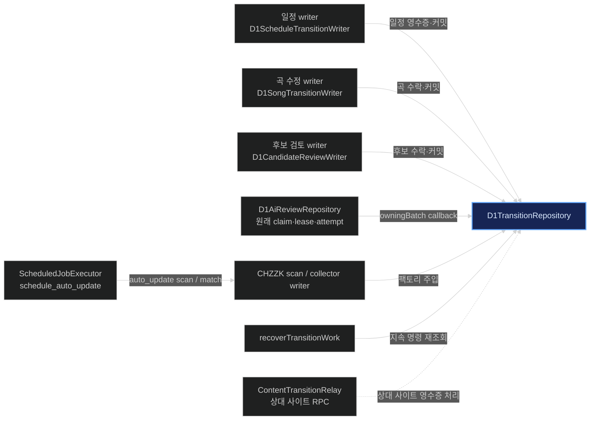
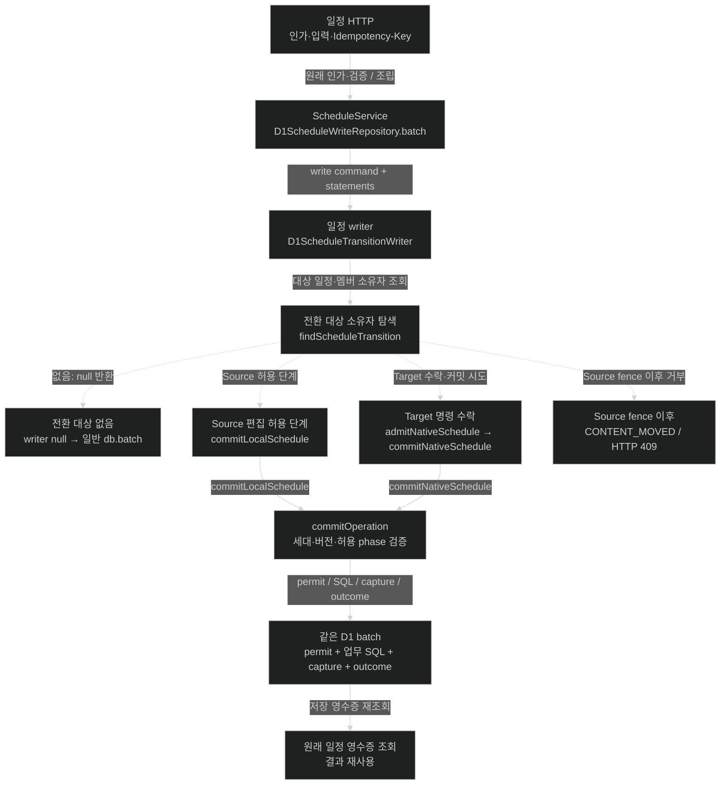
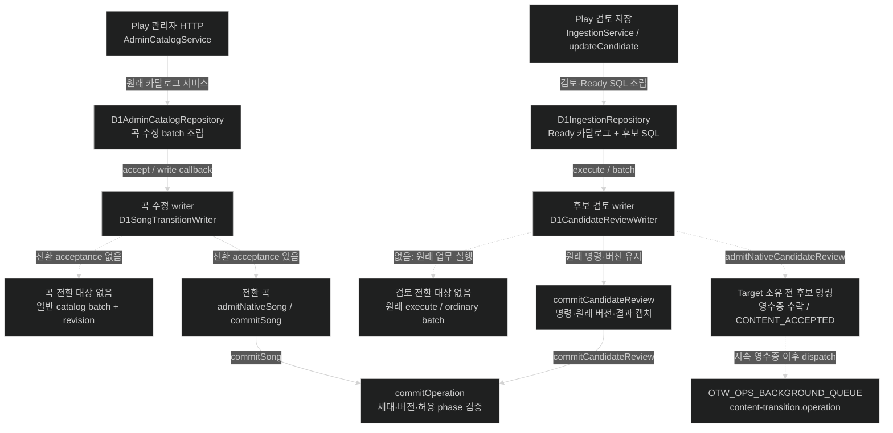
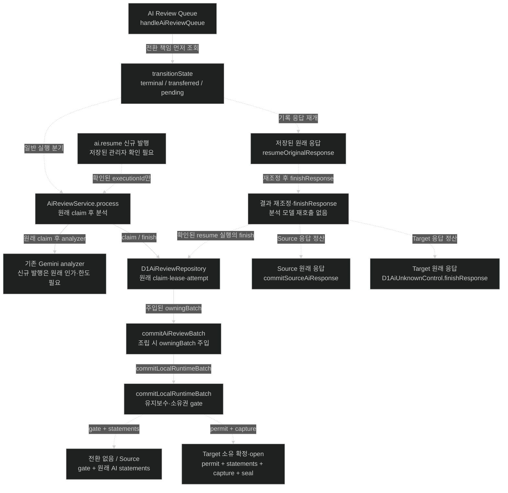
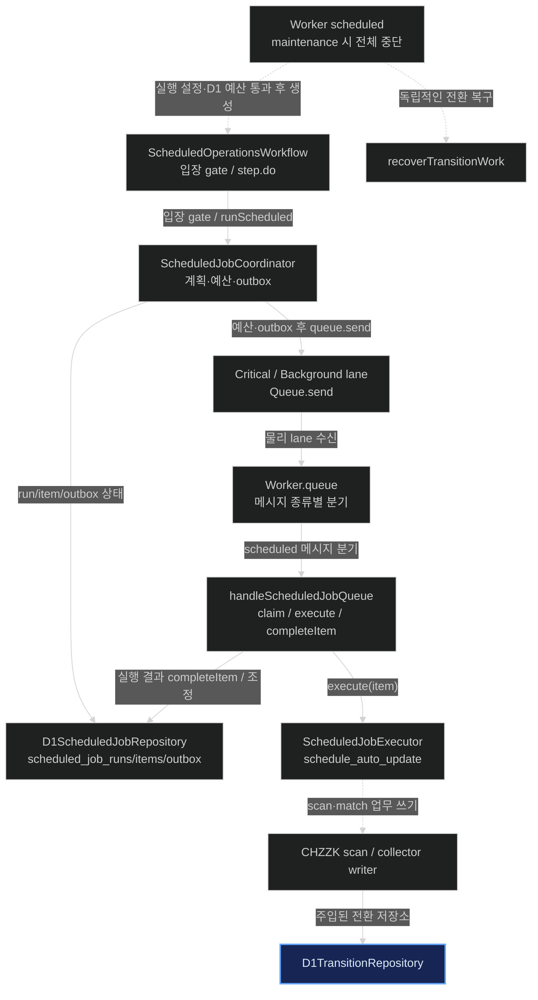
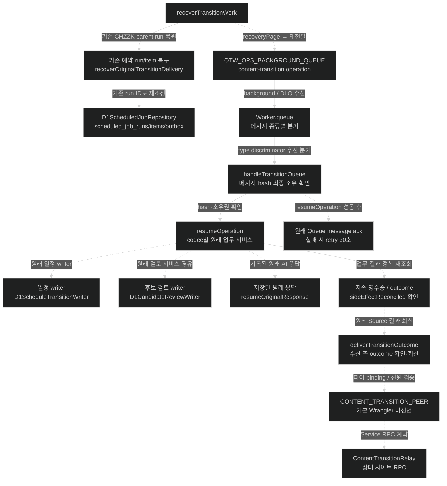

> **역사적 추적의 공개 사본:** 아래의 로컬 보고서는 전체 로컬 아카이브에 보존했다. [현행 구조 검토](../../../architecture-review.md)와 [보관 안내](README.md)를 먼저 읽는다.

# D1TransitionRepository 연결 경로 추적

> **후속 실제 운영 확인:** LuvDia 관리자 HTTP→실제 Queue2단계→운영 D1 검증을 완료했다. 만료 캐시3건만 정리했고 자동화 중지와 AI 설정을 유지했다. 로컬 보관 보고서 `PRODUCTION_LIVE_HTTP_QUEUE_D1.md`를 따른다. 아래의 로컬 검증 기록과 구분한다.

> **2026-10-20 운영 확인 보완:** 아래 이관 추적은 보존된 과거 작업 트리의 구현이다. 양 사이트 활성 운영 번들에서는 PR161에 따라 이관 실행부가 폐기됐다. CONTENT_TRANSITION_PEER 부재는 현재 운영의 설정 오류가 아니다. 로컬 보관 보고서 `PRODUCTION_HTTP_QUEUE_D1.md`을 먼저 읽는다. 원격 D1 작업은 하지 않았다.

Graphify 기존 그래프를 탐색한 뒤 실제 호출부·주입·분기를 소스로 대조했습니다. 기존 그래프는 무방향으로 유지하고, 근거가 확인된 6개 방향성 도표를 `project-structure.html#d1-transition-trace`에 추가했습니다. 점선은 조건부 경로입니다. 그래프 쿼리는 예산에 의해 일부가 생략되어 전체 답변 근거로 간주하지 않았습니다.

Expanded from original query via graph vocabulary: transition, repository, schedule, catalog, review, scheduled, coordinator, queue, relay, admission, outcome.

분석 대상 1,119개 파일의 기존 SHA-256이 모두 일치했습니다. 원래 그래프 JSON과 추출 원본을 변경하지 않았습니다.

## 핵심 경계

- 각 팩토리가 site/database/bucket을 지정해 별도 인스턴스를 만듭니다. 연결 수가 높다는 이유로 전역 singleton·모든 업무의 중앙 실행기라고 해석하지 않습니다.
- 일정·곡·후보 검토의 전환 대상 없음은 원래 저장 경로입니다. AI 일반 저장은 owningBatch callback을 통해 maintenance/owner gate를 적용합니다.
- 예약 run/item/outbox는 D1ScheduledJobRepository, 콘텐츠 전환·명령 영수증·capture/outcome은 D1TransitionRepository가 소유합니다. 예약 작업 scan/match 및 기존 run 복구가 교차 지점입니다.
- Queue send/CONTENT_ACCEPTED는 저장 완료가 아닙니다. 원래 업무 결과와 지속 영수증, 필요한 상대 사이트 확인이 완료 근거입니다.

## 확인된 설정 한계

`wrangler.jsonc`와 `wrangler.luvdia.jsonc`를 설치된 TypeScript JSONC 파서로 읽은 services 목록은 모두 비어 있습니다. 코드의 transitionPeer는 CONTENT_TRANSITION_PEER 누락 시 오류를 냅니다. 사이트 간 Relay 경로는 실제 Service binding 및 신원·스키마·승인 일치가 필요합니다. 당시 정적 분석의 미확인 사항은 위 운영 검증 보고서로 보완됐습니다. 현재 운영에는 이 실행부가 없으며 설정 변경은 하지 않았습니다.

## 연결 개요 · 조립과 의존성

화살표는 아래 근거에서 확인한 호출·주입·조립 방향입니다. 기존 전체 그래프의 무방향 관계에 실행 방향을 덧씌우지 않았습니다. 인스턴스는 각 팩토리가 site/database/bucket과 함께 구성하며 하나의 전역 인스턴스를 공유한다는 뜻이 아닙니다.

근거: A1, A2, A3, P3, P5, R1, R5, S4, S5, T6, T7

## 일정 · 일반 저장과 전환 저장

HTTP의 원래 인가·검증 뒤 서비스가 SQL을 조립합니다. 전환 대상이 없으면 writer가 null을 반환해 일반 D1 batch를 실행합니다. 전환 대상일 때 Source/Target 영수증과 세대·버전 조건을 적용합니다. 이 경로에 자동 Queue 전송을 추가해 그리지 않았습니다.

근거: C1, C2, S1, S2, S3, S4, S5

## Play · 곡 수정과 후보 Ready 검토

대표 경로는 곡 수정과 후보 검토입니다. Ready 저장은 카탈로그 식별자·후보 갱신을 포함한 원래 업무 SQL을 유지합니다. 후보의 Target 소유권이 아직 확정되지 않았으면 수락 영수증을 남기고 복구 큐에 전달합니다. CONTENT_ACCEPTED는 저장 완료 결과가 아닙니다. 엔티티·게시·삭제·채널·영상·회원 제보에도 별도 전환 writer가 조립됩니다.

근거: C3, P1, P2, P3, P4, P5, P6, P7

## AI · 원래 실행 권한과 공통 쓰기 gate

AI는 일반 저장에도 owningBatch가 주입되어 유지보수·소유권 gate를 거칩니다. claim·lease·attempt의 권한은 원래 AI 저장소가 유지합니다. 저장된 응답의 재개는 analyzer를 다시 호출하지 않습니다. finishResponse는 확인된 resume 실행·Source 원래 응답·Target 원래 응답을 구분하며, 마지막 경로는 D1AiUnknownControl이 맡습니다. 별도 ai.resume 신규 발행은 저장된 관리자 확인을 요구합니다.

근거: A1, A2, A3, A4, A5, A6, A7, A8, A9

## 예약 작업 · 실행 상태와 콘텐츠 쓰기 경계

Cron은 유지보수 중이면 종료하며, 나머지 경우 전환 복구와 일반 Workflow 입장을 병렬로 진행합니다. Workflow·예산·run/item/outbox의 권한은 D1ScheduledJobRepository가 소유합니다. schedule_auto_update의 scan/match가 전환 writer와 교차합니다. 예약 이력 전체를 D1TransitionRepository가 관리하는 구조는 아닙니다.

근거: T1, T2, T3, T4, T5, T6, T7

## 공통 복구 · 지속 명령에서 원래 업무로

Queue는 실행 완료의 권위가 아닙니다. 복구가 지속 영수증을 다시 읽고 명령을 재전달하며, 소비자는 payloadHash·소유권·codec을 확인해 원래 업무 서비스로 재진입합니다. terminal outcome 및 필요한 확인 처리를 마친 뒤 ack하고 실패는 재시도합니다. 원래 예약 run/item도 같은 ID로 별도 복구합니다. 상대 사이트 Relay는 Service binding과 신원·스키마·승인 일치를 요구합니다.

근거: A7, R1, R2, R3, R4, R5, R6, T4

## 소스 근거

- **S1** worker/app/routes.ts (당시 로컬 위치: `worker/app/routes.ts:148`) — L148
- **S2** worker/features/schedules/http/schedule-handler.ts (당시 로컬 위치: `worker/features/schedules/http/schedule-handler.ts:35`) — L35;L33;L43
- **S3** worker/features/schedules/infrastructure/d1-schedule-write-repository.ts (당시 로컬 위치: `worker/features/schedules/infrastructure/d1-schedule-write-repository.ts:89`) — L89
- **S4** worker/features/schedules/infrastructure/d1-schedule-transition-writer.ts (당시 로컬 위치: `worker/features/schedules/infrastructure/d1-schedule-transition-writer.ts:47`) — L47;L46;L58;L56;L49;L67
- **S5** worker/features/content-transition/infrastructure/d1-transition-repository.ts (당시 로컬 위치: `worker/features/content-transition/infrastructure/d1-transition-repository.ts:2840`) — L2840;L2846;L2843;L2849
- **C1** worker/features/content-transition/infrastructure/d1-transition-repository.ts (당시 로컬 위치: `worker/features/content-transition/infrastructure/d1-transition-repository.ts:2298`) — L2298;L2875;L2870
- **C2** worker/features/content-transition/infrastructure/d1-transition-repository.ts (당시 로컬 위치: `worker/features/content-transition/infrastructure/d1-transition-repository.ts:3044`) — L3044;L336;L435;L484;L726;L897;L1060;L1709;L2141;L3050;L2859;L3023;L3047
- **C3** worker/features/content-transition/infrastructure/d1-transition-repository.ts (당시 로컬 위치: `worker/features/content-transition/infrastructure/d1-transition-repository.ts:1519`) — L1519;L1528;L1187;L1196
- **P1** worker/app/admin-catalog.ts (당시 로컬 위치: `worker/app/admin-catalog.ts:32`) — L32;L41
- **P2** worker/features/otw-play/infrastructure/d1-admin-catalog-repository.ts (당시 로컬 위치: `worker/features/otw-play/infrastructure/d1-admin-catalog-repository.ts:795`) — L795;L692;L806;L1423
- **P3** worker/features/otw-play/infrastructure/d1-song-transition-writer.ts (당시 로컬 위치: `worker/features/otw-play/infrastructure/d1-song-transition-writer.ts:77`) — L77;L109;L78;L99;L101
- **P4** worker/app/ingestion.ts (당시 로컬 위치: `worker/app/ingestion.ts:32`) — L32;L25;L29;L34
- **P5** worker/features/otw-play/infrastructure/d1-candidate-review-writer.ts (당시 로컬 위치: `worker/features/otw-play/infrastructure/d1-candidate-review-writer.ts:26`) — L26;L54;L56;L58;L63
- **P6** worker/features/otw-play/infrastructure/d1-ingestion-repository.ts (당시 로컬 위치: `worker/features/otw-play/infrastructure/d1-ingestion-repository.ts:1921`) — L1921;L1949;L2034;L2098
- **P7** worker/features/otw-play/application/ingestion-service.ts (당시 로컬 위치: `worker/features/otw-play/application/ingestion-service.ts:392`) — L392;L409
- **A1** worker/app/ai-review.ts (당시 로컬 위치: `worker/app/ai-review.ts:22`) — L22;L28;L69;L36;L155
- **A2** worker/features/otw-play/infrastructure/d1-ai-review-repository.ts (당시 로컬 위치: `worker/features/otw-play/infrastructure/d1-ai-review-repository.ts:52`) — L52;L176
- **A3** worker/features/content-transition/infrastructure/d1-transition-repository.ts (당시 로컬 위치: `worker/features/content-transition/infrastructure/d1-transition-repository.ts:293`) — L293;L298
- **A4** worker/features/content-transition/infrastructure/d1-transition-repository.ts (당시 로컬 위치: `worker/features/content-transition/infrastructure/d1-transition-repository.ts:317`) — L317;L321;L322;L325;L335
- **A5** worker/features/otw-play/application/ai-review-service.ts (당시 로컬 위치: `worker/features/otw-play/application/ai-review-service.ts:266`) — L266;L268;L284;L317;L318;L321
- **A6** worker/app/ai-review.ts (당시 로컬 위치: `worker/app/ai-review.ts:108`) — L108;L110;L111;L116
- **A7** worker/app/content-transition-queue.ts (당시 로컬 위치: `worker/app/content-transition-queue.ts:46`) — L46;L48;L50;L61
- **A8** worker/features/otw-play/infrastructure/d1-ai-review-transition-readback.ts (당시 로컬 위치: `worker/features/otw-play/infrastructure/d1-ai-review-transition-readback.ts:58`) — L58;L64;L72;L77;L82
- **A9** worker/features/content-transition/infrastructure/d1-ai-unknown-control.ts (당시 로컬 위치: `worker/features/content-transition/infrastructure/d1-ai-unknown-control.ts:123`) — L123;L126;L137
- **T1** worker/app/scheduled-workflow-cron.ts (당시 로컬 위치: `worker/app/scheduled-workflow-cron.ts:98`) — L98;L99;L124
- **T2** worker/workflows/scheduled-workflows.ts (당시 로컬 위치: `worker/workflows/scheduled-workflows.ts:39`) — L39;L40
- **T3** worker/features/scheduled-operations/infrastructure/scheduled-job-coordinator.ts (당시 로컬 위치: `worker/features/scheduled-operations/infrastructure/scheduled-job-coordinator.ts:52`) — L52;L65;L146;L179
- **T4** worker/app/worker-queue.ts (당시 로컬 위치: `worker/app/worker-queue.ts:53`) — L53;L65;L59
- **T5** worker/app/scheduled-queue.ts (당시 로컬 위치: `worker/app/scheduled-queue.ts:57`) — L57;L58;L138;L139;L176;L188
- **T6** worker/features/scheduled-operations/infrastructure/scheduled-job-executor.ts (당시 로컬 위치: `worker/features/scheduled-operations/infrastructure/scheduled-job-executor.ts:352`) — L352;L365;L416;L407
- **T7** worker/app/content-transition.ts (당시 로컬 위치: `worker/app/content-transition.ts:52`) — L52;L54;L58;L62
- **R1** worker/app/content-transition-recovery.ts (당시 로컬 위치: `worker/app/content-transition-recovery.ts:13`) — L13;L28;L48;L63
- **R2** worker/app/content-transition-queue.ts (당시 로컬 위치: `worker/app/content-transition-queue.ts:25`) — L25;L30;L34;L208;L312;L313
- **R3** worker/app/content-transition-queue.ts (당시 로컬 위치: `worker/app/content-transition-queue.ts:71`) — L71;L80;L89;L98;L157;L167;L105;L114;L135;L143;L178;L186;L195;L203;L292
- **R4** worker/app/content-transition.ts (당시 로컬 위치: `worker/app/content-transition.ts:24`) — L24;L25;L29;L47;L48
- **R5** worker/app/content-transition-relay.ts (당시 로컬 위치: `worker/app/content-transition-relay.ts:21`) — L21;L195;L199;L216
- **R6** contracts/content-transition-queue.ts (당시 로컬 위치: `contracts/content-transition-queue.ts:1`) — L1;L5
- **W1** worker/app/content-transition.ts (당시 로컬 위치: `worker/app/content-transition.ts:12`) — L12

## 검증 범위

- 소스의 정확한 코드 anchor와 SHA-256, 모든 방향성 관계의 양 끝점·근거 ID를 검증했습니다.
- 기존 graph.json/structure.graph.json/extraction-evidence.json의 해시가 그대로인지 확인했습니다.
- 원격 D1·유료 모델·자동화 재개·배포·실제 업무 변경은 실행하지 않았습니다. 이 결과는 현재 로컬 미커밋 트리의 구조입니다.
- 기존 전체 그래프의 미해결 참조 204건·자기 참조 58건·병렬 관계 병합 12,540건·TSX 부분 파싱 1파일 경고는 보존했습니다. 이 보완 분석이 기존 경고를 해결한 것은 아닙니다.

- 브라우저 검증: 전체 20개·추가 6개 도표, Mermaid 오류 0건, 추가 콘솔 오류 0건. AI 확대 87%→102% 및 화면 맞춤 87%, A4 근거 링크의 자동 펼침을 확인했습니다.
