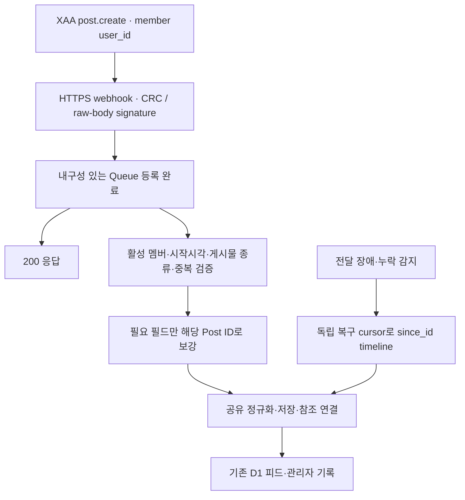

# X 멤버 신규 피드 구독 전환 검토

## 문서 상태와 결론

- 상태: 공식 조사와 멤버 1명 실제 canary 완료. 전체 수집 전환·운영 앱 배포 완료를 뜻하지 않는다.
- 조사 기준일: 2026-10-26, Asia/Seoul.
- 소스 기준: 로컬 `master` HEAD `5843326a814aadb6c311f55e279b4b4213dbe917`. 운영 배포 버전·현재 설정을 조회한 결과가 아니다.
- 공식 문서·현재 소스·운영 원장을 대조했고, 추가 승인으로 실제 구독·webhook 수신·Post 조회를 수행했다(15절). 기존 수집·예산·자동충전 설정, 운영 앱 코드·배포·DB 쓰기는 변경하지 않았다.

**기술적으로 전환 가능함을 실제 수신으로 확인했지만, 현재 설정을 유지하면서 엄격한 UTC 하루 $1을 강제할 수는 없다. 예산 보호가 해결되기 전 전체 전환은 보류한다.** 신규 게시물 발견을 X Activity API(XAA)의 `post.create` 구독으로 바꾸는 방식 자체는 요청에 맞는다. X는 사용자 ID별 생성·삭제 이벤트와 공개 계정의 app-only 구독을 지원한다. [X 변경 이력](https://docs.x.com/changelog), [XAA 공개 이벤트·인증](https://docs.x.com/x-api/activity/introduction#event-privacy-and-authentication)

현재 앱에서 멤버 1명의 등록·CRC·HMAC 검증·자연 신규 글 수신에 성공했다. REST 반복 조회는 한 번 계수됐지만 **XAA 수신과 같은 Post의 REST 보강은 각각 한 번씩 계수**되는 표본을 관측했다. 수신 글은 텍스트였고, 같은 멤버의 기존 사진 글로 실제 미디어 조회도 검증했다. 영상·사진이 포함된 자연 webhook 표본과 공급자 최종 청구서 단위의 귀속은 아직 확인하지 않았다. 아래 제안 구조는 현재 운영 수집 경로로 배포하지 않았으며 기존 polling을 유지했다.

## 1. API 선택

| 후보 | 공식 문서상 동작 | 이번 요청에 대한 판단 |
| --- | --- | --- |
| **XAA `post.create` + webhook** | 공개 사용자 ID별 생성 이벤트, app-only 인증 가능. 본문을 포함한 Post object 전달 | **우선안.** 멤버 신규 게시물 감지와 직접 대응 |
| Filtered Stream HTTP | `from:member_a OR from:member_b` 등의 규칙과 상시 HTTP 연결. Pay-per-use도 1개 연결·1,000개 규칙 지원 | 키워드 필터가 필요할 때 대안. 연결 유지·재연결 운영 추가 |
| Filtered Stream webhook | 검색 규칙에 맞는 Post를 webhook으로 전달 | Enterprise 영역의 별도 제품. XAA webhook과 접근 권한을 혼동하지 않음 |
| Account Activity API(AAA) | 계정 본인의 OAuth 1.0a로 계정 활동 전체를 구독 | 폐기 예정이며 XAA로 이동 안내. 신규 설계에서 제외 |

근거: [XAA 소개](https://docs.x.com/x-api/activity/introduction), [이벤트 payload](https://docs.x.com/x-api/activity/event-payloads), [Filtered Stream 접근 수준](https://docs.x.com/x-api/posts/filtered-stream/introduction#access-levels), [사용자·게시물 종류 연산자](https://docs.x.com/x-api/posts/filtered-stream/integrate/operators), [Stream webhook](https://docs.x.com/x-api/webhooks/stream/introduction), [Enterprise 제품 목록](https://docs.x.com/enterprise-api/getting-started/pricing), [AAA 폐기 안내](https://docs.x.com/x-api/account-activity/introduction), [AAA 사용자 인증](https://docs.x.com/x-api/account-activity/quickstart#adding-a-subscription).

Filtered Stream의 소개 화면에 webhook 카드가 있다고 해서 일반 HTTP stream과 webhook의 접근 권한이 같다는 뜻은 아니다. 공식 Stream webhook 페이지는 Enterprise 탐색 영역에 있고 Enterprise 가격표에도 별도 기능으로 열거된다. 문서의 일부 자동 요약은 이를 “standard tier”로 표시하므로 **실제 앱 entitlement는 별도 확인 사항**으로 남긴다. 이 불명확성 때문에 멤버 단위 수집을 굳이 Stream webhook에 의존시킬 이유는 없다.

## 2. XAA 구독 계약과 수신 범위

공식 quickstart의 흐름은 사용자 ID 확인 → `POST /2/activity/subscriptions` → webhook 또는 HTTP stream 수신이다. 아래는 실행하지 않은 등록 요청 예시다. 관리 API는 서버의 app-only Bearer를 사용하며, webhook의 CRC·서명 검증용 secret은 Bearer와 별도다. [XAA quickstart](https://docs.x.com/x-api/activity/quickstart), [구독 생성 계약](https://docs.x.com/x-api/activity/create-x-activity-subscription), [Webhook 인증 구분](https://docs.x.com/x-api/webhooks/introduction#signature-headers)

```json
{
  "event_type": "post.create",
  "filter": { "user_id": "MEMBER_X_USER_ID" },
  "webhook_id": "REGISTERED_WEBHOOK_ID",
  "tag": "otw-member:MEMBER_ID"
}
```

- `post.create`는 해당 멤버가 작성한 일반 글·답글·인용·리포스트를 포함한다. 타인이 멤버에게 단 답글 알림인 `post.reply.create`와 구분한다. 후자는 user-context 권한이 필요한 별도 이벤트다.
- 보호 계정의 게시물은 XAA에서 전달하지 않는다. 대상 사용자 본인 OAuth가 있어도 이 제한은 유지된다.
- Self-serve 구독 한도는 1,500개다. 사용자별·이벤트별 등록을 기준으로 필요한 개수를 계산하며, 서로 다른 사이트·앱이 같은 멤버를 중복 구독하는 경우도 확인한다.
- `expires_at`를 생략하면 명시적 삭제 전까지 유지된다. `PUT`은 tag·webhook 변경에 사용하며 필터·종류 변경은 재등록 대상이다.

근거: [이벤트 종류·공개 범위·한도·만료](https://docs.x.com/x-api/activity/introduction), [구독 관리](https://docs.x.com/x-api/activity/quickstart#managing-subscriptions).

**현재 제품의 리포스트 제외는 별도로 유지해야 한다.** XAA `post.create` 구독에는 Filtered Stream의 `-is:retweet` 같은 연산자를 넣는 계약이 없다. 따라서 리포스트를 애플리케이션에서 제외해도 이미 전달된 이벤트 비용은 생길 수 있다. 구독 단계의 게시물 종류 필터 지원은 현재 조사한 계약에서 확인되지 않았다. [구독 생성 스키마](https://docs.x.com/x-api/activity/create-x-activity-subscription)

## 3. 이벤트 본문과 추가 조회

XAA는 단순한 “변경 있음” 알림만 주는 API가 아니다. `data` 안에 `event_uuid`, 생성시각, 필터, 종류, tag, `payload`, 선택적 `includes`가 들어온다. `post.create.payload`는 Post object이며 text·ID·작성자·게시시각·관계 정보 등을 담을 수 있다. 공식 예시는 관련 users·tweets도 포함하지만 **필드 가용성은 계정 설정·expansion·전달 당시 객체 상태에 따라 달라진다.** [XAA payload 계약과 예시](https://docs.x.com/x-api/activity/event-payloads)

구독 생성 스키마에는 `tweet.fields`, `media.fields`, `expansions` 설정이 없다. 따라서 “현재 timeline과 동일한 이미지·영상·URL·인용/답글 정보가 항상 webhook만으로 완성된다”는 보장은 하지 않는다. [구독 생성 계약](https://docs.x.com/x-api/activity/create-x-activity-subscription)

제안하는 처리 규칙은 다음과 같다.

1. 서명과 구독 대상이 유효한 이벤트를 내구성 있는 Queue에 넣는다.
2. 기본 본문은 이벤트에서 받고, 현재 게시물 계약을 충족하지 못하는 필드는 해당 ID의 Post Lookup으로 보강한다. 필요한 필드·미디어를 지정하는 조회를 게시물 ID별로 묶을 수 있다.
3. 전체 timeline을 이벤트마다 재조회하지 않는다. 기존 정규화·영구 저장·참조 연결을 재사용한다.
4. 실제 사진·영상·답글·인용의 webhook 표본으로 동등성을 증명하기 전에는 추가 조회가 전혀 필요 없다고 단정하지 않는다.

이는 API 보장이 아니라 **현재 저장소의 표시 계약을 유지하기 위한 구현 제안**이다. 실제 필드 충족률과 정산 결과에 따라 webhook payload 직접 저장 또는 ID 조회를 기본 경로로 확정한다.

## 4. 비용과 예산 경계

공개 가격표에서 XAA `post.create`는 **전달 이벤트당 $0.005**이고 `post.delete`는 과금하지 않는다. 일반 Post Read는 리소스당 $0.005, User Read는 $0.010이다. 같은 UTC 하루의 리소스 재조회는 중복 과금 방지가 적용되지만, X는 이를 soft guarantee라고 명시한다. 정확한 현재 요금은 Developer Console을 따른다. [XAA 이벤트 가격](https://docs.x.com/x-api/activity/event-pricing), [일반 가격·UTC 중복 제거](https://docs.x.com/x-api/getting-started/pricing)

**빈 폴링 요청을 줄인 횟수를 그대로 비용 절감액으로 계산하면 안 된다.** 읽기 가격은 반환 리소스 기준이며, 현재도 `since_id`로 신규 리소스를 좁힌다. 이 전환의 목표는 발견 지연과 불필요한 호출·작업·DB 접근 감소이며, 실제 감소 폭은 전환 후 측정해야 한다. API 비용은 리포스트까지 포함한 이벤트 수, 보강 조회·포함 리소스, UTC 경계, 재처리 정산에 따라 달라진다. [리소스 기준 가격](https://docs.x.com/x-api/getting-started/pricing), [사용량·정산](https://docs.x.com/x-api/fundamentals/post-cap)

계산 예시이며 관측값이 아니다: 하루 생성 이벤트가 40건이면 webhook 기본 비용은 `$0.20/일`, 30일 `$6`이다. 100건이면 `$0.50/일`, 30일 `$15`다. 추가 조회·참조·사용자·복구·리포스트 비용은 별도다. `$1`은 추가 비용이 전혀 없을 때만 생성 이벤트 200건에 해당한다.

Webhook의 event 식별자와 REST Post ID 사이의 중복 정산이 모든 경우에 같다는 구체적 보장은 조사한 문서에서 확인하지 못했다. 따라서 보강 조회를 “항상 무료”로 예산에 넣지 않는다. 포함 객체의 별도 과금 범위도 실제 앱 정산과 대조해야 한다. [Webhook 이벤트 정산 설명](https://docs.x.com/x-api/getting-started/pricing#webhook-events)

현재 코드의 사전 예산 확인은 **우리 쪽에서 외부 호출을 시작하기 전**에 작동한다. 공급자가 이미 전달한 유료 webhook을 받은 뒤 저장을 거절하는 방식은 그 비용을 막지 못한다. 다음은 구현 전 결정할 운영 조건이다.

- 실제 계정의 공급자 측 지출 제한·자동충전 상태·다른 앱과의 비용 공유 범위를 확인한다. 이번 조사에서는 이를 조회하거나 변경하지 않았다.
- 기존 UTC 일일 `$1`·30일 `$30` 및 더 엄격한 공용 제한을 유지한다. 이벤트 과금도 기존 원장에 포함한다.
- 제한에 가까워지면 원격 구독을 중단하고, 중단 readback과 진행 중 전달까지 반영한다. 로컬 플래그만 끄거나 HTTP 200으로 버리는 것으로 비용 차단을 주장하지 않는다.
- 원격 삭제 지연·진행 중 전달로 작은 초과가 생길 수 있다. 공급자가 동일한 UTC 상한을 보장하는지 확인되기 전에는 애플리케이션만으로 엄격한 상한을 증명할 수 없다. 예산 보장을 약화시키는 전환은 승인안으로 취급하지 않는다.

공급자는 Console 지출 제한·사용량 모니터링을 안내하고, 잔액이 약간 음수가 될 수 있다고도 명시한다. XAA 구독 삭제·만료 기능은 있지만 이것을 실시간 과금 hard cap으로 보장하는 문서는 아니다. [비용 관리](https://docs.x.com/x-api/fundamentals/post-cap#managing-costs), [잔액](https://docs.x.com/x-api/getting-started/pricing#credit-balance), [구독 삭제·만료](https://docs.x.com/x-api/activity/introduction#subscription-expiration)

## 5. Webhook 보안·전달·복구

- 공개 HTTPS 엔드포인트가 GET CRC와 POST 이벤트를 처리해야 하며, 이벤트 수신 응답은 10초 안에 200이어야 한다. 서명은 raw body의 HMAC-SHA256으로 확인한다. 권장 헤더는 `X-Twitter-Webhooks-Signature-OAuth2`, 키는 앱 OAuth 2.0 client secret이다. 기존 OAuth 1.0 consumer secret 헤더도 별도 존재한다. Bearer를 서명 키로 쓰지 않는다. [Webhook 요구사항](https://docs.x.com/x-api/webhooks/introduction), [정확한 서명 검증 순서](https://docs.x.com/x-api/webhooks/quickstart#signature-verification)
- **200은 내구성 있는 수신이 완료된 뒤 반환한다.** 메모리 중복 확인이나 응답 뒤 `waitUntil`만으로 처리 완료를 대신하지 않는다. 이는 손실 방지를 위한 제안이다.
- 공통 webhook 문서는 retry/recovery 지원을 설명하지만, 이번에 읽은 XAA 문서에는 정확한 retry 횟수·간격·최대 보존시간·순서 보장이 없다. AAA의 재시도 수치를 XAA 보장으로 옮기지 않는다.
- 공통 `POST /2/webhooks/replay`는 최근 24시간 동안 해당 webhook으로 **전달되었거나 전달 시도된** 이벤트를 대상으로 한다. 미등록 기간의 모든 글이나 24시간 초과 장애를 복구하는 API로 해석하지 않는다. 실제 XAA 앱 접근·완료 알림·재전달 정산은 운영 전 표본 확인 사항이다. [공통 Webhook Replay 계약](https://docs.x.com/x-api/webhooks/create-replay-job-for-webhook)
- CRC 주기 문서가 모순된다. quickstart와 introduction 앞부분은 hourly라고 하며, introduction 상세 validation 절은 “30분마다, 최근 24시간 성공 검증이 없을 때”라고 한다. 특정 간격에 의존하지 말고 항상 CRC에 응답하며 유효 상태를 감시한다. [Quickstart CRC](https://docs.x.com/x-api/webhooks/quickstart#when-crc-is-triggered), [상세 검증 조건](https://docs.x.com/x-api/webhooks/introduction#webhook-validation)

Cloudflare에서는 webhook 요청으로 Queue 전송을 `await`한 뒤 200을 반환하고, 소비자의 중복 처리는 저장소에서 막는 구조가 적합하다. `waitUntil()`은 응답 후 최대 30초이며 영구 이벤트 처리 장치가 아니다. Queues는 at-least-once 전달이므로 중복을 가정해야 한다. [Workers Context](https://developers.cloudflare.com/workers/runtime-apis/context/), [Queues 전달 보장](https://developers.cloudflare.com/queues/reference/delivery-guarantees/)

## 6. 제안하는 정상 흐름과 복구 흐름



이벤트를 처리할 때 기존 REST `last_seen_post_id`를 최신 수신 ID로 올리지 않는다. 이벤트 102가 먼저 왔는데 101이 누락됐다면 이후 REST `since_id=102`는 101을 영구 건너뛸 수 있다. **이벤트 수신 ID와 REST로 완전히 확인한 범위의 cursor를 분리한다.** 기존 pagination·저장 확인 후 전진 조건을 보존해야 한다.

신규 등록과 재활성화도 기존 `collection_started_at` 이후 글만 대상으로 한다. 구독 등록 전후의 짧은 겹침은 제한된 조회로 메우고 Post ID로 중복 저장을 막는다. 전환을 계기로 과거 이력·중지 기간을 소급하지 않는다.

정상 수신은 webhook이 담당하고, 남기는 정기 작업은 구독 목록·webhook 유효성·처리 지연을 확인하는 가벼운 점검이다. 게시물이 오랫동안 없다는 이유만으로 장애를 확정하지 않는다. 수신·처리 시각, 유효 구독, 적체 상태를 기존 scheduled `last_checked_at`과 별도로 관측한다. 누락이 확인되거나 전달 상태가 불명확한 구간만 복구 대상으로 삼는다. 다만 공급자의 조용한 누락은 상태 점검만으로 발견되지 않을 수 있으므로, 완전성 보장이 필요하면 예산 내 저빈도·제한 범위의 대조 조회를 추가할지 설계에서 명시적으로 결정한다. webhook만으로 무손실을 증명했다고 주장하지 않는다. 일반 회원의 피드 요청으로 유료 조회가 발생하는 구조는 도입하지 않는다.

멤버 비활성화·소속 변경·공개 중단은 공급자 구독 목록과도 대조해야 한다. 수신 뒤 로컬에서 숨기거나 버리는 것만으로는 공급자 과금을 멈추지 못한다. 새 webhook은 CRC·HMAC으로 외부 공급자를 인증하며 기존 공개 조회·관리자 수동 실행·기록 삭제 권한을 완화하지 않는다.

백엔드가 즉시 저장한다고 현재 열린 브라우저에 자동 반영되는 것은 아니다. 기존 피드의 D1 조회와 재진입·창 재포커스·새로고침 흐름을 유지한다. 브라우저 SSE·WebSocket은 별도 요구가 없으므로 제안 범위에 넣지 않는다. 실제 전환 검증에서는 새 요청에서 오래된 메모리 캐시가 아닌 저장 결과가 보이는지도 확인한다.

`post.delete` 지원과 무료 요금은 확인했지만 이번 제안의 필수 구독으로 넣지 않는다. 영구 기록 보존·관리자 제거 정책과 공급자 삭제 동기화의 정책 결정은 별도다. 리포스트 제외, 숨김·제거 tombstone, 사이트·멤버 공개 경계를 보존하며 AI·Play 자동화 재개와 연결하지 않는다.

## 7. 실제 전환 전에 확인할 사항

1. **권한:** 현재 앱에서 공개 제3자 멤버의 `post.create` 구독과 webhook 등록·조회·삭제가 실제 가능한지 소수 표본으로 확인한다. 멤버 OAuth를 요구하는 private 이벤트를 잘못 등록하지 않는다.
2. **데이터:** 실제 일반 글·답글·인용·사진·영상·리포스트 표본에서 현재 UI와 동일한 게시물 계약을 충족하는지 확인한다. 불완전 미디어를 성공 처리하지 않는다.
3. **비용:** 이벤트 원장과 공급자 Console 사용량·잔액을 대조해 보강 조회·포함 객체·UTC 경계·재전달 비용을 확인하고 기존 예산을 보장한다.
4. **복구:** 중복·역순·Queue 실패·DB 실패·서명 실패·CRC 무효·누락 구간을 검증하고, 같은 정상 수신→저장→기존 피드 readback으로 다시 확인한다.
5. **전환:** 소수 멤버 구독에서 실제 게시물의 D1 저장·정상 화면 노출을 확인한 뒤 정상 폴링을 제거한다. 표본 단계부터 최종 저장·권한·cursor 구조를 사용하며 별도 임시 저장소를 최종 경로로 오인하지 않는다.

위 항목은 전체 구현·운영 전환의 수용 기준이다. 1차 조사 이후의 계정·비용 확인은 11~13절, 실제 canary 결과는 15절을 따른다. 한 표본의 수신 성공과 전체 운영의 무손실·비용 상한 보장을 구분한다.

## 8. 현재 저장소와 구현 영향 범위

아래는 위 HEAD의 실제 코드 확인 결과다. 기존 Graphify 구조도는 탐색에 사용했으며, 줄 번호와 동작은 현재 소스를 우선했다. 표의 변경 방향은 향후 제안이다.

| 경계 | 현재 코드와 확인 내용 | 전환 시 필요한 변경 |
| --- | --- | --- |
| 공급자 | [x-api.ts](../../worker/features/x-posts/infrastructure/x-api.ts) 307행: `https://api.x.com/2`, [Env](../../worker/platform/types.ts)의 `X_BEARER_TOKEN` | 현재 공식 API 앱을 기준으로 XAA 권한 확인. CRC·서명용 서버 secret 별도 설정 |
| 예약 진입 | [scheduled-workflow-cron.ts](../../worker/app/scheduled-workflow-cron.ts) 8~36행, [planner](../../worker/features/scheduled-operations/infrastructure/scheduled-job-planner.ts) 42~69행: 매시 23·53분 실행 후보, 활성화·저장 주기 확인 후 멤버 handle을 4개씩 나눔 | 정상 신규 글 탐색을 구독으로 전환. Cron 전체를 끄지 않고 다른 수집과 구독 상태·복구 점검을 보존 |
| 소스·동시 실행 | [x-collection.ts](../../worker/features/x-posts/infrastructure/x-collection.ts) 239~303행: 활성 멤버·사이트 공개 정책, 소스 lease, 예산·참조 보강 조합 | 이벤트 소비와 복구·수동 수집의 경합을 같은 저장 계약에서 처리. 이벤트 경로에 기존 주기 cooldown을 그대로 적용해 신규 글을 버리지 않음 |
| 조회·정규화 | [x-api.ts](../../worker/features/x-posts/infrastructure/x-api.ts) 1950행의 `normalizeXTimelineResponse`, 2614~2644행의 `exclude=retweets`, 미디어 expansion, `since_id`/`start_time` | authored 일반 글·답글·인용을 유지. webhook 스키마를 그대로 timeline JSON으로 간주하지 않고 필요한 ID 조회와 기존 정규화를 연결 |
| 영구 저장 | 같은 파일 1443행의 `writeStoredPosts`: `x_posts`→facts→references, 숨김·제거 행 복원 차단 | private 저장 경계를 최소한으로 공유해 이벤트·복구가 같은 경로를 사용. 사실·참조 기록까지 성공한 후 처리 완료. 실패하면 같은 ID로 재시도 |
| 복구 기준점 | 같은 파일 2696~2730행: 저장 성공 후 pagination·watermark 확인 | 기존 REST 완전성 cursor와 이벤트 수신 기준점을 분리. 역순 이벤트가 복구 범위를 건너뛰지 않음 |
| 등록·수신 상태 | [schema](../../db/schema/index.ts) 800~823행의 `x_post_sources`에 이미 `user_id`·활성화 시각·lease·cursor가 있음. 공급자 구독 등록부와 이벤트 수신 상태는 없음 | `user_id` 재사용, 사이트·멤버·앱·구독 ID의 대응과 내구성 있는 처리·중복 상태를 최소 확장. handle 변경·비활성화도 대조 |
| 외부 HTTP·Queue | [routes.ts](../../worker/app/routes.ts), [worker-queue.ts](../../worker/app/worker-queue.ts), [OTW 설정](../../wrangler.jsonc), [LuvDia 설정](../../wrangler.luvdia.jsonc) | CRC GET·서명 POST의 별도 진입점과 메시지 계약·소비자 추가. 기존 Queue는 작업 종류를 구분하므로 raw X payload를 그대로 넣지 않음. 사이트 리소스·기존 관리자 권한 보존 |
| 공개 피드 | [x-posts-service.ts](../../worker/features/x-posts/application/x-posts-service.ts) 198~201행 `refresh:false`, [x-api.ts](../../worker/features/x-posts/infrastructure/x-api.ts) 2901행에서 D1 직접 조회 | 기존 `/feed`, `/api/member-posts`, `/api/x/posts`, 관리자 이력의 DTO·권한과 D1 권위 유지. 공개 조회가 X API를 호출하지 않음 |
| 열린 화면 | [content-read-policy.ts](../../src/shared/query/content-read-policy.ts), [use-member-posts.ts](../../src/features/member-posts/queries/use-member-posts.ts), [use-x-posts.ts](../../src/features/x-posts/queries/use-x-posts.ts): 재진입·포커스·수동 갱신 | 서버 수집의 즉시성과 열린 탭 자동 갱신을 구분. 브라우저 실시간 전송 추가는 별도 요구 |
| 운영·회귀 | [x-history.ts](../../worker/features/x-posts/infrastructure/x-history.ts), [x-posts.test.ts](../../worker/features/x-posts/x-posts.test.ts), [Worker 수집 통합 검사](../../worker/features/scheduled-operations/infrastructure/native-workflow.integration.test.ts), [저장 피드 검사](../../worker/features/x-posts/infrastructure/x-stored-feed.integration.test.ts) | 구독 상태·수신/저장/실패·이벤트 비용·미디어 보강·복구 적체를 실제 값으로 관측. 중복·역순·활성화 경계·권한·실패 재처리와 기존 피드 readback 검증 |

기존 [신규 피드·보존 계약](x-member-history-and-archive-design.md), [비용·원장 계약](x-api-cost-minimization-design.md), [멤버 게시물 정책](member-post-storage-policy.md)을 전환 결정 이후 함께 갱신해야 한다. 과거 문서의 30분·2시간·source 수는 당시 기록이며 현재 운영값으로 단정하지 않았다. 기존 수집·참조 보강·공개 정책을 바꾸는 별도 정리는 이번 검토에 포함하지 않는다.

## 9. 1차 조사 검증 범위 — 계정 확인 전

- 공식 X·Cloudflare 문서를 조회하고 위 HEAD의 실제 호출·저장·권한·Queue·화면 갱신 코드를 정적으로 대조했다. 기존 테스트는 영향 범위로 식별했으며 실행 결과로 사용하지 않았다.
- 문서의 로컬 참조 21개, 현재 작업 진입 링크, 코드 블록 짝·UTF-8·공백·충돌 표식을 검사했다. `git diff --check`도 통과했다.
- `pnpm.cmd sync:agent-cursor:check`: 27개 관리 파일 변경 없음, 참조 유효. 실행 환경 Node `25.2.1`·pnpm `11.7.0`은 저장소 Node `>=24.20.0 <25` 요구와 달라 engine 경고가 있었다. 이 검사는 애플리케이션 실행·릴리스 검증이 아니다.
- 코드·설정·schema는 변경하지 않아 애플리케이션 테스트·빌드·preflight는 실행하지 않았다. 유료 호출·실제 구독·운영 DB/API 조회·설정 변경·PR 게시·배포도 하지 않았다. 연구 문서와 현재 작업 링크만 추가했다.

## 10. 공식 요금·예산 추가 조사 — 2026-10-26

### 확정 요금과 미확정 항목

| 항목 | 공개 1차 문서에서 확인한 계약 | 비용 비교에 반영하는 방법 |
| --- | --- | --- |
| XAA 생성 이벤트 | `post.create`: `$0.005/event`; 삭제는 not billed | 수신 후 리포스트를 버려도 생성 이벤트 수에 포함 |
| REST 본문 | `GET /2/users/:id/tweets`, `GET /2/tweets` 등의 일반 Post Read: `$0.005/resource` | 요청 수가 아니라 실제 과금 대상 게시물 수로 비교 |
| 사용자 조회 | 일반 User Read: `$0.010/resource` | 사용자 직접 조회와 보강 조회량을 구분 |
| 미디어 | 현재 공개 가격표에 독립적인 Media Read 단가가 없음. `$0.005`의 `Media Metadata`는 write/action 표에 있음 | 코드의 보수적 미디어 추정치를 공급자 확정 요금으로 제시하지 않음 |
| 이벤트→같은 ID REST | 같은 UTC 하루 중복 방지 일반 설명과 event dedup 설명은 존재. 두 경로의 식별자·정산 결합 방식은 명시 불명확 | 추가 Post 과금 `0~$0.005/건`을 민감도 범위로 계산. 무조건 무료로 간주하지 않음 |
| webhook의 `includes`, REST expansion | 사용자·관련 Post·미디어가 모두 무료인지, 별도 과금되는지 일괄 보장하는 최신 상세 계약을 이번에 확정하지 못함 | 실제 Console의 적용 요금과 포함 객체 과금을 확인하기 전 총액 상한을 확정하지 않음 |

근거: [XAA 이벤트별 요금](https://docs.x.com/x-api/activity/event-pricing), [공개 Read/Action 가격·UTC 중복 방지](https://docs.x.com/x-api/getting-started/pricing), [반환 리소스·사용량 집계](https://docs.x.com/x-api/fundamentals/post-cap), [expansion의 응답 구조](https://docs.x.com/x-api/fundamentals/expansions).

일반 HTTP 조사에서 403이었던 [X 공식 expansion 과금 공지](https://devcommunity.x.com/t/inform-x-api-ppu-expansions-update/279110)는 후속 Chrome 조회에서 원문을 확인했다. Announcements의 X Staff `taycaldwell` 공지는 **현재 expansion 객체는 사용량에 집계하지 않으며, 2026-11-22부터 관련 Post·User·Media·Poll·Place 객체를 각 리소스의 일반 PPU 요금으로 과금한다**고 안내한다. 현재 비용과 11/22 이후 예상 비용을 구분해야 한다. 공지 자체에는 Media Read의 숫자 단가가 없으므로 임의의 공식 단가를 붙이지 않는다. REST expansion 변경은 확인했지만 XAA의 선택적 `includes`에 같은 변경이 어떻게 적용되는지는 별도 확인 사항이다.

### 현재 앱의 읽기 확인으로 증명할 수 있는 범위

| 관리 GET | 확인 가능한 것 | 이것만으로 확인할 수 없는 것 |
| --- | --- | --- |
| `GET /2/activity/subscriptions` | 인증된 앱의 활성 XAA 구독 목록과 필터 | 특정 공개 멤버의 새 `POST` 등록 권한·성공, 실제 전달 |
| `GET /2/webhooks` | client app의 등록 URL·`valid` 상태 | 새 URL 등록·CRC 통과, 수신 서버 서명 검증 |
| `GET /2/usage/credits` | payer 기준 USD 잔액: `prepaid_balance`, `free_balance`, `free_grants`, `total_balance` | 자동충전 설정·지출 상한의 정확한 동작·앱별 비용 귀속 |
| `GET /2/usage/tweets` | 앱별·날짜별 Post consumption | 전체 금액, 포함 객체별 비용, webhook↔REST 중복 정산 세부 |

근거: [XAA 목록 계약](https://docs.x.com/x-api/activity/get-x-activity-subscriptions), [Webhook 목록 계약](https://docs.x.com/x-api/webhooks/get-webhook), [payer 잔액 계약](https://docs.x.com/x-api/usage/get-usage-credits), [Post 사용량 계약](https://docs.x.com/x-api/usage/get-usage).

위 관리·잔액 GET에 별도 과금 항목이 공개 가격표에 열거되어 있지는 않지만, 해당 endpoint 문서에서 **명시적 무료 보장도 확인하지 못했다.** “읽기 전용”과 “과금 없음”은 같은 뜻이 아니다. 계정 확인은 필요 최소의 기존 관리 화면·기록을 우선하며, 이번 추가 조사는 실제 앱 자격증명이나 API를 사용하지 않았다. GET 200·빈 목록은 그 GET이 허용됐다는 증거이며, 구독 기능 전체의 정상 작동 판정은 아니다.

### 예산 차단의 권위와 시간 범위

- API 사용량은 app 단위로 추적하지만 크레딧은 payer 잔액이다. 잔액 API의 `total_balance`는 `max(0, prepaid_balance + free_balance)`이며 `prepaid_balance`는 음수일 수 있다. 따라서 total이 0으로 보여도 실제 채무까지 0이라고 해석하지 않는다. [잔액 계약](https://docs.x.com/x-api/usage/get-usage-credits), [집계 단위](https://docs.x.com/x-api/fundamentals/post-cap)
- 공급자 지출 제한은 Console에서 설정하도록 안내하지만, 공개 문서만으로 기존 **UTC 하루 `$1`·30일 `$30`**과 정확히 같은 기간·앱 공유 범위·즉시 차단·진행 중 webhook 처리까지 보장하는지는 확정할 수 없다. 월간 300만 Post 상한은 별도 수량 제한이며 금액 예산이 아니다. billing cycle도 30일 rolling 예산과 같다고 가정하지 않는다. [지출 관리·월간 상한](https://docs.x.com/x-api/fundamentals/post-cap)
- 과금 중복 방지의 일자는 UTC 자정에 바뀐다. 한국 시각으로는 매일 **09:00** 경계다. 같은 게시물을 다음 UTC 날 다시 조회하면 재과금 가능성이 생긴다. 다른 앱·payer 사이 중복 제거까지 보장된다는 명시는 확인하지 못했다. [UTC 중복 방지](https://docs.x.com/x-api/getting-started/pricing#deduplication)
- 자동충전은 설정된 잔액 threshold 아래로 내려갈 때 결제를 일으킬 수 있다. “요청 중지”와 “카드 자동충전 중지”는 별도이며, 이 작업은 어느 설정도 변경하지 않는다. 크레딧 소진은 호출 차단 사유지만 공급자는 약간의 음수 잔액도 가능하다고 안내한다. 따라서 크레딧 소진을 기존 `$1`의 엄격한 차단 수단으로 쓰지 않는다. [잔액·자동충전](https://docs.x.com/x-api/getting-started/pricing#credit-balance)

### 동일한 게시물 결과를 기준으로 한 계산식

같은 기간에 폴링과 구독이 모두 저장해야 할 authored 글·답글·인용을 `P`, 구독에서 추가 전달되는 리포스트를 `R`, 같은 ID 보강 조회 중 실제 추가 과금된 Post 수를 `H`, 장애 복구·대조에서 추가 과금된 Post 수를 `L`로 둔다. 아래는 **비교용 모델**이며 실제 사용량 관측값이 아니다.

```text
폴링 = 0.005 × P + 사용자 직접조회·참조·미디어 등 기존 부가 비용
구독 = 0.005 × (P + R + H + L) + 사용자·참조·미디어 등 전환 후 부가 비용
```

`H`를 0으로 놓는 경우는 같은 ID 재조회가 중복 제거되거나 추가 조회가 필요 없을 때다. 보수적으로는 보강한 Post마다 `$0.005`를 추가하고, 양쪽의 실제 부가 비용도 같은 표시 계약으로 비교한다. 새 webhook payload의 포함 객체 과금이 확인되면 부가 항목에 더한다.

| 같은 30일의 예시 | 폴링 본문 | 구독 생성 이벤트 | 보강 Post 추가 과금 | 비교 해석 |
| --- | ---: | ---: | ---: | --- |
| `P=1,200`, 리포스트·추가 조회 없음 | `$6` | `$6` | `$0` | API 본문 비용 동일. 호출·발견 지연 감소가 주효과 |
| `P=1,200`, `R=300`, `H=0` | `$6` | `$7.50` | `$0` | 리포스트 때문에 `$1.50` 증가 |
| 같은 수량, `H=1,200` | `$6` | `$7.50` | `$6` | 기본 합계 `$13.50`. 사용자·참조·미디어·복구는 별도 |

빈 폴링 수를 위 금액에서 차감하지 않는다. 기존 폴링에 일일 반복 조회가 실제로 있다면 그 유료 리소스만 별도로 측정해 차감한다. 최종 비용 우열은 현재 앱의 실제 `P/R/H/L`과 부가 요금으로 계산해야 하며, 구독 전환 자체를 비용 절감 보장으로 표현하지 않는다.

## 11. 현재 앱·계정 1차 확인 — 실제 등록 전, 2026-10-26 KST

사용자의 추가 요청에 따라 로그인된 Chrome의 X 개발자 콘솔에서 확인했다. 등록·저장·충전 버튼은 실행하지 않았다.

| 확인 항목 | 실제 관측 결과 | 판정 범위 |
| --- | --- | --- |
| 현재 앱 | `otw_schedule_app`, App ID `32988052`, Development 표시. 계정 앱 목록에 1개 표시 | 이 개발자 계정의 앱을 특정했다. 배포된 Worker의 암호화된 secret 값과 대조한 것은 아님 |
| XAA | 앱을 선택한 구독 목록이 정상 표시되며 등록된 구독 없음. 생성 창에서 `Post`→`Post Create`와 사용자 핸들 필터·선택적 webhook 입력 제공 | **콘솔의 구독 기능 접근과 등록 준비 화면은 사용 가능.** 실제 POST 등록 성공·특정 멤버 허용·이벤트 수신은 미검증 |
| Webhook | 관리 목록 정상 표시, 등록된 webhook 없음. 생성 제어 제공 | 수신 URL·CRC·서명 처리·실제 등록이 추가로 필요 |
| 잔액 | 선불 `$9.50`, 무료 `$0.00` | 현재 잔액 관측값 |
| 자동충전 | **켜짐**, 잔액 `$5` 도달 시 저장 결제수단으로 `$10` 충전 | 잔액 소진을 예산 차단 수단으로 간주할 수 없음. 설정은 그대로 유지 |
| 지출 한도 | **청구 주기 `$30`**, 무제한 지출 선택 해제. 현재 지출 `$9.21`, 주기 `Sep 27 – Oct 27, 2026` | 공급자는 한도 도달 시 다음 주기까지 API 요청 차단을 안내. UTC 하루 `$1` 또는 rolling 30일 `$30`과 같지 않음 |
| 최근 30일 실제 사용 비용 | Console `September 25th – October 25th UTC`, **총 `$10.06`**, API 요청 약 `5.82천`, Post 약 `1.82천` | 공급자가 표시한 계정 사용량. 아래 D1의 UTC 날짜 범위·내부 추정과 구분 |

출처: 로그인된 [앱 목록](https://console.x.com/accounts/2059529979700846592/apps), [이벤트 구독](https://console.x.com/accounts/2059529979700846592/subscriptions), [webhook 목록](https://console.x.com/accounts/2059529979700846592/webhooks), [크레딧·지출 한도](https://console.x.com/accounts/2059529979700846592/billing/credits), [실제 사용량](https://console.x.com/accounts/2059529979700846592/usage). 이 링크는 해당 계정 로그인이 필요하며 공개 자료가 아니다.

**판정:** 현재 앱에서 XAA를 사용할 수 없는 상태나 업그레이드 차단 화면은 관측되지 않았다. 구독 등록 화면까지 확인했으나 이를 실제 구독·수신 성공으로 확대하지 않는다. 현재 구독과 webhook이 모두 없어 검토 과정에서 새 이벤트 비용은 발생시키지 않았다. 공개 멤버 이벤트의 문서상 app-only 조건과 실제 등록·수신 확인을 구분한다.

## 12. 실제 원장 기반 예상 비용 비교

### 조회 범위와 기존 비용

운영 D1 조회 전 계정 합산 D1 GraphQL 예산을 확인했다. UTC 10/25는 731,650행(5M 목표의 14.63%)이었다. 날짜 변경 뒤 실제 SELECT 직전 재확인한 `2026-10-26T00:00:30.828Z` 값은 0행이었다. 집계 지연 가능성을 감안하고 4M 배경 중단 기준보다 충분히 낮을 때만 날짜·키 범위를 제한해 읽었다.

OTW·LuvDia에서 각각 설정 키 조회, 일일 비용 원장, 보존된 리소스 원장을 읽었다. 성공한 SELECT 6개의 D1 메타데이터는 **총 읽기 4,463행·쓰기 0·changes 0**이다. 초기 REST batch 형식 요청 2개는 HTTP 400/7400으로 거부되어 단일 SELECT 요청으로 수정했다. 원격 migration·강제 수집·게시물 API 호출은 하지 않았다. 정제된 원본과 계산 결과는 로컬 Git 제외 파일 `.wrangler/tmp/xaa-cost-research-2026-10-26.json`에 보관했다.

두 사이트 모두 현재 저장 설정은 수집 활성·optimizer 활성·`x_collection_interval_hours=0.5`·일일 예산 100센트다. 실제 실효 간격은 70% guard·backoff·개별 source 상태에 따라 달라지므로 모든 source가 항상 30분마다 API를 호출한다고 해석하지 않는다. OTW 참조 보강 설정은 30센트·`cached_author`, LuvDia의 해당 키 미설정 값은 코드 기본 10센트·`cached_author`다. 참조 예산은 전체 예산에 추가되는 금액이 아니라 그 안의 부분 한도다.

아래는 UTC **9/25 00:00 이상, 10/25 00:00 미만**의 정확히 30일 원장이다. `listed`는 공급자 청구서가 아닌 현재 공개 단가 기반 내부 추정이다. Post/User 수는 해당 UTC 일일 고유 리소스 합계 또는 단가 환산이며, 전 기간 distinct 게시물·사람 수와 같지 않다.

| 범위 | Timeline 요청 | Timeline Post 환산 | 참조 Post 환산 | User 환산 | 공개 단가 추정 | 미디어 포함 보수적 내부 추정 |
| --- | ---: | ---: | ---: | ---: | ---: | ---: |
| OTW | 4,541 | 1,598 | 97 | 77 | `$9.245` | `$10.545` |
| LuvDia | 699 | 127 | 20 | 17 | `$0.905` | `$1.095` |
| 합계 | **5,240** | **1,725** | **117** | **94** | **`$10.15`** | **`$11.64`** |

계산 근거는 `1,725 × $0.005 + 117 × $0.005 + 94 × $0.010 = $10.15`다. 내부 보수적 추정과의 차이 `$1.49`는 코드가 미디어에 적용하는 추정치이며 현재 공식 Media Read 청구액이 아니다. 보존 기간이 짧은 `x_api_resource_daily`의 수량을 장기 `x_api_usage_daily` 대신 전체 30일 청구량으로 쓰지 않았다.

공급자 Console의 `$10.06`과 D1 합계 `$10.15`는 약 `$0.09` 차이가 있으나 같은 청구서로 간주하지 않는다. 표시 기간의 끝점·집계 지연·사이트 간 중복 정산·단가 추정 차이를 센트 단위로 완전히 분해하지는 않았다. 로컬에는 OTW 저장 토큰만 있고 LuvDia 저장 토큰은 없어 양쪽 운영 secret의 동일 payer 여부를 직접 대조하지 못했다. **사이트별 원장 합계는 공급자 계정의 정확한 추가 청구액을 증명하지 않는다.**

최근 7일(UTC 10/18~10/24)은 합계 Timeline Post 환산 322건, 참조 29건, User 19건, 추정 `$1.945`였다. 이 활동량이 유지되면 30일 약 `$8.34`다. 최근 활동량과 사이트 가동 기간이 달라 과거 30일 `$10.15`를 고정 월 비용으로 예측하지 않는다.

### 같은 활동량에서 구독으로 바꿀 때

아래 모델은 과거 30일의 Post 과금 단위가 같은 수의 생성 이벤트로 이어진다고 가정하고, 사용자·참조 비용은 동일하게 유지한다. **리포스트 비율 25%는 측정값이 아닌 민감도 예시**다. `H=100%`는 모든 보강 Post가 별도 과금되는 보수적 시나리오이며 확정 요금이 아니다. 장애 복구의 새 과금과 11/22 이후 포함 객체 요금은 별도다.

| 동일 30일 활동량 시나리오 | OTW | 두 사이트 원장 규모 합계 | 합계의 기존 대비 차이 |
| --- | ---: | ---: | ---: |
| 현재 polling | `$9.25` | **`$10.15`** | 기준 |
| XAA, 리포스트 0·보강 추가 과금 0 | `$9.25` | **`$10.15`** | 본문 단가상 동일 |
| XAA, 리포스트가 원문 수의 25%·보강 추가 과금 0 | `$11.24` | **`$12.31`** | **`+$2.16`**, 약 21% |
| 위 조건 + 원문 전체 보강이 각각 추가 과금 | `$19.23` | **`$20.93`** | **`+$10.78`**, 약 106% |

빈 timeline 응답의 반환 리소스 비용이 0인 구조이므로 5,240회 요청을 없애는 만큼 API 요금이 줄어들지는 않는다. 이 수량에서 전환의 주 이득은 수집 지연·불필요한 요청·Queue/D1 작업 감소다. 실제 Cloudflare 청구 절감액은 별도로 측정하지 않았다. 리포스트 양과 미디어 보강·중복 정산을 확인하기 전에는 구독안의 단일 예상 청구액을 확정하지 않는다.

11/22 과금 변경 이후에는 양 방식에서 조회하는 expansion 객체 수에 실제 해당 단가를 곱해 추가해야 한다. 현재 polling도 미디어 expansion을 사용하므로 향후 증가를 전부 구독 전환 비용으로 귀속시키지 않는다. 반대로 webhook payload의 `includes`가 현재와 같은 미디어를 항상 제공하고 같은 정산을 받는다고 가정하지 않는다.

## 13. 예산 차단 조건과 최종 권고

| 장치 | 현재 확인한 경계 | XAA 전환 시 판단 |
| --- | --- | --- |
| 공급자 청구 주기 `$30` | 실제 계정에서 설정 확인, 무제한 해제, 현재 주기 잔여 `$20.79`. 한도 후 API 요청 차단 안내 | 유지할 안전장치. 이미 전달 중인 이벤트와 webhook 과금이 정확히 언제 중지되는지, 최대 초과액은 미검증 |
| 자동충전 `$5`→`+$10` | 실제 켜짐 | 결제 지속 장치다. 일일 예산 차단 장치가 아님. 임의로 끄지 않음 |
| 내부 UTC 하루 `$1` | 운영 설정 100센트, 현재 소스는 외부 요청 전에 보수적 비용 예약·가용량 확인 | 공급자가 먼저 전달하는 webhook 과금까지 같은 방식으로 막을 수 없음 |
| 내부 예산의 사이트 범위 | 현재 코드의 원장은 각 `env.otw_db`에 저장되며 OTW·LuvDia DB는 분리 | 두 사이트가 같은 payer를 쓰면 각각 `$1` 설정만으로 계정 합산 `$1`을 증명하지 못함. payer 범위 요구를 별도로 맞춰야 함 |
| 예산 70%·backoff | polling의 실효 주기를 완화하는 조건 | webhook은 주기를 늘려 제어할 수 없음. 공급자 구독 중단·해지 및 재개 기준으로 다시 설계해야 함 |

구독은 현재 앱 콘솔에서 제공되고 현재 관측 활동량의 기본 비용도 낮지만, **비용 절감 목적만으로 전환할 근거는 없다. 수집 지연을 줄이기 위한 조건부 전환이 적절하다.** 기존 일일 예산을 유지하려면 공급자 측 구독 중단과 실제 중단 readback, 이벤트 비용 원장, 중단 중 복구·재활성화 경계가 필요하다. 로컬에서 이벤트를 거절하거나 버리는 것으로 과금 차단을 대체하지 않는다.

공급자의 확인된 한도는 청구 주기 기준이다. 엄격한 UTC 하루 `$1`을 webhook에 그대로 보장하는 공급자 기능·진행 중 이벤트 상한은 확인하지 못했다. 따라서 “이벤트 수신 후 예산 확인”만 추가해 기존 보호가 보존됐다고 승인하지 않는다. 실제 등록·CRC·소수 공개 멤버의 이벤트 수신과 정산 확인은 다음 구현/전환 단계의 별도 실제 검증이다. 이번에는 구독·webhook 생성·설정 저장·결제·배포를 실행하지 않았다.

## 14. 멤버 1명 실제 구독 검증을 위한 API 계약 조사

아래는 추가로 승인된 실제 검증의 실행자를 위한 공식 계약 정리다. 이 절의 작성자는 계정 API를 호출하지 않았으며, 등록·수신 성공을 이 조사 결과로 대신하지 않는다.

| 작업 | 메서드·경로·요청 | 주의 |
| --- | --- | --- |
| callback 등록 | `POST /2/webhooks`, JSON `{"url":"PUBLIC_HTTPS_CALLBACK"}` | 등록 요청 중 CRC 검증. 응답의 `id`, `valid`와 목록 readback 확인 |
| 멤버 생성 이벤트 | `POST /2/activity/subscriptions`, JSON `{"event_type":"post.create","filter":{"user_id":"MEMBER_ID"},"webhook_id":"WEBHOOK_ID","tag":"one-member-canary","expires_at":"RFC3339_UTC"}` | 한 명·한 이벤트만 등록. 실제 응답의 만료시각을 확인 |
| 만료 갱신 | 같은 구독을 같은 필터로 `POST`하면서 `expires_at` 변경 | `PUT`은 tag·webhook 변경만 지원. 만료를 생략하면 영구 구독이 됨 |
| 종료 | `DELETE /2/activity/subscriptions/{subscription_id}`, 이후 `GET /2/activity/subscriptions` | 수신 뒤 즉시 해지하고 진행 중 전달도 기록. 종료 readback 필수 |
| callback 정리 | `DELETE /2/webhooks/{webhook_id}`, 이후 `GET /2/webhooks` | 이번 검증에서 만든 전용 callback만 정리 |

근거: [Webhook 생성](https://docs.x.com/x-api/webhooks/create-webhook), [XAA 생성·만료](https://docs.x.com/x-api/activity/create-x-activity-subscription), [만료 갱신 의미](https://docs.x.com/x-api/activity/introduction#subscription-expiration), [PUT 계약](https://docs.x.com/x-api/activity/update-x-activity-subscription), [구독 삭제](https://docs.x.com/x-api/activity/deletes-x-activity-subscription), [Webhook 삭제](https://docs.x.com/x-api/webhooks/delete-webhook).

`expires_at`의 최소·최대 기간은 현재 공개 스키마에 명시되어 있지 않다. 짧은 미래 시각(예: 15분)을 지정해 공급자의 실제 수락과 echo를 확인해야 한다. TTL과 첫 수신 뒤 해지는 노출 시간을 줄이지만 **이벤트 폭주·진행 중 전달·기존 폴링을 포함한 금액 hard cap은 아니다.** 자동충전·기존 폴링·예산값을 유지하는 조건에서는 TTL만으로 엄격한 UTC 하루 `$1`을 증명하지 않는다.

서명 검증은 기존 문서의 OAuth2 client secret 또는 legacy consumer secret 규칙을 따른다. 등록 API의 Bearer로 CRC를 서명하지 않는다. CRC 응답은 `response_token = "sha256=" + base64(HMAC_SHA256(secret, crc_token))`, POST 검증 메시지는 재직렬화하지 않은 raw body다. [공식 CRC·서명 quickstart](https://docs.x.com/x-api/webhooks/quickstart)

사진·영상 보강의 최소 조회는 `GET /2/tweets?ids=POST_ID&tweet.fields=attachments,created_at,entities,public_metrics&expansions=attachments.media_keys&media.fields=media_key,type,url,preview_image_url,width,height,alt_text,variants` 형태다. `attachments.media_keys`와 `includes.media[].media_key`를 연결하고 사진 URL·영상 preview·variants의 실제 가용성을 확인한다. 작성자·참조 expansion은 이번 미디어 표본에 필요할 때만 추가한다. [Lookup quickstart](https://docs.x.com/x-api/posts/lookup/quickstart), [미디어 필드·expansion 계약](https://docs.x.com/x-api/posts/get-posts-by-ids)

공식 quickstart는 `tweet.fields`·`edit_history_tweet_ids`를, 자동 생성된 최신 reference는 `post.fields`·`edit_history_post_ids`와 `referenced_posts`를 사용해 문서가 일치하지 않는다. 이미 운영에서 쓰는 쿼리·응답 계약을 시작점으로 실제 응답을 확인하며, 이름만 바꿔 기존 정규화가 유지된다고 가정하지 않는다.

`POST /2/webhooks/replay`의 JSON은 `{"webhook_id":"ID","from_date":"yyyyMMddHHmm","to_date":"yyyyMMddHHmm"}`다. 최근 24시간에 해당 webhook으로 전달·전달 시도한 이벤트를 재생하는 계약이며 구독 이전의 멤버 게시물로 실제 신규 수신 검증을 대신하지 않는다. [공통 replay 계약](https://docs.x.com/x-api/webhooks/create-replay-job-for-webhook)

중복 과금 표본은 자연 이벤트의 `event_uuid`·Post ID·수신시각, 정확한 hydration URL·응답·시각, 기존 폴링의 같은 ID 처리·비용 원장을 함께 기록한다. 공급자 잔액은 요청 전·이벤트 후·보강 후의 **raw USD 숫자**로 보존하고 Console 반영값과 대조한다. 그러나 잔액 API는 숫자형 USD만 규정하며 소수 정밀도·반영 지연 SLA는 명시하지 않는다. 동시에 다른 멤버 폴링이나 자동충전이 있으면 단순 잔액 차이로 `$0.005` 한 건의 원인을 확정할 수 없다. polling을 중지하지 않은 채 호출 사이의 기존 원장을 대조하더라도 공급자 최종 정산과 분리해 “관측 일치” 또는 “귀속 미확정”으로 판정한다. [잔액 스키마](https://docs.x.com/x-api/usage/get-usage-credits), [앱별 일간 사용량](https://docs.x.com/x-api/usage/get-usage)

## 15. 멤버 1명 실제 구독·수신·정산 표본 — 2026-10-26 KST

### 결과와 실제 경로

사용자가 실제 검증을 승인했고 대상은 공개 멤버 **테리 누나 `terri_nunna`**, X user ID `1607408138545950721` 한 명으로 한정했다. 앱은 `otw_schedule_app / 32988052`다. 기존 수집을 중단하거나 강제 실행하지 않았다.

기존 `.env.local`에는 Bearer만 있어 처음에는 서명 키를 사용할 수 없었다. 사용자가 기존 OAuth 2.0 Client Secret을 `X_CLIENT_SECRET`으로 추가한 뒤 진행했다. 에이전트는 키를 재발급·회전하지 않았고 값은 출력하거나 증거 문서에 저장하지 않았다.

실제 경로는 **X 등록 API → 공급자의 HTTPS CRC → 공개 멤버 자연 글 → 임시 HTTPS callback → raw-body HMAC 검증 → 로컬 내구성 파일 → 같은 ID의 실제 Post Lookup**이었다. Cloudflare Quick Tunnel은 검증용 로컬 callback에만 연결했고 기존 서비스 배포·라우트·권한·DB를 바꾸지 않았다. 동작을 흉내 낸 POST나 과거 글 replay로 수신을 대신하지 않았다. [Quick Tunnel 용도](https://developers.cloudflare.com/tunnel/get-started/quick-tunnels/)

| 항목 | 실제 결과 |
| --- | --- |
| 최초 등록 권한 확인 | 09:25 KST에 같은 멤버의 stream-only 구독 생성 HTTP 200, 조회 확인 후 DELETE 200·빈 목록 확인. 스트림 연결은 열지 않음 |
| 실제 응답 형태 | 생성 응답은 `data.subscription`, 목록은 `data[]`. 최초 응답 소유권 파싱을 이 형태로 정정한 뒤 해당 ID만 삭제·readback 확인 |
| Webhook | ID `2114515863432986624`, **09:34:02 KST 등록 HTTP 200·valid=true**. 현재 앱의 Console에도 Client App `32988052`로 표시 |
| 실제 연결 구독 | ID `2114515867463827456`, 09:34:03 KST 생성 HTTP 200. `post.create`, 대상 user ID, webhook ID, tag·만료시각을 목록에서 재확인 |
| 자동 만료 | `2026-10-26T00:49:01.900Z`(09:49:01.900 KST), 생성 요청의 15분 미래 시각을 공급자가 echo |
| 자연 게시물 | [Post `2114516278392348991`](https://x.com/terri_nunna/status/2114516278392348991), 게시 **09:35:41.000 KST** |
| 실제 POST 수신 | **09:35:45.832 KST**, 게시 후 **4,832ms**. `event_uuid=2114516278392348991`, `post.create`, 필터 user ID 일치 |
| 서명·보존 | `X-Twitter-Webhooks-Signature-OAuth2`를 기존 Client Secret의 HMAC-SHA256과 raw bytes로 검증. 재직렬화 없이 검증 후 원본·수신시각·SHA-256을 파일에 flush하고 200 응답 |
| 구독 즉시 해지 | **09:35:46.121 KST DELETE 200**, 이후 GET 목록에서 해당 ID 없음 확인 |
| 동일 ID 보강 | **09:36:55.580 KST Post Lookup HTTP 200**, 반환 ID 일치. 해당 자연 글은 텍스트여서 media_keys·media가 없는 결과 |

원본은 로컬 Git 제외 `.wrangler/tmp/xaa-canary/`에 보존했다: `registration-probe.json`, `provider-state.json`, `event-2114516278392348991.json`, `event-hydration-probe.json`, `summary.json`. 파일의 원본 이벤트·서명 검증 결과와 공급자 readback이 실제 수신 근거다. 합성 테스트 결과로 이를 대체하지 않는다.

### 미디어 보강의 실제 확인 범위

같은 멤버의 기존 공개 사진 글 `2114205311053828204`를 선택해 실제 `GET /2/tweets`에 `attachments.media_keys` expansion과 media fields를 요청했다. `media_key=3_2113583646963814400`의 **photo 1장·1920×1080·URL**을 반환했고, 실제 이미지 URL의 HEAD는 **HTTP 200, image/jpeg, 208,512 bytes**였다. 09:29:20.986과 09:30:11.233 KST의 두 조회에서 미디어 메타데이터가 동일했다.

**실제 webhook 글에는 사진이 없었다.** 따라서 “사진이 있는 webhook에서 미디어 누락을 발견해 보강했다”거나 영상 variants까지 통과했다고 주장하지 않는다. 사진 보강 API의 가용성과 자연 webhook→동일 Post Lookup 연결을 각각 실제 확인했다. 원본은 `media-sample-stored.json`, `media-repeat-probe.json`이다.

관련 표시 계약도 발견했다. 자연 webhook의 `payload.text`는 154자, `payload.note_tweet.text`는 317자였다. 이번 최소 REST fields 응답의 text는 154자이고 note_tweet은 없었다. 향후 어댑터는 더 짧은 보강 응답으로 이미 받은 긴 원문을 덮어쓰지 않고 note_tweet을 처리해야 한다. 이번에는 운영 정규화 코드를 변경하지 않았다.

### 중복 과금 관측

단순 잔액 차이만 사용하지 않고 동일 앱/프로젝트의 `project_usage`와 타임스탬프, 두 운영 DB의 겹친 요청 원장을 함께 대조했다.

| 단계 | 공급자 `project_usage` | 관측 |
| --- | ---: | --- |
| 사진 조회 전 | 1,669 | 시작 기준 |
| 같은 사진 Post의 REST 조회 2회 후 | 1,670 | **두 번 조회해도 1건 증가**. REST 반복 중복 제거와 일치 |
| 새 Post의 실제 XAA 이벤트 후, 보강 전 | 1,671 | 이벤트로 **1건 추가** |
| 같은 이벤트 Post의 REST 보강 후 반영 대기 | 1,672 | 보강으로 **다시 1건 추가** |

UTC 00:29:20~00:40:02 사이 기존 OTW·LuvDia `x_api_usage_events`의 호출은 각각 0건이었다. 두 사이트 설정을 변경하지 않은 채 겹친 정상 수집 호출이 없었던 구간을 확인했다. `GET /2/usage/tweets?days=1`의 실제 응답은 프로젝트/주기 counter였으며 Post ID별 청구 내역이나 일별 breakdown을 반환한 것으로 해석하지 않았다. 카운터 반영에는 지연이 있었다.

**이번 표본에서 XAA 이벤트와 같은 Post의 REST 보강은 서로 중복 제거되지 않고 각각 한 번 계수됐다.** 현재 공개 단가로는 텍스트 Post 한 건의 이벤트 `$0.005`와 보강 `$0.005`, 합계 `$0.010`을 예산에 넣는 것이 관측에 맞는다. 반복 REST 조회까지 매번 추가 과금된 것은 아니다. 모든 미래 요청의 계약상 정산 보장이나 최종 청구서의 개별 항목 대조까지 완료했다는 뜻은 아니다. [공식 이벤트 가격](https://docs.x.com/x-api/activity/event-pricing), [공식 Post Read 가격](https://docs.x.com/x-api/getting-started/pricing)

모든 신규 Post를 보강한다고 가정하면 12절의 두 사이트 활동량에서는 리포스트 0이어도 `$10.15 + 1,725 × $0.005 = $18.775`(약 `$18.78/30일`)가 된다. 리포스트 25% 예시는 `$20.93`이다. 모든 글을 반드시 보강해야 한다는 판정은 아니며, 실제 미디어 webhook 표본으로 필요한 보강 비율을 먼저 정해야 한다. 11/22 이후 포함 객체 비용도 별도다.

잔액 API의 관측 순서는 `$9.49 → $9.48 → $9.48 → $9.48 → $9.47`이었다. 이 표본에서는 소수 둘째 자리만 반환되어 `$0.005` 한 건을 잔액만으로 분리할 수 없었다. 카운터의 3건 증가 기준 canary 추정은 **`$0.015`**(사진 REST 1건, XAA 1건, 이벤트 REST 1건)이며 정밀 청구서 확정액으로 표시하지 않는다. 운영 수집 비용까지 포함한 Console 주기 사용액은 기존 `$9.21`에서 `$9.24`, 잔액은 `$9.50`에서 `$9.47`로 변했다.

09:49:14 KST의 추가 관측에서도 잔액 `$9.47`·프로젝트 counter `1,672`가 유지됐다(`settlement-observation.json`). 공급자 최종 청구서의 Post별 귀속이나 장시간 뒤 모든 정산까지 확인했다는 뜻은 아니다.

### 예산·설정 보존과 $1 판단

- 운영 readback에서 양 사이트의 수집 활성, `scheduled_v2_x_collection_enabled`, 0.5시간 주기, optimizer, 일일 100센트 설정이 시작 시점과 같았다. 기존 수집의 실행·source cursor·기준시각을 직접 변경하지 않았다.
- Console에서 **자동충전 켜짐($5→$10), 청구 주기 한도 $30**이 그대로임을 다시 확인했다. 키 추가 외의 계정·인증·지출 설정을 저장하지 않았다.
- 실제 canary 구간의 관측 사용액은 $1보다 낮았다. 그러나 이를 **향후 매 UTC 일 절대 $1 이하를 강제할 수 있다는 증거로 쓰지 않는다.** 월/주기 $30 제한과 자동충전은 일일 제한이 아니다.
- callback에서 수신을 거부하거나 기록하지 않아도 X가 이미 전달한 이벤트의 과금을 취소하지 않는다. 이번에도 해지 완료 전 약 0.29초의 시간이 있었고, 대량 동시 전달·해지 지연의 최대 과금량은 보장하지 못한다. TTL·첫 수신 뒤 해지는 노출 감소 장치다.
- 실험용 외부 호출 비용은 로컬 증거에 기록했고 운영 비용 원장에 임의 쓰기를 추가하지 않았다. 운영 원장만 읽으면 이번 추가 호출을 놓치므로, 실제 전환에서는 payer 범위의 이벤트·보강 비용을 통합 계측해야 한다. 통합 원장과 여유 예산을 갖추더라도 공급자 일일 hard cap이나 최대 진행 중 비용의 보장 없이 절대 $1이라고 약속할 수 없다.

따라서 **기존 설정을 그대로 둔 현재 조건에서는 엄격한 일일 $1을 보장하는 XAA 전환안을 승인할 수 없다.** 예산 초과를 유도하는 실험은 하지 않았다. 같은 Post의 보강을 무료로 취급하지 말고, 신규 본문 수집을 우선하는 보강 예산 분리와 공급자 측 일일 차단/최대 과금 보장을 먼저 해결해야 한다.

### 정리와 남은 한계

09:38:47 KST에 이번 webhook만 DELETE 200으로 삭제했다. 공급자 최종 목록은 **구독 0·webhook 0**이었다. 로컬 수신기와 Quick Tunnel을 종료하고 포트 18971·18972 listener 및 해당 cloudflared 프로세스가 없음을 확인했다. 추가 구독·자동화·백그라운드 감시는 남기지 않았다.

임시 수신기에는 raw-byte 서명 검증, 대상 멤버/이벤트 제한, CRC의 임의 JSON 서명 방지 검사를 추가했고 Node 테스트 3개가 통과했다. 실제 성공 근거는 공급자의 CRC와 서명된 자연 이벤트다. Node 25.2.1의 임시 수신기를 사용했으며 운영 앱을 빌드·배포하거나 애플리케이션 전체 테스트를 수행한 결과는 아니다. 보고서 참조·형식과 시작/종료 설정 동일성·정리 readback을 검사했다.

사진/영상이 있는 자연 webhook, 공급자 최종 청구서별 귀속, 기존 polling의 다음 자연 실행에서 이 글이 저장되는 순간, 장기 운영·누락 복구·예산 초과 상황은 이번 canary의 검증 범위 밖이다. 이를 전체 X 수집 교체 완료나 제품 기능 출시로 표시하지 않는다.

## 16. 새 사진·영상 webhook의 필드 완전성 조사 — 실제 결과와 구분

이번 후속 검증의 대상은 앞서 선택한 **`terri_nunna` 한 명의 새 자연 게시물**이다. 아래는 공식 문서와의 비교 기준이며, 사진·영상 webhook을 실제 받았다는 증거가 아니다. 실행 결과·원문 비교·종료 상태는 다음 절에서 별도로 기록한다.

### XAA 예시가 보장하는 범위

공식 XAA 문서는 `post.create.payload`를 Post object로 설명하고 `includes`는 선택적이며, 필드 가용성은 전달 당시 객체 상태 등에 따라 다르다고 명시한다. 현재 Post event 예시들에는 `attachments`, `includes.media`, `media_key`, `variants`, `extended_entities`, `video_info`가 나오지 않는다. 따라서 **raw webhook에서 해당 필드가 없다는 사실만으로 “미디어 없는 글”로 확정하지 않는다.** 이 예시의 부재는 API 미지원 증거도 아니다. [공식 XAA payload와 가용성 설명](https://docs.x.com/x-api/activity/event-payloads)

`extended_entities.media`나 `video_info.variants`가 실제 raw에 오면 해당 표본의 실제 스키마로 기록할 수 있다. 하지만 이를 현재 XAA의 필수·항상 완전한 형식으로 가정하지 않는다. V2 `attachments`/`includes.media`와 legacy 형태의 필드가 모두 없을 때 빈 미디어 배열로 성공 처리하는 규칙은 근거가 부족하다.

### 비교할 미디어와 본문

| 대상 | 공식 V2 필드 | 비교·수용 기준 |
| --- | --- | --- |
| 사진 | `type=photo`, `url`, 선택적 크기·`alt_text` | 원문 Post의 모든 `attachments.media_keys`가 해당 사진 객체·URL로 연결되는지 확인 |
| 영상 | `type=video`, `preview_image_url`, `variants` | preview는 정지 이미지다. 영상 본체 URI와 variant의 `content_type`·가능한 `bit_rate`를 별도로 비교 |
| GIF | `type=animated_gif`, playback variants | 사진 preview가 있다고 photo로 분류하지 않음 |
| 혼합·여러 첨부 | 여러 `media_keys`와 각각의 media object | 첫 객체나 한 가지 type만 고르지 않고 모든 key를 연결. 일부 key 누락이면 불완전 |
| 인용·리포스트 미디어 | `referenced_tweets`와 참조 Post의 attachments | 멤버 자신의 첨부와 참조 원문의 첨부를 구분. 이번 멤버 자체 사진·영상 수신 증거로 혼동하지 않음 |
| 링크 preview | `entities.urls[].images`·title·description | 링크 카드 이미지를 직접 첨부 사진으로 세지 않음 |
| 긴 본문 | `note_tweet.text`, 해당 `note_tweet.entities` | 긴 본문과 일반 `text`를 대조. note 본문을 쓰면서 짧은 본문용 entities 인덱스를 섞지 않음 |

근거: [Media·Post 데이터 사전](https://docs.x.com/x-api/fundamentals/data-dictionary), [필드·미디어·링크 카드 예시](https://docs.x.com/x-api/fundamentals/data-dictionary/reference), [정확한 Lookup query와 media.fields](https://docs.x.com/x-api/posts/get-posts-by-ids). 위 혼합 첨부의 처리·비교 기준은 공식 객체 계약에서 도출한 제안이며 모든 종류를 이번 한 표본으로 검증할 수 있다는 뜻은 아니다.

영상 `preview_image_url`은 static placeholder이며 재생 URL을 대신하지 않는다. `variants`는 해상도·형식이 다른 후보들이다. 예를 들어 `content_type=video/mp4`의 URL이 있으면 브라우저 재생 후보가 되지만 실제 재생 확인은 별도다. playlist만 있는 경우나 영상 객체·본체 URL이 빠진 경우를 사진 preview 성공으로 대신하지 않는다. [공식 Media 필드 정의](https://docs.x.com/x-api/fundamentals/data-dictionary#media)

### 최소 보강과 조건부 조회 판정

이번 표본에서는 raw를 먼저 보존한 뒤 **같은 새 Post ID 한 건만** 다음 형태로 조회해 비교한다. 전체 timeline·다른 멤버·과거 미디어 글을 표본 대신 조회하지 않는다.

```text
GET /2/tweets
  ?ids=NEW_POST_ID
  &tweet.fields=author_id,created_at,attachments,entities,referenced_tweets,note_tweet
  &expansions=attachments.media_keys
  &media.fields=media_key,type,url,preview_image_url,width,height,alt_text,variants,duration_ms
```

`note_tweet`는 공식 데이터 사전에서 280자 초과 글의 전체 본문으로 설명한다. 최신 자동 생성 reference의 `post.fields`/`note_post` 명칭은 기존 `tweet.fields`/`note_tweet` 예시와 다르므로 실제 수락된 query·응답 필드를 함께 기록한다. 필드를 요청했다는 사실만으로 공급자가 모든 필드를 반환했다고 판정하지 않는다. [Lookup quickstart](https://docs.x.com/x-api/posts/lookup/quickstart), [긴 본문 정의](https://docs.x.com/x-api/fundamentals/data-dictionary), [현재 reference](https://docs.x.com/x-api/posts/get-posts-by-ids)

- **raw 완전:** 실제 표본에서 원문 첨부 key 전부와 type·필요 URL·긴 본문이 lookup 결과와 일치하면 이 표본은 직접 사용 가능으로 판정한다. 향후 모든 이벤트의 완전성 보장으로 확대하지 않는다.
- **미디어 있음·상세 누락:** key는 있는데 대응 객체·사진 URL·영상 본체 variant가 빠졌으면 해당 ID를 보강한다. 일부만 받은 결과를 “미디어 없음”으로 바꾸지 않는다.
- **필드 생략·불명:** raw에 attachments나 미디어 객체가 없고 명시적 부재 보장도 없으면 unknown이다. 현재 계약에서는 조건부 보강 대상이다.
- **조회에서도 직접 첨부 없음:** 요청 필드·대상 ID·오류를 확인한 뒤 해당 조회 시점의 직접 첨부 없음으로 구분한다. 인용 원문·외부 링크 이미지는 별도다.
- **삭제·보호·오류·부분 응답:** 읽을 수 없거나 필드가 불완전하면 그 구체적 상태를 남긴다. 정상적인 빈 미디어로 성공 처리하지 않는다.

이 절은 API 문서 조사만 완료했다. 사진 1건·영상 1건·GIF·혼합 첨부·긴 글은 서로 다른 coverage이며, 실제 받은 종류만 검증 완료로 기록한다. 기존 polling·예산·자동충전 설정을 바꾸거나 추가 유료 호출을 실행하지 않았다.

## 17. 승인된 양 사이트 전환의 RPC·공급자 동기화 계약 조사

현재 실행 범위는 [승인된 전체 전환 사양](../superpowers/specs/2026-10-26-x-activity-rollout.md)이 소유한다. 앞 절의 1명 한정·운영 전환 보류는 과거 단계다. 이번 조사에서는 새 canary·자연 게시물 대기·독립 검증 실행을 제안하거나 수행하지 않는다. **OTW 공유 관리 지점, 고정 사이트의 비공개 RPC, 전체 유료 X 요청의 공통 원자적 예산 예약**을 전제로 공식 계약을 확인했다.

### 고정된 비공개 RPC 포트

Cloudflare Service Binding은 같은 계정의 다른 Worker를 공개 URL 없이 호출한다. 호출자 Wrangler의 `services`에 `binding`, 대상 Worker의 `service`, named export의 `entrypoint`를 명시한다. 대상은 `cloudflare:workers`의 `WorkerEntrypoint`를 상속한 named class를 export하며 기존 default fetch/queue/scheduled export를 유지할 수 있다. RPC는 compatibility date `2024-04-03` 이상에서 지원되므로 현재 양 설정의 `2025-11-25`는 기본 조건을 충족한다. [Service Bindings](https://developers.cloudflare.com/workers/runtime-apis/bindings/service-bindings/), [Named entrypoints](https://developers.cloudflare.com/workers/runtime-apis/bindings/service-bindings/rpc/#named-entrypoints), [RPC 호환성](https://developers.cloudflare.com/workers/runtime-apis/rpc/)

아래는 **설정 형태 예시이며 실제 구현된 export 이름이 아니다.** TCP 포트나 공개 중계 endpoint를 추가하는 구조가 아니다.

```jsonc
// LuvDia: 사이트가 LuvDia로 고정된 OTW coordinator 포트만 호출
"services": [{
  "binding": "X_COORDINATOR",
  "service": "overthewall-schedule",
  "entrypoint": "XCoordinatorForLuvdia"
}]

// OTW: LuvDia 자신의 대상 목록·수신함 포트만 호출
"services": [{
  "binding": "LUVDIA_X_ACTIVITY",
  "service": "luvdia-schedule",
  "entrypoint": "XActivityForLuvdia"
}]
```

예산 예약·허용된 X operation 실행, 사이트별 대상 목록 조회, 검증 이벤트의 내구성 접수 등 **필요한 메서드만** 노출한다. 임의 `siteId`, DB 선택, callback URL, 외부 URL·임의 HTTP method를 받는 범용 RPC를 만들지 않는다. named entrypoint별 사이트와 `env.SITE_ID`를 고정하고 수신 사이트가 자신의 활성 멤버·공개 정책·DB·Queue를 다시 확인한다. 이는 승인 사양을 적용한 제안이다. RPC stub을 보유한 호출자만 노출 객체를 호출할 수 있다는 capability 보안이 사이트별 업무 인가를 대신하지는 않는다. [공식 RPC 보안·가시성](https://developers.cloudflare.com/workers/runtime-apis/rpc/visibility/)

RPC 메서드는 prototype method로 선언한다. arrow instance property는 RPC로 노출되지 않는다. helper는 `#private` 또는 외부 모듈 함수로 둬 노출 포트를 좁힌다. `WorkerEntrypoint` 인스턴스는 호출 동안만 존재하므로 인스턴스 변수·메모리 Map을 전역 예산·구독 lock의 권위로 쓰지 않는다. 원자성은 승인된 OTW D1 장부에서 보장해야 한다. [메서드 가시성](https://developers.cloudflare.com/workers/runtime-apis/rpc/visibility/), [Entrypoint 생명주기](https://developers.cloudflare.com/workers/runtime-apis/bindings/service-bindings/rpc/#the-workerentrypoint-class)

현재 compatibility date에서는 custom Error의 임의 속성 전달이 보장되지 않는다. 강화된 error serialization은 `2026-04-21` 이후 기본이며, 그 경우에도 custom prototype·`instanceof` 보장은 없다. 예산 거절·중지 사유·상태·재시도 시각은 작고 직렬화 가능한 명시적 응답 계약으로 전달하는 편이 안전하다. RPC 실패나 공통 장부 장애를 사이트별 직접 X 호출로 우회하지 않는다. [RPC 오류 계약](https://developers.cloudflare.com/workers/runtime-apis/rpc/error-handling/)

### 상호 참조의 첫 배포와 호환성

양 Worker가 이미 존재해도 새 named entrypoint가 이미 배포됐다는 뜻은 아니다. Cloudflare 공식 workerd의 현재 구성 연결 코드는 대상 named entrypoint가 없으면 `has no such named entrypoint` 구성 오류와 invalid channel을 만든다. **“배포는 항상 통과하고 호출할 때만 실패한다”는 가정을 두지 않는다.** 다만 공개된 hosted upload API 문서만으로 모든 버전의 배포 거절 시점을 확정하지는 못했다. [공식 workerd 구성 연결 코드](https://github.com/cloudflare/workerd/blob/main/src/workerd/server/server/config.rs#L921)

OTW의 정상 병합 자동 배포를 중복 수동 배포하지 않는 호환 순서는 다음과 같이 구성할 수 있다. 이는 검증을 위한 별도 운영 실행이 아니라 같은 릴리스의 의존성 준비 순서 제안이다.

1. LuvDia에 승인된 동일 릴리스의 수신 named export를 먼저 준비한다. 아직 존재하지 않는 OTW 새 포트의 binding은 이 준비 산출물에 넣지 않으며 새 유료 흐름을 활성화하지 않는다.
2. OTW는 정상 merge-triggered 배포로 coordinator export와 이미 준비된 LuvDia 포트 binding을 제공한다.
3. LuvDia의 최종 설정에 OTW coordinator binding을 반영한다. 양쪽 버전·binding·공통 예산 seed가 준비된 후 전체 구독을 활성화한다.

최종 산출물에서 필수 binding이 없거나 target/method/계약 버전이 맞지 않으면 해당 작업을 실패·대기로 남긴다. HTTP 중계나 직접 유료 호출을 임시 호환 경로로 추가하지 않는다. 단계별 이전·새 코드가 공존할 수 있으므로 export·응답 필드는 추가 호환으로 유지하고, 공통 예산 준비 전 신규 유료 수집은 멈춘다. Worker version에는 코드·bindings·호환성 설정이 포함되지만 D1 상태는 포함되지 않아 Worker rollback이 예산 seed나 migration을 되돌리지 않는다. [버전·배포의 권위](https://developers.cloudflare.com/workers/versions-and-deployments/)

RPC stub은 임의 메서드가 존재하는 것처럼 보일 수 있으므로 `typeof binding.method === "function"`만으로 대상 기능 준비를 판정하지 않는다. [RPC compatibility flag의 동작](https://developers.cloudflare.com/workers/configuration/compatibility-flags/#durable-object-stubs-and-service-bindings-support-rpc)

### 다중 멤버 inventory·만료·소유권

- `GET /2/activity/subscriptions`는 **현재 앱의 활성 구독 목록**이다. `max_results`는 기본·최대 1,000, `pagination_token`과 `user_id` 필터를 지원한다. 반환 항목의 `subscription_id`, event/filter/user, tag, webhook, expiry를 로컬 등록부와 대조한다. 현재 문서의 응답 스키마에는 다음 페이지 token 필드가 명시되어 있지 않으므로 1,000개 경계·페이지 실패·불명확한 목록을 전체 inventory 완료로 간주해 삭제하지 않는다. [공식 목록 계약](https://docs.x.com/x-api/activity/get-x-activity-subscriptions)
- 공개 멤버의 `post.create`는 app-only로 구독할 수 있다. Self-serve는 1,500개 구독이며 보호 계정의 Post는 전달하지 않는다. 같은 `user_id`를 사이트마다 중복 등록하는 대신 한 공급자 구독과 사이트별 허용 대상을 분리한다. [인증·한도](https://docs.x.com/x-api/activity/introduction)
- `expires_at`는 RFC3339이며 생략하면 영구 구독이다. 같은 구독의 `POST`는 만료를 갱신하고 `PUT`은 tag·webhook만 바꾼다. 예산 중지 중에는 갱신하지 않고, 직접 중지·공개 제외와 예산 중지를 구분한다. [생성 계약](https://docs.x.com/x-api/activity/create-x-activity-subscription), [만료 갱신](https://docs.x.com/x-api/activity/introduction#subscription-expiration), [PUT 계약](https://docs.x.com/x-api/activity/update-x-activity-subscription)
- tag는 호출자가 정하는 표식이며 공급자 권한 경계가 아니다. 로컬 소유 subscription ID와 기대 tag·webhook·event/user를 함께 확인해 소유한 구독만 갱신·해지한다. 같은 멤버의 미소유 구독과 충돌하면 별도 등록 실패로 표시하고, refresh·PUT·DELETE로 강제 인수하지 않는다. 요청 실패·동기화 lock 만료 후에는 실제 목록을 대조해 중복 생성·잘못된 제거를 막는다. [tag·관리 계약](https://docs.x.com/x-api/activity/quickstart#managing-subscriptions)
- 공식 rate limit은 subscription `POST/GET/PUT/DELETE` 각각 앱당 **500/15분**, webhook CRUD 각각 **450/15분**이다. 실제 `x-rate-limit-remaining/reset`을 따르고 429는 대상 상태와 재시도 시각으로 남긴다. 한 대상의 정책·등록 오류 때문에 독립 대상 전체를 실패 처리하지 않되, 앱 전체 rate limit·인증·공통 예산 장애는 공유 조건으로 처리한다. [공식 제한표·429](https://docs.x.com/x-api/fundamentals/rate-limits#activity--webhooks)

이 절은 공식 문서·소스 조사만 수행했다. 구현·migration·provider mutation·배포·독립 검증은 실행하지 않았으며 실제 릴리스 판정은 승인 사양의 운영 readback과 기존 CI가 소유한다.

## 18. 전체 전환 구현·릴리스 기록

승인 사양에 따라 OTW의 `x_shared_budgets`/`x_shared_requests`가 양 사이트 유료 요청을 원자적으로 예약하고,
서명된 이벤트는 `x_activity_dispatch`에서 한 번 비용을 기록한 뒤 각 사이트의 inbox·기존 Queue·저장 경로로 전달한다.
동일 X user는 한 구독만 소유하며, 사이트별 허용 목록은 수신 시 다시 확인한다. 공개 중계 endpoint는 추가하지 않는다.
최종 고정 RPC는 OTW→LuvDia `X_ACTIVITY_LUVDIA`/`XActivitySiteRpc`, LuvDia→OTW `X_ACTIVITY_COORDINATOR`/`XActivityCoordinatorRpc`다.
로컬 일반 수집도 공통 게이트를 필수로 사용한다. 연결·장부가 준비되지 않으면 유료 호출을 중지한다.

조건부 보강은 현재 제품의 사진·영상 포스터 표시 계약을 따른다. 원본에 첨부 key 전부와 사진 URL 또는 영상/GIF 포스터가 있으면 직접 저장한다.
첨부 정보가 생략되거나 일부 상세가 없으면 같은 Post만 보강하며, UTC 날짜별 동일 보강 identity를 양 사이트가 공유한다.
긴 본문은 `note_tweet.text`와 그 entities를 함께 사용한다. 영상 직접 재생은 이번 범위가 아니다.
삭제된 본문은 로컬 tombstone·lease 취소와 공유 응답 캐시 purge outbox로 보호한다.

24시간 REST 복구는 기존 cursor를 보존한다. 다음 페이지가 남으면 `pendingSources`와 `partial`을 반환하고 전체 완료로 표시하지 않는다.
웹훅 저장은 REST cursor·완료시각을 전진시키지 않는다. 예산 중지에만 다음 UTC 날짜 재개를 적용하고 사용자·사이트 중지는 유지한다.
공통 예산의 30,000micros 여유분이 부족하면 유료 요청·등록·갱신을 중지하고 소유 구독을 해제한다.
이미 전달 중인 이벤트는 실제 비용으로 계속 기록되므로 합산 하루 $1은 목표이며 강제 상한이 아니다.
기존 공급자 자동충전 $5→$10·주기 $30 제한은 변경하지 않는다.

배포 전 운영 기준값(2026-10-26 12:37 KST)은 두 사이트 수집 활성·30분·각100센트 조회 보호 한도,
당일 내부 장부 각20,000micros·예약0이었다. 전환 시 이 사용액과 알려진 canary15,000micros를 보존하며 최신 snapshot으로 초기화한다.
계정 GraphQL D1 읽기는100,003행으로 배경4M 기준 미만이었다. 기준값 SQL8개는 읽기49행·쓰기0이었다.

첫 기존 릴리스 검사에서 타입·린트·구조 검사는 통과했으나 테스트14건이 실패했다.
진입점의 자원 검증 순서, 새 HTTP 계약 목록, 과거 시각 fixture의 공통 장부 seed와 실제 단일 페이지 수집 의미를 추적해 수정했다.
새 별도 검증 pipeline 대신 기존 Workers Builds의 `WORKERS_CI=1` 경로에 기존 타입·린트·전체 테스트·구조/정책 검사를 연결했다.
[공식 빌드 환경 변수](https://developers.cloudflare.com/workers/ci-cd/builds/configuration/#environment-variables)를 따른다.
추가 유료 canary·자연 사진/영상 대기는 수행하지 않는다. 최종 CI·배포·등록 readback은 이 절의 후속 기록 또는 소유 PR evidence 댓글로 확정한다.

준비 HEAD `a804ee9`의 기존 자동 CI는3284건 통과·4건 실패·기존3건 생략이었다.
사이트 주소를 빠뜨린 테스트2개와 REST 내림차순이 반대인 표본1개를 수정했다.
마이그레이션 reader는5593ms로 기존5000ms 검사를 넘었다. 기존 pnpm patch에서 큰 따옴표 본문의 매 문자마다
누적 문자열에 `endsWith`를 적용하던 경로를 닫는 구분자 길이의 suffix 비교로 바꿨다.
기존 compound·주석·quote 파싱 흐름, SQL 원문과 전체 migration 입력을 보존하고 긴 한글·이모지/dollar quote 회귀를 기존 CI에 추가했다.
검사 시간·병렬 수·skip/retry 정책은 바꾸지 않았다. 의존성 버전 변경 없이 patch hash만 갱신했다.

양 사이트가 같은 Post를 동시에 보강할 때 먼저 진행 중인 공유 요청은 재발행하지 않는다.
두 번째 사이트는 같은 UTC 요청 identity로1분 뒤 완료 응답을 재확인한다. 이 대기는 실제 조회 시도 횟수에서 제외하고,
응답을 재사용하므로 두 번째 유료 요청을 만들지 않는다. 실제 불명확한 전송 실패와 예산 부족의 다음 UTC 재시도는 유지한다.

HEAD `2efd3d4`의 기존 자동 CI는 X 회귀를 포함한3289건 통과·기존3건 생략, migration reader1건만5281ms로 실패했다.
실패 진단 CPU profile에서 긴 문자열 누적의 garbage collection이 큰 비중을 차지했다.
SQL/인용 본문을 조각으로 모아 문장 경계에서 합치는 방식으로 변경했다. 같은 로컬 전체156개 migration·10610개 SQL의
JSON SHA-256 `7e497e877c7a0c0db8e7c1c911836c8fbe8f3a3d10416539d37a53c3492a3fdc`가 수정 전후 일치했다.
수정 후 공개 reader API의 진단 읽기는1545ms였다. 이는 로컬 진단이며 CI의5초 통과를 대신하지 않는다.

준비 HEAD `7d54ea8`의 기존 Workers Builds `043feffd-169a-41bb-a028-13cab8ac3e3a`는 최종 성공했다.
398개 파일·3290건 PASS, 기존 플랫폼 한정3건 SKIP이며 타입·린트·구조·정책 동기화·OTW 빌드와 버전 업로드가 통과했다.
같은 HEAD의 LuvDia 정상 빌드도 통과했다. 성능 검사 조건·병렬 수·전체 migration은 유지했다.
2026-10-26 13:27 KST 계정 GraphQL 읽기618,576(<배경4M)을 먼저 확인했다.
두 운영 DB에0153–0156을 증분 적용하고, LuvDia 준비 버전 `e696eb02-539d-4ebe-a6d6-3391f83919a2`를 정상 배포했다.
서명 키는 기존 값을 미배포 버전에 등록했으며 새 유료 흐름·구독은 아직 미활성이다. 최종 binding의 CI와 운영 readback이 남아 있다.

### 현재 구조의 비용 비교

12절의 역사적 활동량1725건/30일을 사용한 **Post·event 단순 모델**이다. 일별 집중도·리포스트·추가 객체·사용자 조회는 별도다.
이번 구조는24시간 REST 복구도 사용하므로 이전1명 검토의 이벤트+보강만 계산한 값과 구분한다.

| 경로 | 30일 단순 모델 |
| --- | ---: |
| XAA event1725건 × $0.005 | $8.625 |
| REST 누락 복구가 같은 Post1725건을 다시 반환하는 경우 | 최대 $8.625 |
| 조건부 Post 보강0–1725건 | $0–8.625 |
| 위 세 항목 합계 | $17.25–25.875 |

같은 UTC 날짜의 반복 REST resource 중복 제거는 비용을 줄일 수 있지만, XAA와 REST는 별도로 계수된 실제 표본을 기준으로 무료라고 가정하지 않는다.
현재 polling의 역사적 내부 추정은10.15달러/30일이다. 위 새 합계는 전체 청구액 예측이 아니라 세 Post/event 경로의 범위이며,
사용자 조회·리포스트 이벤트와 미디어 포함 객체 비용이 추가될 수 있다. 공통 장부는 이 비용들을 보수적으로 반영한다.
따라서 전환의 주된 이점은 도착 지연 감소이며 비용 절감을 보장하지 않는다. 일별 급증은 공통 목표의 중지·다음 UTC 재개로 대응한다.

### 첫 운영 전체 적용 FAIL과 후속 수정

PR193의 병합 `a8c84f5`는398개 파일·3292건 PASS(기존3건 SKIP)와 자동 OTW 배포를 통과했다.
같은 소스의 LuvDia 최종 배포와 양방향 binding·서명 Secret 상속도 활성 버전에서 읽었다.
13:56 KST 정상 관리자 전체 적용에서는 기존25,000+20,000micros와 검증15,000을 합친60,000micros 장부를 준비했고,
OTW 복구 주기를24시간으로 저장했으나 공급자 구독 등록은0건으로 실패했다. 이를 운영 완료로 간주하지 않는다.

실제 `GET /2/webhooks`200 응답은 `{ "meta": { "result_count": 0 } }`이며 `data`를 생략했다.
`GET /2/activity/subscriptions`200은 `{ "data": [], "meta": { "result_count": 0 } }`였다.
공통 inventory reader가 첫 형태를 무조건 오류로 처리한 것이 원인이다. 전체 목록을 확인하지 않은 채 기본값`[]`로 바꾸지는 않는다.
명시적 result_count0·오류/다음 페이지 없음만 빈 목록으로 허용하고, 누락된 근거·개수 불일치·부분 목록은 등록/해지를 계속 차단하도록 고친다.
기존 CI fixture를 실제 빈 envelope로 바꾸고 불명확한 목록에서 공급자 mutation이0회인 회귀를 포함한다.
당시 원격 readback은 계정D1읽기1,048,354(<4M), 새 공유 유료 요청0·공급자 구독0·웹훅0이었다.
