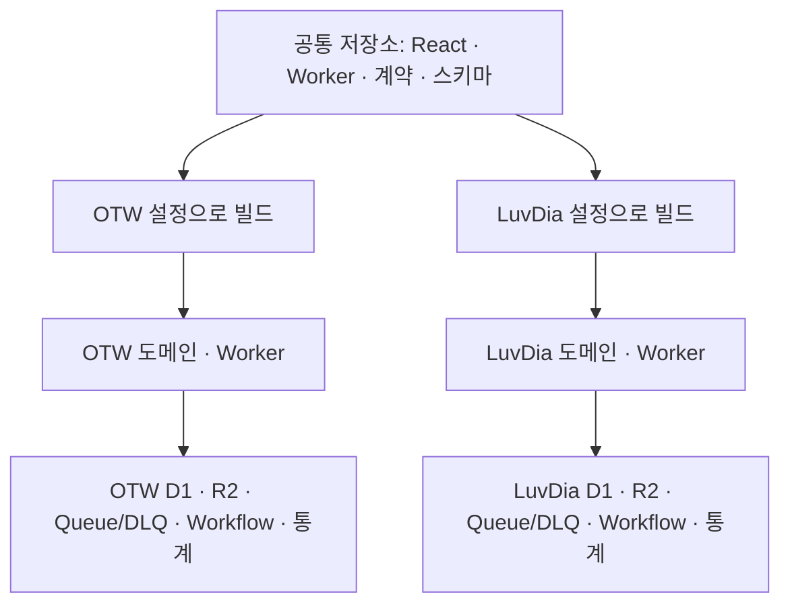

# SUL-36: 러브다이아 스케쥴 사이트 운영 방식 기술 검토

- 조사일: 2026-10-13, Asia/Seoul
- 코드 기준: `bf0c8159412d283996e04c6d6147de52dbd10ba5`
- 기록 성격: 구현 전 구조 조사와 정책 결정 기록이다. 이후 코드·로컬 검증을 시작했으며, 현재 완료·미완료 증거는 [로컬 검증 기록](local-implementation-verification.md)과 [구현 계획](../../superpowers/plans/2026-10-13-luvdia-independent-deployments.md)에서 갱신한다. 아래 당시 코드 설명을 현재 구현 상태로 해석하지 않는다.
- 구현 중 기술 판단과 틀렸을 때의 재작업은 [판단 기록](implementation-rulings.md)에 시간순으로 정리한다. 사용자 확정 정책과 부분 구현의 검증 상태를 구분한다.
- 2026-10-14 구현 중 허용 범위를 넘긴 운영 R2 업로드가 발생했다. 최초 로그의 완료 6개·미응답 1개와 중단 증거를 [사고 기록](operational-upload-incident.md)에 보존했다. 사용자 허용 뒤 정확히 7개 현재 파일을 읽어 모두 업로드 입력과 크기·SHA-256이 일치함을 확인했다. 사고 전 상태·실제 upload-version·이용자 영향은 미확인이며 로컬 PASS로 무해함을 판정하지 않는다.
- 요구 근거: 사용자가 제공한 SUL-36 본문. 빙하유·유리리·양메이의 개인세 전환에 맞춰 러브다이아 전용 사이트를 운영한다.
- 확인된 운영 결정: 2026-10-13 사용자가 **공통 코드·사이트별 독립 배포/DB**, **두 사이트 지속 개선·운영**, **LuvDia의 기존 OTW 전체 기능 유지**, **사이트별 로그인·회원 분리**를 선택했다.
- 2026-10-14 정책 확정: LuvDia 대상은 **빙하유·유리리·양메이 3명만**이다. 추가 멤버는 포함하지 않는다.
- 2026-10-14 자료 관리 정책: 분리 후 세 사람의 **새 자료는 LuvDia에서만 관리**하며 **OTW 과거 기록은 보존**한다. 아래 공개 목표에 맞춰 수집·갱신 소유권을 인계하는 상세 절차를 검증해야 한다.
- 2026-10-14 과거 자료 정책: 세 사람의 **예전 일정·전체 콘텐츠를 LuvDia로 이관**하고, **OTW 보존 원본은 관리자만 열람**한다. 일반 화면/API/검색/SEO/cache의 노출 차단을 설계·계획에 추가했다.
- 2026-10-14 회원 데이터 정책: 멤버 콘텐츠·검수 자료만 이관하며 **개인 플레이리스트·일반 회원 계정 연결 데이터는 OTW에 유지**한다. LuvDia 계정으로 자동 승계하지 않는다.
- 2026-10-14 Cloudflare 정책: **기존 OTW와 같은 계정**을 사용하되 **모든 운영 자원은 별도 생성**한다. 계정 한도·청구 공유는 사이트별 예산과 합산 관측에 반영한다.
- 2026-10-14 브랜드 정책: 표시 이름은 **LuvDia Schedule / LuvDia Play**이며 비공식 팬 운영 고지를 유지한다.
- 2026-10-14 현재 프로필 표기: 기본 문구는 **개인 방송인**이며 화면 개발 결과에 따라 수정할 수 있다. 과거 소속·크레딧 사실은 유지한다.
- 2026-10-14 초기 자원: **기존 러브다이아 로고·문의 메일 `397love@gmail.com`**을 사용하며 커뮤니티 링크는 전용 주소 확정 후 표시한다. 도메인은 미정이다.
- 2026-10-14 운영/API 정책: **기존 운영자·외부 API 프로젝트를 공유**하며 관리자 권한과 가능한 API 키는 사이트별 분리한다. 공용 quota는 합산 관리한다.
- 2026-10-14 배포 정책: 정상 운영은 검증된 **master 병합 후 사이트별 자동 배포**다. 최초 이관·공개 전환은 별도 검증·실행 지시 후 진행한다.
- 2026-10-14 공개 목표: **2026-10-18 오전 11시 KST**. 도메인·별도 LuvDia Clerk 앱은 미정/미준비이고 코드·로컬 검증은 진행 중이다. 공개 가능성이 검증된 일정은 아니다.
- 2026-10-14 전환 정책: **세 사람의 수집·갱신도 중단 없는 전환**이 필요하다. 일시 중지 동기화안은 제외하고 live 변경분·지연 작업·처리 주체 인계 검증을 계획에 추가했다. 새 방식 미검증으로 일정 위험이 높다.
- 2026-10-14 초기 수집: **기존 OTW의 세 사람 대상 수집 소스·주기를 승계**하며 확대는 추후 결정한다. 기존 기능·게시 상태·공개/회원/admin 제한은 유지한다.
- 2026-10-14 비용 정책: **기존 계약·합산 한도를 우선 사용**하고 **추가 비용·요금제 변경은 실제 비용 확인 후 별도 결정**한다. 별도 Clerk와 이관 중 추가 사용량도 검토한다.
- 2026-10-14 공개 미완료 정책: 목표 시각까지 전체 기능·이관·권한·무중단 전환 검증이 끝나지 않으면 **검증 완료까지 LuvDia 공개를 연기**하며 기존 OTW 수집·갱신을 유지한다.
- 2026-10-14 실행 전 추가 확인: 최초 이관은 **현재 보유한 대상 자료 전체**, 없는 과거 자료 복구는 후속 결정이다. 접수된 저장은 보존하고 **전환 후 새 편집은 LuvDia 로그인**으로 진행한다.
- 문서 상태: 선정된 방향의 조사 근거. 확정 정책·남은 입력과 상세 설계는 [설계안](../../superpowers/specs/2026-10-13-luvdia-independent-deployments-design.md), 실행 단계는 [구현 계획](../../superpowers/plans/2026-10-13-luvdia-independent-deployments.md)에 있다. 설계 당시 구현은 보류했으며 현재는 승인된 코드·로컬 검증을 진행한다. 조사 당시 Linear 연결은 `UNAUTHORIZED`여서 이슈 최신 상태 조회·변경은 하지 못했다.
- [구현 실행 전 점검](pre-implementation-review.md)은 위 정책을 당시 쓰기·조회·수집·파일·배포 경로에 대조한 준비 판정이다. 정책 확정과 문서 검사 통과는 무중단 구현·배포 준비 완료를 뜻하지 않는다.

## 결론

**같은 저장소와 스케쥴 엔진을 사용하고, OTW와 LuvDia를 각각 별도 Worker·D1·도메인으로 배포한다는 방향을 사용자가 채택했다.** 두 사이트 모두 계속 기능 개선·운영한다. 공통 일정·관리자·자동 수집의 수정과 보안 패치를 한 번 개발하면서, 데이터와 배포·롤백은 따로 관리할 수 있어 이 운영 방향에 적합하다. Cloudflare는 같은 코드의 별도 Worker 배포와 환경별 D1 연결을 지원한다. [Wrangler environments][C1], [D1 environments][C2]

현재 코드는 한 사이트만 배포하도록 구성되어 있다. **DB ID와 도메인만 바꾸는 작업으로 끝나지 않는다.** 브랜드·SEO·인증·Queue 라우팅·마이그레이션·운영 검사까지 사이트 선택이 일관되게 전달되어야 한다. 특히 Queue 물리 이름을 바꾸면 기존 코드가 작업을 처리하지 않고 ACK할 수 있다. [현재 배포 구성][R1], [Queue 분기][R2]

독립 개발팀·저장소 권한·릴리스 책임이 필요하거나, 향후 두 사이트의 기능 방향이 크게 달라진다면 독립 포크를 재검토할 수 있다. 이 경우에도 런타임 분리 작업과 데이터 이관 검증은 필요하며, 포크 자체가 운영 자원을 분리하지는 않는다. 이 판단은 코드·운영 구조를 바탕으로 한 추론이다.

## 선택지 비교

| 항목 | 독립 포크·별도 배포 | **같은 저장소·별도 배포: 권고** | 하나의 Worker에서 사이트를 동적으로 선택 |
| --- | --- | --- | --- |
| 코드·개발 | OTW 코드를 복사하고 이후 각각 변경 | 공통 엔진, 명시적인 OTW/LuvDia 설정·빌드 | 요청마다 사이트·DB·인증·작업 문맥 결정 |
| 데이터 | 별도 D1을 연결해야 분리 | 별도 D1을 연결해 분리 | DB가 별도여도 모든 경로에서 올바른 DB 선택 필요 |
| 배포·롤백 | 각각 독립 | 각각 독립; 공통 변경도 사이트별 검증 후 배포 | 공통 Worker 변경·롤백이 두 사이트에 영향 |
| 초기 작업 | 복사 후 아래 단일 사이트 결합을 수정 | 아래 결합을 필요한 설정으로 분리 | HTTP 외 Cron·Queue·Workflow까지 사이트 문맥 추가 |
| 장기 유지 | 공통 오류·취약점 패치를 각각 반영; 스키마 분기 가능 | 한 변경을 두 사이트에서 회귀 검증; 스키마 변경 호환성 관리 | 격리·권한·캐시·작업 문맥의 지속적 검증 부담 |
| 적합한 조건 | 운영 소유권·기능 방향이 분리됨 | 운영자는 유사하고 기능 차이는 브랜드·대상 데이터 중심 | 많은 사이트를 운영하는 플랫폼 요구가 실제로 생김 |

비교는 현재 코드에 대한 설계 판단이다. 현재 `Env`는 필수 `otw_db` 하나를 받고, 주요 테이블에는 `site_id`/`tenant_id`가 없으며 `settings`는 전역 key를 사용한다. `unit_name`은 테넌트 격리 수단이 아니다. **같은 DB에 화면 필터만 추가하는 방식은 요구한 별도 운영의 데이터 경계를 만들지 못한다.** [Env][R3], [스키마][R4], [활성 멤버 조회][R5]

상시 운영 브랜치를 사이트별로 갈라 유지하는 방식도 공통 패치 반영 부담은 포크와 비슷하다. 두 사이트의 운영 분리는 배포 대상에서 표현하고, 코드 이력을 갈라야 할 실제 이유가 생길 때 포크를 선택하는 편이 낫다.

## 권고 구조와 분리 경계

이는 향후 목표 구조이며 현재 LuvDia 배포의 존재를 나타내지 않는다. Cloudflare는 기존 OTW 계정을 공유하기로 확정했다. **같은 계정의 자원 분리는 계정의 권한·청구·사용량 한도 분리와 다르다.**

| 경계 | 필요한 처리와 확인 |
| --- | --- |
| Worker·도메인·정적 자산 | 사이트별 Worker 이름·custom domain·빌드 결과를 지정한다. 한 사이트 배포가 다른 Worker를 덮어쓰지 않아야 한다. 현재 `wrangler.jsonc`와 Vite `configPath`, 배포 스크립트는 OTW만 지정한다. [R1], [R6], [vite.config.ts](../../../vite.config.ts) |
| D1 | 각 사이트의 물리 `database_id`/`database_name`을 분리한다. 코드의 논리 binding `otw_db`는 유지할 수 있다. REST 통계에 쓰는 `CLOUDFLARE_D1_DATABASE_ID`와 계정 ID·토큰도 같은 대상을 가리켜야 한다. [R1], [R3], [D1 binding 정의][C3] |
| Queue·DLQ·Workflow·Cron | 물리 Queue/DLQ와 Workflow 이름·Cron 설정을 분리한다. Queue 하나에는 consumer Worker 하나만 연결할 수 있다. 기존 코드의 물리 이름 분기와 DLQ 판별을 함께 수정하고, 일반 처리·재시도·실패 처리 모두 같은 사이트로 이어져야 한다. [R1], [R2], [R7], [Queue consumer 제약][C4] |
| R2·파일 경로 | 공지·프로필 파일을 사이트별 bucket으로 분리한다. 연결된 이미지·파일 URL도 새 사이트에서 실제로 읽히는지 확인한다. bucket만 생성해도 기존 파일이 복사되지는 않는다. [R1], [R3] |
| Analytics Engine | 기록 dataset을 분리하고 읽기 SQL·계정·토큰도 해당 dataset을 사용한다. 생산 binding만 변경하면 운영 화면이 OTW 통계를 읽을 수 있다. [R1], [R8] |
| RateLimit | 논리 이름을 유지하더라도 별도 `namespace_id`를 쓴다. 같은 계정의 서로 다른 Worker가 같은 namespace ID를 쓰면 동일 key의 카운터를 공유한다. [R1], [Rate Limiting binding][C5] |
| 인증·관리자 | 사용자가 선택한 별도 Clerk application의 production 설정을 사용한다. client publishable key, issuer/JWKS, authorized origins, admin IDs를 사이트별로 맞춘다. 같은 운영자도 새 앱의 user ID를 개별 허용하며 기존 회원 ID나 권한을 자동 승계하지 않는다. [R9], [Clerk 환경][C6], [요청 인증][C7] |
| Secrets·외부 API | 배포별 secret을 주입하고 권한 범위를 점검한다. 별도 key/token이 공급자의 quota·청구까지 분리한다는 뜻은 아니다. YouTube key는 Google project를 식별하므로 같은 project의 새 key만으로 quota가 독립한다고 판단할 수 없다. [R1], [R3], [YouTube 인증][G1] |
| 로컬·검사·배포 도구 | build/deploy뿐 아니라 doctor·reset·seed·migration·Queue provisioning·R2 업로드·preflight·테스트가 선택한 사이트 자원을 사용해야 한다. 기존 로컬 persist 경로·port 옵션은 재사용한다. [R6], [R10], [R11], [package.json](../../../package.json), [scripts](../../../scripts) |

### 배포 설정을 고르는 방법

두 사이트의 **완전한 named deployment config와 사이트별 빌드 프로필**을 먼저 만드는 것이 현재 구조에 맞는 최소안이다. 예를 들어 OTW/LuvDia가 같은 소스·스키마를 사용하되 config가 각 물리 자원을 명시하도록 한다. 범용 테넌트 등록 시스템·런타임 DB 라우터·새 패키지 체계는 이 요구에 필요하지 않다.

Wrangler의 `env.otw`/`env.luvdia`로 구현하는 것도 가능하다. 다만 bindings·vars·secrets는 환경별로 선언해야 하며, 루트 Worker도 별도 배포 대상이다. 환경 상속만 믿고 자원 일부를 OTW에 남기지 않도록 모든 대상을 검사해야 한다. [Wrangler environments][C1]

이 저장소는 Cloudflare Vite plugin을 쓴다. 공식 문서상 Cloudflare 환경은 **dev/build 시 선택**되어 생성된 배포 config에 반영된다. 따라서 OTW로 만든 산출물에 `wrangler deploy --env luvdia`만 덧붙이는 절차를 만들면 안 된다. 사이트 브랜드·Clerk 앱 identity와 생성된 Worker config가 같은 빌드 프로필인지 검사한 후 배포해야 한다. 현재 Clerk 빌드 검사는 `pk_live` 여부를 확인하지만 어느 사이트의 앱인지는 확인하지 않는다. [Vite 환경][C8], [현재 배포][R6], [Clerk 빌드 검사][R12]

### UI를 넘어 도달해야 할 변경 범위

헤더 로고·aria/alt·footer·외부 커뮤니티 링크·권리 고지 외에도 공유 `SITE_ORIGIN`/`SITE_NAME`, 페이지 제목·설명, canonical·OG·sitemap·robots·생성 HTML/404, Worker JSON-LD를 같은 사이트 프로필로 생성해야 한다. 화면 이름만 바꾸면 검색엔진·공유 링크는 계속 OTW를 가리킬 수 있다. [헤더][R13], [footer](../../../src/app/layout/footer.tsx), [navigation](../../../src/app/layout/app-navigation.ts), [권리 고지](../../../src/shared/lib/site-rights.ts), [SEO 계약][R14], [생성 HTML](../../../scripts/generate-seo-assets.ts), [Worker SEO][R15]

Site-content 캐시 key도 `otw.internal`에 고정되어 있다. 사이트 origin/브랜드 변경 시 캐시 key와 응답 readback을 확인한다. 이 조사에서 Worker 간 캐시 유출은 입증하지 않았으며, 도메인·zone·캐시 설정에 따른 격리를 실제 배포에서 검증해야 한다. [캐시 구현](../../../worker/features/seo/infrastructure/site-content-cache.ts)

또한 공지 발행자 `publisher_type='otw'`가 DB 기본값·API 계약·관리자·공개 화면에 걸쳐 있다. 이 값을 바로 `luvdia`로 전역 치환하면 OTW 계약과 기존 데이터를 깨뜨릴 수 있다. 기존 값이 내부 코드로 유지될지, 공통 사이트 발행자를 표현하는 계약으로 바뀔지 정하고 모든 소비자를 함께 확인한다. **팬 사이트 브랜드가 실제 소속·공식 발행자를 의미하는지**도 제품 정책으로 확정해야 한다. [공지 스키마][R4], [공지 계약][R16]

## 데이터 이관과 한도

**새 LuvDia DB에는 현재 보유한 빙하유·유리리·양메이의 모든 과거 일정·멤버 콘텐츠·검수 자료를 이관한다.** 이미 없는 과거 자료 복구는 후속 결정이다. 일반 회원의 개인 데이터는 OTW에 유지한다. 세 사람 관련 OTW 원본은 삭제하지 않고 관리자만 열람하도록 보관한다. 기존 `is_deprecated`나 화면 필터만으로 이 접근 경계를 대신하지 않는다. 멤버 UID·schedule/member link·공지 관련 멤버·공동 참여·파일 참조의 관계와 기존 게시/접근 상태를 보존해야 한다. [스키마][R4], [활성 조회][R5]

빈 DB에서 현재 migration을 바로 전부 실행할 수 있다고 가정하면 안 된다. `0030`/`0032`는 특정 기존 멤버를 조회해 NOT NULL `member_uid`를 삽입한다. 기존 reset 도구는 번호별 migration 사이에 bootstrap 멤버를 넣고 뒤에서 정리한다. **새 DB 구축은 이 전제를 검증한 bootstrap과 실제 migration 체인을 재현하고, 과거 적용된 migration 파일을 새 사이트용으로 수정하지 않는다.** 임시 bootstrap 로스터와 최종 제품 로스터는 구분한다. [0030][R17], [0032][R18], [reset 절차][R10]

DB 전체 복제는 설정·검수 대기·예약 실행·작업 lease/generation·admin audit·개인정보까지 복제할 수 있다. 확정한 업무 데이터·파일과 실행 상태를 구분하고, 새 배포가 기존 작업을 재실행하지 않도록 인계 전 LuvDia의 자동 실행을 비활성화한다. 기존 OTW 수집·갱신은 유지하며 live 변경분·삭제·관계 변경·미완료 작업·지연 Queue와 수집 checkpoint를 검증한 뒤 소유권을 넘긴다. 이관 manifest에 범위·건수·관계·설정·버전을 기록하고 새 DB readback과 공개/관리자 흐름으로 확인한다. D1 export/import 도구는 있지만 export 중 다른 DB 요청이 차단될 수 있으므로 무중단 전환의 방법으로 전제하지 않는다. [D1 import/export][C9]

| 항목 | 2026-10-13 공식 기준과 이 결정의 영향 |
| --- | --- |
| Workers | Free 요청 한도는 계정당 100,000/day. Paid는 계정당 최소 US$5/month부터이며 사용량 과금이 추가될 수 있다. Worker를 두 개 만든다고 같은 계정의 무료 한도가 두 배가 되지 않는다. [Workers limits][C10], [Workers pricing][C11] |
| D1 | Free는 읽기 5 million rows/day, 쓰기 100,000 rows/day, 총 storage 5 GB. 계정이 일일 한도를 넘으면 쿼리가 실패한다. 별도 DB를 같은 계정에 만든다고 이 한도가 독립하지 않는다. [D1 pricing][C12] |
| 현재 예산 guard | Cron 사전 guard는 `env.otw_db`의 ledger만 읽는다. 두 DB를 따로 두면 이 guard가 계정 합산 사용량을 자동 보호하지 않는다. 같은 계정은 두 사이트의 보수적인 예산 배분과 기존 usage ledger의 읽기 기반 합산 관측을 설계한다. guard 관측을 위해 추가 D1 쓰기를 만들지 않는다. [Cron guard][R19], [사이트 예산 기본값][R20] |
| 외부 API | 현재 YouTube quota ledger도 DB별이다. 같은 공급자 project·계정을 사용한다면 합산 예산·중복 수집을 확인해야 한다. 외부 quota 독립 여부는 공급자 권한 단위로 결정한다. [YouTube quota][R21], [YouTube 인증][G1] |

실제 Cloudflare/Clerk 요금제·청구서·최근 사용량은 조회하지 않았다. 따라서 운영비 숫자나 작업 일수는 추정하지 않는다. 실제 트래픽·수집 범위·파일·작업량을 같은 Cloudflare/API 계정의 합산 한도에서 확인해야 한다.

Clerk satellite domain은 도메인 간 세션 공유 옵션이지만, 사용자가 사이트별 로그인·회원을 분리하기로 선택했으므로 이번 채택안에는 사용하지 않는다. [Clerk satellite domains][C13]

## 후속 작업의 최소 범위

| 순서 | 결과물 | 다음 단계 조건 |
| --- | --- | --- |
| 1. 정책·필수 입력 정리 | 확정된 로스터·브랜드·이관·인증·계정을 전제로 도메인·실제 자원/관리자 ID·초기 수집·예산·상세 무중단 절차 확정 | 설계안 D01–D08의 확정 정책과 남은 입력을 구분 |
| 2. 동일 엔진의 배포 경계 준비 | 두 사이트의 config/build profile; 위 표에 나온 브랜드·SEO·인증·resource 선택·Queue/DLQ 라우팅·도구 수정 | OTW 현재 동작과 LuvDia 설정이 모두 일관되게 빌드되며 잘못된 사이트/자원 조합을 거부 |
| 3. 새 자원·검증된 데이터 구축 | 별도 DB/R2/Queue/Workflow/통계, production 인증·secrets, bootstrap/migration, 전체 멤버 콘텐츠·연속 변경분 이관 | 대상 identity·schema·migration 이력·관계 readback; 기존 OTW 수집은 계속 유지 |
| 4. 실제 흐름 검증·전환 | 두 사이트 공개/관리자·live 변경분을 확인한 뒤 LuvDia 수집 소유권 인계와 OTW 관리자 보관 전환 | 아래 인수 기준과 무중단 검증 충족 후 10월 18일 오전 11시 공개 목표 |

이 단계는 구현 작업 제안이다. Queue 처리나 인증·자원 선택이 나중 단계에서 교정되어야 하는 배포를 중간 완성본으로 운영하지 않는다. 두 사이트 기능이 달라져도 같은 데이터 구조의 호환성을 유지하고, migration 적용 시점과 각 Worker 버전을 별도로 기록한다.

### 공개 전 인수 기준

1. **일반 방문자 흐름:** 각 실제 도메인 → 오늘/주간 스케쥴 → 공지·프로필에서 승인된 대상만 자연스럽게 보인다. title/canonical/OG/sitemap/파일 링크가 해당 사이트를 가리킨다. OTW 이력 노출은 확정한 정책을 지킨다.
2. **관리자 영속성:** 각 도메인에서 해당 production 로그인 → 기존 관리자 진입 → 일정/공지 생성·수정 → 공개 화면 새로 조회 → 해당 D1 readback으로 저장을 확인한다. 다른 사이트 데이터는 변하지 않고 다른 사이트 사용자에게 관리자 권한이 자동 이전되지 않는다. OTW 보관 자료는 관리자 정상 동선에서만 열람된다.
3. **예정 작업:** 실제 Cron → 기존 Workflow → 해당 Queue → Worker consumer → 해당 D1/R2 → Operations 화면·ledger까지 진행한다. 정상 완료·재시도·DLQ가 올바른 사이트에서 처리된다. 하위 handler 직접 호출이나 mock 통과만으로 대체하지 않는다. 변경된 Queue 이름의 미처리 ACK도 회귀 검증한다.
4. **배포 안전:** 산출물의 사이트·Clerk 앱·Worker 이름과 물리 resource identity를 확인한다. OTW 배포/롤백이 LuvDia를 덮어쓰지 않고 반대도 성립한다. 한 사이트 rollback으로 이미 적용한 공통 schema와 호환되지 않게 되는지 확인한다.
5. **운영 한도:** 선택한 Cloudflare/API 계정의 실제 예산과 두 사이트 합산 사용량을 읽기로 확인한다. 외부 자동 실행을 활성화하기 전에 중복 수집·재실행·의도하지 않은 API 호출이 없음을 확인한다.

기존 테스트·fixtures·검사 스크립트는 선택한 사이트와 Queue 이름을 검증하도록 바꿔야 한다. OTW 문자열을 고정한 테스트가 제품 결정을 막거나, 실제 흐름을 생략한 테스트 성공이 배포 완료를 뜻하도록 만들지 않는다. 모든 재검증은 이관/빌드/배포한 실제 artifact identity와 연결한다.

## 남은 실행 입력·기술 검토

- 도메인과 보유 상태는 미정이다. 전용 커뮤니티 URL은 추후 입력하며 그 전에는 링크를 숨긴다. 표시명·로고·문의처·현재 프로필 기본 문구는 확정되었다.
- 초기 수집은 기존 소스·주기 승계, 비용은 기존 계약·한도 우선으로 확정했다. 실제 설정·합산 사용량·사이트별 예산 배분과 추가 비용 발생 여부는 확인해야 한다.
- 확정된 별도 Clerk 앱·Cloudflare 자원·관리자 권한·가능한 API 키의 실제 식별자/값, 최근 합산 사용량과 예산 배분이 실행 입력으로 필요하다. 비밀값을 문서에 저장하지 않는다.
- 현재 outbox/감사는 모든 변경·삭제를 복제하기에 부족하다. 원자적 변경 포착·watermark·실제 쓰기 소유권·관계/작성자 변환·보관 자료 정리 예외의 상세안과 실제 부하는 아직 검증되지 않았다. 목표 일정의 가능성은 이 검토 후 평가해야 한다.
- 정책 조사 당시에는 구현을 보류했다. 이후 사용자가 승인한 코드·로컬 검증은 진행 중이며, 운영 자원 생성·데이터 이관·배포는 여전히 별도 실행 범위다. 현재 증거는 [로컬 검증 기록](local-implementation-verification.md)을 따른다.

## 조사·검증 범위

현재 코드·배포 도구와 아래 공식 문서를 확인했다. 기존 아키텍처 문서의 단일 사이트 설명은 참고자료이며, 현재 `worker/index.ts`/`wrangler.jsonc`와 실제 코드 흐름을 판단 기준으로 삼았다.

읽기 전용 공개 확인에서는 2026-10-13 KST `/api/members`가 HTTP 200으로 활성 멤버 8명을 반환했다. `/weekly`는 16:07:14에 HTTP 200과 OTW 제목/canonical을 반환했고, `/api/schedule-board?startDate=2026-10-13&endDate=2026-10-19`는 16:07:55에 HTTP 200, 8 members·28 schedules·13 ddays·0 notices, `updatedAt=2026-10-13T06:09:41Z`를 반환했다. 이는 기존 OTW 진입점의 조회 확인이며 **그 배포 commit이 위 기준 commit과 같다는 증거는 아니다.** [공개 멤버 API](https://otw-schedule.info/api/members), [주간 화면](https://otw-schedule.info/weekly), [공개 스케쥴 API](https://otw-schedule.info/api/schedule-board?startDate=2026-10-13&endDate=2026-10-19)

현재 API의 세 사람 `unit_name='러브다이아'` 표기는 전환 이후 정책의 권위가 아니다. 사용자가 제공한 개인세 전환을 기준으로 판단했다. 이 조사에서는 런타임 코드를 변경하거나 운영 DB·Queue·인증·배포를 수정하지 않았고, 실제 관리자 mutation·수집 실행·LuvDia 배포·실제 청구·migration replay는 검증하지 않았다. 앱 코드를 바꾸지 않아 애플리케이션 테스트는 실행 대상이 아니다. **이번 결과물은 근거를 갖춘 운영 방식 권고와 후속 작업 범위다.**

초기 조사 문서 작성 시 보고서와 `docs/README.md` 두 파일 검증은 통과했다. 로컬 링크 44개·기준 commit에 고정한 코드 출처 21개의 경로/line anchor·참조 정의·코드 fence·후행 공백을 확인했다. `git diff --check`는 exit 0, `pnpm.cmd sync:agent-cursor:check`는 exit 0으로 27개 관리 파일과 참조가 유효했다. 이후 설계/계획 문서는 별도로 검사하며, 문서 검사는 실제 LuvDia 운영 검증을 대체하지 않는다.

## 근거

R 번호의 코드 링크는 위 기준 commit에 고정했고, 상대 경로는 관련 소비자 파일을 찾는 링크다. 공식 문서의 요금·제약은 조사일 기준이며 실제 구현·배포 시 재확인한다.

[R1]: https://github.com/rlatmfrl24/overthewall-schedule/blob/bf0c8159412d283996e04c6d6147de52dbd10ba5/wrangler.jsonc
[R2]: https://github.com/rlatmfrl24/overthewall-schedule/blob/bf0c8159412d283996e04c6d6147de52dbd10ba5/worker/app/worker-queue.ts#L13-L66
[R3]: https://github.com/rlatmfrl24/overthewall-schedule/blob/bf0c8159412d283996e04c6d6147de52dbd10ba5/worker/platform/types.ts#L9-L38
[R4]: https://github.com/rlatmfrl24/overthewall-schedule/blob/bf0c8159412d283996e04c6d6147de52dbd10ba5/db/schema/index.ts#L221-L390
[R5]: https://github.com/rlatmfrl24/overthewall-schedule/blob/bf0c8159412d283996e04c6d6147de52dbd10ba5/worker/features/members/infrastructure/d1-member-reader.ts
[R6]: https://github.com/rlatmfrl24/overthewall-schedule/blob/bf0c8159412d283996e04c6d6147de52dbd10ba5/scripts/deploy-workers.mjs
[R7]: https://github.com/rlatmfrl24/overthewall-schedule/blob/bf0c8159412d283996e04c6d6147de52dbd10ba5/worker/app/scheduled-queue.ts#L58
[R8]: https://github.com/rlatmfrl24/overthewall-schedule/blob/bf0c8159412d283996e04c6d6147de52dbd10ba5/worker/features/otw-play/infrastructure/cloudflare-play-observability-reader.ts
[R9]: https://github.com/rlatmfrl24/overthewall-schedule/blob/bf0c8159412d283996e04c6d6147de52dbd10ba5/worker/platform/auth.ts
[R10]: https://github.com/rlatmfrl24/overthewall-schedule/blob/bf0c8159412d283996e04c6d6147de52dbd10ba5/scripts/d1-reset-local.mjs
[R11]: https://github.com/rlatmfrl24/overthewall-schedule/blob/bf0c8159412d283996e04c6d6147de52dbd10ba5/scripts/local-dev-config.mjs#L50
[R12]: https://github.com/rlatmfrl24/overthewall-schedule/blob/bf0c8159412d283996e04c6d6147de52dbd10ba5/scripts/client-build-deploy-guard.mjs#L45
[R13]: https://github.com/rlatmfrl24/overthewall-schedule/blob/bf0c8159412d283996e04c6d6147de52dbd10ba5/src/app/layout/app-shell.tsx#L291-L314
[R14]: https://github.com/rlatmfrl24/overthewall-schedule/blob/bf0c8159412d283996e04c6d6147de52dbd10ba5/contracts/site-seo.ts
[R15]: https://github.com/rlatmfrl24/overthewall-schedule/blob/bf0c8159412d283996e04c6d6147de52dbd10ba5/worker/features/seo/application/site-content-service.ts#L70-L95
[R16]: https://github.com/rlatmfrl24/overthewall-schedule/blob/bf0c8159412d283996e04c6d6147de52dbd10ba5/contracts/notices.ts
[R17]: https://github.com/rlatmfrl24/overthewall-schedule/blob/bf0c8159412d283996e04c6d6147de52dbd10ba5/drizzle/0030_tiresome_boomerang.sql
[R18]: https://github.com/rlatmfrl24/overthewall-schedule/blob/bf0c8159412d283996e04c6d6147de52dbd10ba5/drizzle/0032_wakeful_boom_boom.sql
[R19]: https://github.com/rlatmfrl24/overthewall-schedule/blob/bf0c8159412d283996e04c6d6147de52dbd10ba5/worker/app/scheduled-workflow-cron.ts#L49-L66
[R20]: https://github.com/rlatmfrl24/overthewall-schedule/blob/bf0c8159412d283996e04c6d6147de52dbd10ba5/worker/platform/scheduled-jobs/job-policy.ts#L16-L18
[R21]: https://github.com/rlatmfrl24/overthewall-schedule/blob/bf0c8159412d283996e04c6d6147de52dbd10ba5/worker/features/youtube/infrastructure/youtube-quota.ts
[C1]: https://developers.cloudflare.com/workers/wrangler/environments/
[C2]: https://developers.cloudflare.com/d1/configuration/environments/
[C3]: https://developers.cloudflare.com/workers/wrangler/configuration/#d1-databases
[C4]: https://developers.cloudflare.com/queues/get-started/#connect-the-consumer-worker-to-your-queue
[C5]: https://developers.cloudflare.com/workers/runtime-apis/bindings/rate-limit/
[C6]: https://clerk.com/docs/guides/development/managing-environments
[C7]: https://clerk.com/docs/reference/backend/authenticate-request
[C8]: https://developers.cloudflare.com/workers/vite-plugin/reference/cloudflare-environments/
[C9]: https://developers.cloudflare.com/d1/best-practices/import-export-data/
[C10]: https://developers.cloudflare.com/workers/platform/limits/#daily-requests
[C11]: https://developers.cloudflare.com/workers/platform/pricing/
[C12]: https://developers.cloudflare.com/d1/platform/pricing/
[C13]: https://clerk.com/docs/guides/dashboard/dns-domains/satellite-domains
[G1]: https://developers.google.com/youtube/registering_an_application
