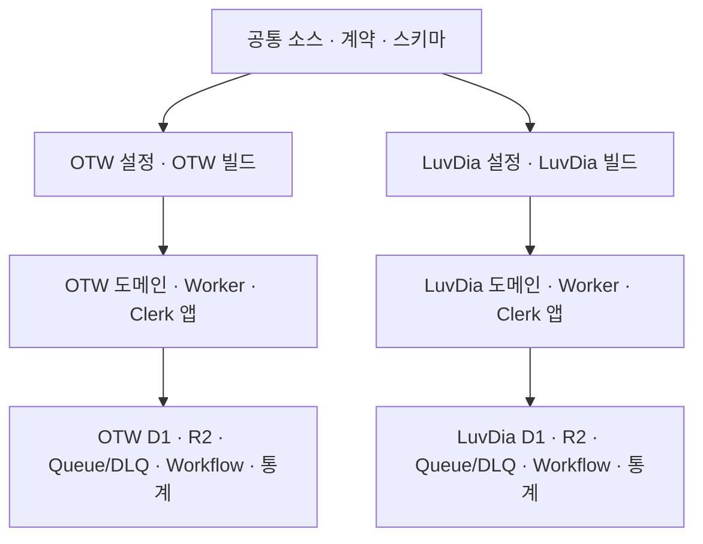

# SUL-36: 공통 코드와 사이트별 독립 운영 설계안

- 작성일: 2026-10-13, Asia/Seoul
- 코드 기준: `bf0c8159412d283996e04c6d6147de52dbd10ba5`
- 배경: [기술 검토](../../reports/sul-36/README.md)
- 상태: 사용자 선택을 반영한 상세 설계. 2026-10-14 **코드 구현과 로컬 검증을 지시받아 진행 중**이다. 도메인은 사용자가 등록 후 제공하며 도메인 의존 작업·운영 자원 준비·운영 데이터 이관·배포는 실행하지 않는다.
- 요청에 따라 [구현 계획](../plans/2026-10-13-luvdia-independent-deployments.md)도 함께 준비했다. 문서의 구현 작업과 검증 명령은 향후 실행할 항목이다.
- 정책 인터뷰: 2026-10-14 운영 방향 확정. 실제 도메인·자원/권한 식별자·예산 배분과 무중단 전환 상세 검토는 실행 전에 남아 있다.
- 실행 전 전수 점검: [준비 상태·추가 고려사항](../../reports/sul-36/pre-implementation-review.md). 코드 대조 결과 변경 포착·소유권·이관 관계·검증 환경의 상세 설계가 미충족이며, 정책 확정을 실행 준비 완료로 해석하지 않는다.

## 1. 확정된 목적과 범위

사용자는 OTW와 러브다이아 두 사이트를 계속 기능 개선·운영하며, 공통 코드를 유지하고 사이트별 배포·DB를 분리하기로 결정했다. 러브다이아도 **기존 OTW 기능을 모두 유지**하고, **로그인·회원은 사이트별로 분리**한다. 이 세 가지는 가정이나 추가 승인 대상이 아니다.

목표는 각 사이트의 팬이 자기 사이트의 일정과 콘텐츠를 자연스럽게 이용하고, 운영자가 해당 사이트에서 저장·검수·게시·자동 수집한 결과를 그 사이트의 DB와 화면에서 확인하는 것이다. 공통 패치는 한 번 개발하되 한 사이트의 저장·작업·배포가 다른 사이트에 작용하지 않아야 한다.

| 정책 확정 기록 | 사용자 선택 |
| --- | --- |
| D01 대상 멤버 · 2026-10-14 | LuvDia에서 관리하는 대상은 빙하유·유리리·양메이 3명만. 추가 멤버는 포함하지 않음 |
| D07 신규 자료 관리 · 2026-10-14 | 사이트 분리 후 세 사람의 새 일정·게시글·영상·음악은 LuvDia에서만 수집·관리. OTW 과거 기록은 삭제하지 않고 보존 |
| D01/D04 과거 자료 · 2026-10-14 | 세 사람 관련 예전 일정과 전체 콘텐츠를 LuvDia로 이관. OTW에 보존한 세 사람 관련 모든 자료는 일반 이용 화면에서 숨기고 관리자만 열람 |
| D04 개인 회원 데이터 · 2026-10-14 | 멤버 콘텐츠·검수 자료만 이관. 일반 회원의 개인 플레이리스트·계정 연결 데이터는 OTW에 유지하며 LuvDia 회원 계정으로 자동 연결하지 않음 |
| D03 Cloudflare 계정 · 2026-10-14 | 기존 OTW와 같은 Cloudflare 계정 사용. Worker·D1·R2·Queue/DLQ·Workflow·dataset·rate-limit namespace는 모두 별도 자원으로 분리 |
| D02 표시 이름 · 2026-10-14 | 사이트 표시명은 `LuvDia Schedule`, 음악 기능 이름은 `LuvDia Play`. 비공식 팬 운영 고지는 유지 |
| D02 도메인 · 2026-10-14 | 사용자가 미정으로 답변. 주소·보유 상태는 추후 확정하며 production origin/Clerk/DNS/배포의 필수 입력으로 남김. OTW 주소로 대신 채우지 않음 |
| D01 현재 소속 문구 · 2026-10-14 | LuvDia 현재 프로필의 기본 표시는 `개인 방송인`. 화면 개발 결과 검토 후 수정 가능. 과거 자료의 당시 소속·크레딧을 덮어쓰는 사실값으로 사용하지 않음 |
| D02 초기 브랜드 자원 · 2026-10-14 | 저장소의 기존 러브다이아 로고와 문의 메일 `397love@gmail.com` 사용. 전용 주소 확정 전 커뮤니티 외부 링크는 표시하지 않으며 게시글·Cafe 수집 기능은 유지 |
| D05 운영 권한·API · 2026-10-14 | 기존 OTW 운영자가 LuvDia도 관리. 외부 API 프로젝트/계정은 공유하고 가능한 키는 사이트별 분리. LuvDia 새 Clerk user ID에 권한을 개별 부여하며 provider 한도는 합산 관리 |
| D06 정상 운영 배포 · 2026-10-14 | 검증된 `master` 병합 후 사이트별 설정·pipeline으로 자동 배포. Worker·DB·rollback은 독립 관리. 최초 이관·서비스 전환은 별도 검증·실행 지시 이후 진행 |
| D06 공개 일정 · 2026-10-14 | 특정 공개 날짜를 우선 맞춰야 한다는 사용자 요구. 아래 목표 시각과 무중단 조건을 적용하며 기능·권한·이관 검증 생략이나 구현 실행 허가로 해석하지 않음 |
| D06 목표 공개 시각 · 2026-10-14 | `2026-10-18 11:00 Asia/Seoul` (`2026-10-18T02:00:00Z`). 목표 일정이며 준비·검증 완료나 공개 가능성의 보장은 아님. 이후 지시에 따라 코드·로컬 검증은 진행하고 운영 이관·배포는 보류 |
| D06 전환 연속성 · 2026-10-14 | 세 사람의 수집·갱신도 중단 없는 전환 필요. 동기화를 위해 수집·쓰기 잠시 중지하는 방식은 채택하지 않음. 다른 OTW 멤버 운영도 유지 |
| D08 초기 수집 · 2026-10-14 | 세 사람의 기존 OTW 수집 소스·주기를 LuvDia가 승계. 신규 소스·주기 확대는 추후 결정하며 기존 기능·공개/회원/admin 접근 제한은 유지 |
| D08 비용 · 2026-10-14 | 기존 Cloudflare·외부 API 계약과 합산 한도를 우선 사용. 추가 비용·요금제 변경은 실제 비용 확인 후 별도 결정. 별도 Clerk와 이관 중 추가 사용량도 검토 대상 |
| D06 공개 미완료 · 2026-10-14 | 목표 시각까지 전체 기능·이관·접근 권한·무중단 전환 검증이 끝나지 않으면 검증 완료까지 LuvDia 공개 연기. 기존 OTW 수집·갱신은 계속 유지 |
| D04 보유 자료 범위 · 2026-10-14 | 현재 보유한 대상 자료 전체를 최초 이관. 이미 없는 과거 자료의 외부/백업 복구는 후속 결정. 현존·cache·만료/삭제·제외 사유를 manifest로 구분하고 전체 과거 자료가 남아 있다고 가정하지 않음 |
| D06 관리자 전환 동선 · 2026-10-14 | 수집·이미 접수된 저장은 누락 없이 처리하며 전환 후 새 편집은 LuvDia에 별도 로그인해 진행. OTW 로그인/미저장 편집 세션의 자동 승계는 요구하지 않음 |

| 유지할 기능 | 보존할 계약 |
| --- | --- |
| 오늘·주간 일정, 라이브 상태, 일정 이미지 내보내기 | 기존 일정 API와 관리자 저장 흐름; 이미지에도 해당 사이트의 브랜드·도메인 표시 |
| 공지·이벤트·D-day·멤버 프로필 | 기존 공개·유효 기간·이미지·권리 안내와 운영자 관리 흐름 |
| VOD·클립·YouTube·X·Naver Cafe | 승인한 대상 소스만 수집; 기존 공개/회원/비공개 정책과 외부 API 제한 |
| 멀티뷰 | 공개 멤버 선택 → Mul.Live 새 탭; 최신 Plus 확장 안내. 자체 임베드·전용 확장 개발은 포함하지 않음 |
| Play·플레이리스트·회원 제안 | 카탈로그·재생·플레이리스트는 회원용, 노래 클립은 관리자용. 검수와 명시적 게시, ID 재사용·동시성·중복 방지 보존 |
| 관리자·Operations·자동 수집·AI 검수 | 사이트별 권한, Cron → Workflow → Outbox → Queue, 재시도·DLQ·예산·관측 보존 |

기능 유지와 모든 수집·공개 플래그를 즉시 켜는 것은 다르다. 새 사이트의 초기 노출·수집 대상은 결정표 D08을 따른다. 세 사람 대상 신규 수집은 D07의 전환 시점에 OTW에서 LuvDia로 처리 주체를 인계하며 다른 대상·설정은 유지한다. [제품 계약](../../../PRODUCT.md), [Play 접근 정책](../../../contracts/otw-play-access.ts)

## 2. 배포 구성 선택

세부 배포 표현은 **독립 Wrangler config 두 개**를 선택했다. Task 1에서 두 config의 로컬 실행 기반을 만들었으며 전체 runtime 격리와 실제 운영 자원 연결은 후속 검증 대상이다.

| 방법 | 판단 |
| --- | --- |
| **기존 `wrangler.jsonc` + 새 `wrangler.luvdia.jsonc`** | 권고. 기존 OTW 진입점을 유지하고 각 사이트 자원을 완전하게 명시한다. 두 config의 공통 구조는 검사로 보호한다. |
| 하나의 config에 `env.otw`/`env.luvdia` | 가능. 환경별 비상속 항목을 빠짐없이 선언해야 하며 루트 Worker의 의미도 정해야 한다. 두 사이트뿐인 현재 요구에서는 config 두 개가 읽기 쉽다. |
| 런타임 테넌트 선택·설정 생성 플랫폼 | 현재 범위에 불필요. 요청 host나 query로 DB·인증을 바꾸는 경로를 추가하지 않는다. |

사이트 ID는 `otw`와 `luvdia` 두 값으로 한정한다. 하나의 공통 소스·계약·스키마·migration 체인을 사용하고, 사이트별 장기 브랜치나 신규 패키지 체계를 만들지 않는다. Worker의 논리 binding 이름 `otw_db`, `ASSET_BUCKET`, 기존 Queue/Workflow binding은 유지해 불필요한 전역 치환을 줄인다. 실제 연결되는 자원은 각각 다르다.

이 도식은 목표 구조이며 새 사이트의 실재나 배포 완료를 나타내지 않는다.

## 3. 사이트 선택과 설정의 책임

### 3.1 공개 정의와 실행 대상

순수 공유 모듈 `contracts/site-definition.ts`에 사이트별 공개 정의를 둔다. 계약은 `SiteId = 'otw' | 'luvdia'`, `SiteDefinition`, `parseSiteId(value: string | undefined): SiteId`, `getSiteDefinition(siteId: SiteId): SiteDefinition`으로 정한다. 공개 정의 필드는 `id`, `publicOrigin`, `siteName`, `serviceName`, `playName`, `logoPath`, `fanCafeUrl`, `contactEmail`, `copyrightOwner`다. 도메인이 미정인 LuvDia의 기본 `publicOrigin`은 `null`이며 로컬 실행에서 선택 포트의 localhost origin을 명시적으로 주입한다. production origin이 없으면 빌드·배포를 차단한다. `fanCafeUrl`은 사용하지 않기로 결정하면 `null`로 두고 다른 사이트의 링크로 채우지 않는다.

프런트의 `src/shared/config/site.ts`는 빌드 시 `VITE_SITE_ID`를 검증해 공개 정의를 읽는다. Worker의 `worker/platform/site.ts`는 설정의 `SITE_ID`와 자원 이름을 검증해 composition root에 전달한다. `scripts/site-target.mjs`는 `--site=otw|luvdia`로 config·산출물·로컬 상태의 대상을 선택한다. 공유 계약은 `process.env`, Cloudflare runtime, 요청 host를 읽지 않는다.

| 설정 소유자 | 내용 |
| --- | --- |
| 공개 정의 | 브랜드, canonical origin, 로고, 외부 링크, 권리 표시 주체. 비밀값이나 DB ID는 포함하지 않음 |
| Wrangler config | Worker/domain, D1/R2, Queue/DLQ/Workflow, dataset, rate-limit namespace, `SITE_ID`, Queue 이름·dataset runtime vars |
| 빌드 환경 | 사이트별 Clerk production/development publishable key. `VITE_`에는 비밀값을 넣지 않음 |
| Worker secrets | 해당 사이트의 Clerk issuer/JWKS/authorized parties/admin IDs, 외부 API와 관측 token |
| 각 D1 | roster, 콘텐츠, 노출·수집 설정, 검수, 개인 데이터, 실행 이력·기존 ledger |

사이트 선택 누락·알 수 없는 값·config/Clerk/산출물 불일치는 실패시킨다. 사이트 미선택을 OTW로 fallback하지 않는다. 기존 `pnpm dev/build/deploy` 등은 package script가 **명시적으로 OTW를 선택하는 alias**로 호환성을 유지하고, LuvDia alias도 같은 처리에 명시적 site 인자를 전달한다.

공유 모듈은 Node.js 24.20.0과 TS 5.8의 erasable syntax·상대 import로 실행 가능한 형태를 유지한다. TS 해석이 필요한 기존 SEO script는 설치된 `tsx`를 사용한다. 새 의존성은 추가하지 않는다. [Node TS](https://nodejs.org/docs/latest-v24.x/api/typescript.html), [Vite 환경 변수](https://vite.dev/guide/env-and-mode)

### 3.2 UI·SEO·산출물

화면, aria/alt, footer, 권리 안내, 외부 링크, 프로필, 모든 snapshot template을 공개 정의에서 생성한다. SEO는 `resolveSiteSeo(rawPath, site)`, `toSiteUrl(path, site)`와 기존 metadata builder의 필수 site 인자로 전달한다. `STATIC_SITEMAP_URLS`는 `buildStaticSitemapUrls(site)`로 바꾸고 소비자·테스트를 함께 갱신한다. Node HTML 생성, Worker HTML/JSON-LD/sitemap/robots, React navigation 이후 metadata가 같은 정의를 사용한다.

`SiteSeoService(reader, site)`, `SiteContentService(seoReader, reader, site, cache?)`는 순수 공개 정의를 받아 env를 읽지 않는다. 고정 origin·브랜드가 남은 모든 caller를 찾아 갱신한다. `publisher_type='otw'`, `OTW_PLAY_*`, DB table 등 내부 식별자는 일괄 개명하지 않고 사용자 표시를 사이트 정의로 분리한다. 기존 notice payload·저장 계약도 보존한다.

빌드·로컬 상태는 `dist/otw` / `dist/luvdia`, `.wrangler/state/otw` / `.wrangler/state/luvdia`로 나눈다. client·Worker의 실제 출력 경로는 plugin의 생성 config로 검증한다. manifest에는 `siteId`, `gitCommit`, `publicOrigin`, `workerName`, `configHash`, `clerkIssuer`를 기록하고 비밀값은 넣지 않는다. deploy는 검증한 해당 산출물만 사용하고 배포 시 사이트를 바꾸지 않는다.

로컬은 D1뿐 아니라 R2·env·port·Clerk development origin도 사이트별로 격리한다. 기존 R2 `remote:true`를 그대로 가져와 운영 파일을 수정하지 않는다. `dev:restart`/stop은 해당 site의 process만 대상으로 하고 공용 `.env*`/process env가 상대 사이트의 키·issuer를 덮어쓰지 않도록 선택 규칙을 명시한다. binding 변경 후 `cf-typegen`으로 generated 타입도 갱신한다.

Cloudflare Vite plugin의 `configPath`는 dev/build 시 선택한다. 환경 변수와 생성 config의 관계를 빌드 후에도 확인한다. [plugin API](https://developers.cloudflare.com/workers/vite-plugin/reference/api/), [Cloudflare environments](https://developers.cloudflare.com/workers/vite-plugin/reference/cloudflare-environments/)

### 3.3 비동기·캐시·통계

Queue role은 `control`, `critical`, `background`, `ingestion`, `aiReview`, `deadLetter`다. 각 config는 물리 Queue 이름을 consumer/producer와 runtime vars `SITE_CONTROL_QUEUE_NAME`, `SITE_CRITICAL_QUEUE_NAME`, `SITE_BACKGROUND_QUEUE_NAME`, `SITE_INGESTION_QUEUE_NAME`, `SITE_AI_REVIEW_QUEUE_NAME`, `SITE_DEAD_LETTER_QUEUE_NAME`에 지정하고 빌드 검사가 일치를 확인한다.

`getWorkerSiteResources(env)`는 `{ site, queues, analyticsDataset }`을 반환한다. `queues`는 위 role을 key로 쓰는 문자열 map이다. `worker-queue.ts`와 모든 DLQ 판별이 이를 사용한다. 정상 처리·재시도·실패 처리 의미를 보존하며 알 수 없는 물리 Queue는 처리 완료 ACK 대신 retry와 오류 관측으로 연결한다. 잘못된 message에 대한 기존 처리 계약은 유지한다.

Play·site-content·Cafe cache key에는 `site.id` 또는 해당 `publicOrigin`을 포함해 같은 path·date·revision도 구분한다. DB cache/ledger는 별도 DB 경계를 사용한다. Analytics reader는 `PLAY_ANALYTICS_DATASET`의 검증된 식별자를 사용하고 기록 dataset·읽기 SQL·account/token을 일치시킨다. rate-limit namespace도 분리한다.

같은 Cloudflare/API 계정을 공유하므로 각 DB guard를 합산 guard로 오인하지 않는다. 기존 계약·합산 한도 내에서 사이트별 예산과 기존 ledger의 읽기 기반 합산 관측을 정한다. 별도 Clerk·이관 사용량까지 비용을 확인하고 증가나 요금제 변경이 필요하면 별도로 결정한다. 관측을 위한 새 D1 쓰기나 범용 예산 플랫폼은 추가하지 않는다.

기존 Play ingestion read guard는 이미 계정 전체 D1 읽기를 측정한다. 이 계정 threshold와 각 DB의 예약/사용 ledger, 공급자 프로젝트 한도를 구분하며 계정 threshold를 사이트별로 단순 분할하지 않는다. 실제 다른 소비자·관측 지연·이관 여유분도 포함한다.

## 4. 인증과 데이터

OTW의 기존 Clerk 앱을 유지하고 LuvDia는 별도 Clerk 앱의 development/production을 사용한다. session·user ID·admin IDs를 승계하지 않는다. 같은 운영자라도 LuvDia 앱에서 생성한 user ID를 개별 허용한다. 각 API는 서명·issuer·authorized parties와 기존 route 권한을 검증하고 다른 사이트 token을 거부한다.

새 D1은 실제 numbered migration chain을 replay한다. `0030`/`0032`의 기존 멤버 전제는 현행 bootstrap을 사이트 대상으로 확장해 해결하며 과거 migration 수정이나 가공의 applied 기록을 사용하지 않는다. 임시 bootstrap 멤버는 최종 roster가 아니다. doctor/reset/seed/migration/R2 upload도 선택한 대상을 읽고 remote mutation 전 account·DB·bucket identity를 표시·확인한다.

| 데이터군 | 확정 정책과 남은 세부 결정. 실제 이관은 아직 실행하지 않음 |
| --- | --- |
| 세 사람의 일정·프로필·전체 콘텐츠 | 과거 기록을 포함해 LuvDia로 이관. UID 관계·JSON 배열·외부 ID·R2 참조·catalog/read model 일관성 확인. 이관이 기존 공개/회원/admin 제한이나 게시 상태를 바꾸지는 않음 |
| Play 곡·참여자·performance/source | 세 사람 관련 자료와 필요한 관계·credit를 함께 이관. 세 사람 관련 OTW 원본은 관리자 보관. 다른 멤버의 무관한 자료는 기존 정책 유지 |
| 멤버 관련 미게시 콘텐츠·검수 자료 | 콘텐츠·검수 내용과 게시 상태를 이관하되 일반 회원의 계정 연결·소유권을 새 회원에게 승계하지 않음. 진행 중 실행 상태를 복제해 외부 작업을 자동 재실행하지 않음 |
| 개인 playlist·계정 연결·일반 회원 개인 데이터 | OTW에 유지하고 이관하지 않음. 새 앱 user에 기존 user ID/email 등으로 자동 연결하지 않음 |
| Queue/Workflow 진행 상태·lease·outbox·retry·cache·과거 ledger | 실행 상태를 통째로 복제해 작업을 재실행하지 않음. 미완료 작업·지연 delivery는 기존 소유자에서 완료하거나 검증된 인계 규칙으로 넘김. 변경분 watermark·수집 연속성을 위한 checkpoint는 별도 검증하여 누락 방지. 기존 이력은 OTW에 보존 |
| 설정·공개/수집 flags | 통째로 복제하지 않음. 세 사람의 실제 기존 source·주기·게시/접근 정책을 확인해 새 사이트에 적용하고 공용 한도 내 budget을 배분. 인계 전 LuvDia 자동 실행은 비활성, 기존 OTW 실행은 유지 |

새 사이트 이관을 이유로 OTW 데이터나 멤버를 삭제·deprecated 처리하지 않는다. 이관 manifest에 범위·기간·건수·ID 대응·file hash·제외 이유·schema/commit을 기록한다. backup/export의 운영 영향·개인정보 범위를 확인하고 원본 DB를 보존한다.

대상 식별자는 멤버 코드 `bing_hayu`, `u_lili`, `yang_mei`다. 기존 `members.uid`는 정수 PK이며 `members.code`는 현재 유일성을 보장하지 않는다. 각 코드를 정확히 한 원본 UID로 해석하고 승인된 원본·목적지 UID 대응을 manifest에 고정한다. 누락·중복 코드는 분류 충돌로 처리하며 임의의 행을 선택하거나 roster를 추가하지 않는다.

manifest는 현재 보유한 영구 자료·cache·확인된 만료/삭제·외부 조회 전용·범위 분류 대기 자료를 구분한다. 멤버 관계가 없는 D-day나 관련 멤버가 지정되지 않은 공지 등은 운영자가 후보를 분류한다. 이미 삭제/제거된 원문이나 tombstone을 복원하지 않는다. 외부/백업의 과거 자료 복구는 최초 공개 범위에 자동 포함하지 않는다.

분류되지 않은 후보를 조용히 제외하지 않는다. 준비·보호·최종 원본 권한 전환은 누락 분류를 검사하며 전환 직전 검사는 같은 트랜잭션에 묶는다. 새 미분류 자료가 생기면 전환만 보류하고 원본 수집·접수·저장은 계속한다. 전환 전에는 기존 결정·UID·자원·schema·세대를 유지하면서 미분류 자료의 결정만 추가하는 승인 revision을 허용한다. 정확한 이전 digest를 검증하고 새 포함 자료의 관계 포착을 원자적으로 기록하며, 목적지가 revision을 확인하기 전에는 이전 접수 준비 증거를 사용할 수 없다. 기존 초기 이관의 승인 header·해시는 검증된 revision 관계로 보존하고 임의로 재결합하거나 초기화하지 않는다. 원본 권한 전환 뒤 revision은 거부한다.

실행 inventory의 기준 시각·원본 변경 번호를 정하기 전에 대상 행/파일의 운영상 만료·registry 삭제·cleanup 보호를 활성화한다. 정상 수집·수정은 계속하며 의도적인 삭제/redaction은 기존 제거 의미를 보존한다. 단순 TTL과 의도적인 삭제를 구분하지 않고 모든 DELETE를 목적지에 재생하면 현재 보유 자료 보존을 위반할 수 있다.

관리 roster는 세 명만 유지하고 공동 콘텐츠의 다른 참여자는 역사적 외부 credit로 보존하는 변환을 설계한다. 하나의 공동 항목은 OTW에서 관리자 보관하지만, 공유 song/source에 연결된 다른 멤버의 독립 콘텐츠까지 숨기지 않는다. 회원 제안·검수 기록의 출처와 인증상 소유권도 구분하며 원 회원 ID/email을 새 회원이나 관리자에게 매핑하지 않는다. 원 개인정보와 원본 이력은 OTW에 남긴다. 이관 자료를 새 관리자 동선에서 정상 검수·수정할 수 있도록 schema/DTO와 상태 제약을 함께 설계한다.

자료 접근 정책은 사이트별로 유지한다. OTW의 `admin_archive`를 업무 변경분으로 LuvDia에 재생하지 않으며 신규 목적지 자료는 `normal`에서 기존 게시·회원·관리자 제한을 그대로 적용한다. 재개 시 이미 적용된 목적지 정책을 초기화하지 않는다. 이관 관계에 포함된 공유 곡·외부 참여자는 다른 OTW 콘텐츠에서도 사용하는 경우 원본에서 계속 편집할 수 있다. 선택된 콘텐츠와 전용 관계의 쓰기 권한만 인계하며 관계 포착 범위를 독점 소유권으로 해석하지 않는다.

계정·실행 ID를 제거하면 기존 FK/NOT NULL 제약을 충족할 수 없는 검수·수집 출처·AI 결과는 비실행 역사 자료로 보존한다. 원 상태·검수 내용·시각을 정상 관리자 조회에 연결하되 가짜 작성자나 실행 가능한 job/lease를 만들지 않는다. 원본 JSON은 원본의 변경 포착에만 보관할 수 있으며, 목적지에 들어가는 모든 초기 자료·변경분·인계 자료는 같은 버전의 파싱·필드 허용 규칙을 거친다. 미지의 구조나 참조는 승인 충돌이다.

전환 검증은 최신 원본 행뿐 아니라 이미 봉인한 초기 자료와 재생에 필요한 과거 변경 이미지도 포함한다. 현재 이름·필드를 고쳐도 승인된 과거 이미지의 충돌을 없앤 것으로 간주하지 않는다. 충돌한 boundary·table·PK·이유를 보고하고 원본 수집·편집은 계속 유지한다. 새로운 초기 boundary나 역사 identity 처리 방향은 별도 검토·승인할 운영 결정이며, 기존 승인 계보·staging·접수 요청을 자동 초기화하거나 다른 사람을 이름으로 합치지 않는다.

OTW의 세 사람 관련 보관 자료에는 **관리자 전용 접근 경계**를 적용한다. 화면 필터나 `is_deprecated`만으로 대신하지 않는다. 일반·회원용 API, 상세 URL, 검색/추천, 공개 HTML/JSON-LD/sitemap, cache/read model에서 모두 제외하고 관리자 자료 조회에서는 보존한다. OTW에 남긴 개인 playlist의 보관 콘텐츠 참조도 제목·멤버·재생 URL을 우회 노출하지 않으며 개인 playlist 데이터는 삭제하지 않는다. 공동 참여 콘텐츠도 세 사람 관련 여부를 판단하며 필요한 관계·무관한 다른 자료를 훼손하지 않는다. 적용 시 기존 공개 캐시를 무효화하고, 권한/보관 상태를 명시하는 canonical schema·DTO·reader·migration 변경을 계획에 포함한다.

개인 playlist는 기존 unavailable slot을 재사용하고 대표 이미지·기본 playlist도 같은 경계를 적용한다. OTW 내 제안의 본인 조회/수정 또한 보관 상태를 따른다. 현재 YouTube source registry의 DELETE/cascade·재활성화, feed TTL, source-health, 파일 cleanup을 수정하지 않으면 보관 자료가 삭제되거나 다시 수집될 수 있으므로 이 경로를 함께 다룬다. 새 요청과 사이트 화면의 접근을 제어하되 이미 다운로드된 파일·브라우저 저장본·외부 사이트까지 회수할 수 있다고 약속하지 않는다.

## 5. 확정 정책과 남은 실행 입력

공통 코드·두 사이트 지속 운영·전체 기능·별도 로그인과 아래 운영 정책은 사용자 선택으로 확정되었다. 실제 도메인·식별자·설정/사용량 조사·무중단 방식은 실행 입력 또는 기술 검토 항목이다. 이 입력을 임의 값으로 채우지 않는다. 2026-10-14 지시에 따라 코드 구현·로컬 검증은 진행하고 도메인 의존 작업·운영 데이터 이관·배포는 남겨둔다.

| ID | 확정 정책 | 적용 규칙·남은 입력 | 입력·검증 시점 |
| --- | --- | --- | --- |
| D01 | 대상 3명·과거 관리자 보관 확정. 현재 기본 문구는 `개인 방송인`, 화면 검토 후 변경 가능 | 빙하유·유리리·양메이만. 표시 문구로 과거 사실·권한을 추론하지 않음 | 실제 roster/관계 검증, 문구는 화면 검토 |
| D02 | 표시명·기존 로고·문의 메일·외부 링크 비표시 확정. domain은 미정 | `LuvDia Schedule`·`LuvDia Play`, `397love@gmail.com`, 전용 Cafe 링크는 추후. 비공식 팬 운영 고지 유지 | production origin·Clerk/DNS 설정 전 실제 주소 확정 |
| D03 | 기존 OTW와 같은 Cloudflare 계정 사용으로 확정 | 자원은 전부 분리하고 계정 한도·청구는 공유. 각 사이트 예산·기존 ledger 합산 관측으로 확인 | provisioning 전 실제 resource ID 확보 |
| D04 | 현재 보유한 대상 멤버 콘텐츠·검수 자료 전체 이관, 없는 과거 자료 복구는 후속. 개인 데이터 OTW 유지 | 세 사람 관련 자료·관계·게시 상태 이관. 현존/cache/만료·삭제를 구분. 계정·실행 권한은 복제하지 않고 OTW 원본은 관리자 보관 | export/import 전 실제 보유 manifest·관계/작성자 변환 검증 |
| D05 | 기존 운영자·API 프로젝트/계정 공유, 권한·가능한 키 분리로 확정 | 새 Clerk user ID로 개별 허용. provider별 실제 공용 quota와 사이트별 배분을 설정 | 실행 전 실제 관리자 ID·키·한도 확보 |
| D06 | 자동 배포·2026-10-18 오전 11시 KST·수집/갱신 무중단 전환, 검증 미완료 시 공개 연기 | live 변경분을 포착·동기화하고 처리 소유권을 넘겨 누락/재실행/공개 공백 방지. 일시 중지 방식은 제외. 미완료 시 기존 OTW 운영 유지 | 목표일 전 도메인·무중단 방식·권한·전체 흐름 검증 필요. 미완료면 공개 연기 |
| D07 | 신규 자료는 LuvDia 전용·OTW 과거는 관리자 보관으로 확정 | 공개 전환 시 LuvDia가 수집·갱신 소유권을 공백 없이 인계받고 OTW 관리자 보관 경계를 적용 | 목표 공개 시각에 맞춘 상세 전환 절차 검증 |
| D08 | 기존 수집 소스·주기 승계, 확대는 추후. 기존 계약·한도 우선, 비용 증가는 별도 결정 | 기존 기능·접근 제한 유지. 실제 설정·사용량·Clerk/이관 비용을 확인해 공용 한도 내 사이트별 budget 배분 | runtime 검증·Cron 활성화 전 실제 설정·한도 확보. 증액 필요 시 비용 확인 후 결정 |

## 6. 완료 조건과 공개 순서

전환은 **원본 변경 포착·쓰기 소유권 경계의 호환 배포/검증 → live 수집·갱신 유지 → 초기 이관 → 변경분 연속 동기화 → 비공개 LuvDia 실제 흐름/변경분 검증 → 처리 소유권 인계·OTW 관리자 보관·LuvDia 공개** 순서다. 기존 수집 주기를 인위적으로 비우지 않고 접수된 변경·미완료 job·지연 Queue를 누락하거나 이중 반영하지 않아야 한다. 현재 outbox/감사 기록은 모든 쓰기·삭제를 포괄하지 못하므로 원본 저장과 원자적으로 연결된 최소 전환 저널이 필요하다. 초기 복사와 변경 재생의 순서, 이관 대상 진입/이탈, 실제 쓰기 시 소유권 검사·혼합 작업·늦은 delivery를 상세 설계한다. 모니터 새 생성/재개로 watermark를 최신화해 인계하지 않는다. 주기적 복사나 mock만으로 무중단을 증명하지 않으며 최종 구조에 상시 OTW DB 의존성을 남기지 않는다.

초기 이관은 원본 기준점·승인 manifest·전체 행 수·순서별 해시를 묶어 비활성 임시 영역에 나눠 저장하고, FK 순서에 따라 제한된 묶음으로 적용한다. 전체 목적지 행·해시·checkpoint의 실제 조회가 일치한 뒤 영속 완료 증거를 남긴다. 부분 적용·재개·승인 digest 변경은 이 증거를 대신할 수 없다. 이후 각 원본 업무 트랜잭션의 변경분 재생은 원자성을 유지한다. 원본 보호·기준점 생성의 처리 비용도 별도로 검증한다.

원본 쓰기 권한을 닫기 전에 목적지가 해당 전환·다음 소유권 세대·schema/protocol에 맞는 요청을 영속 접수할 준비가 됐다는 증거를 확인한다. 원본 권한 전환은 최종 커밋·checkpoint와 전환 전 접수/파일 의도 집합을 원자적으로 고정한다. 목적지는 이 기준점·필수 파일·미완료 요청의 **책임 인수 확인** 뒤 업무 쓰기를 열며 이전 외부 작업의 **최종 결과 확인**을 기다리지 않는다. 늦게 도착한 원본 결과는 변경 불가능한 실행 증거로 받으며 새 목적지 편집은 버전 검사로 보호한다. 완료는 전환 전 고정 집합만 확인하고 계속 늘어나는 신규 목적지 작업을 기다리지 않는다.

필수 파일의 가용성은 승인된 초기 자료·manifest·포착 참조와 exact transition·generation·fence를 기준으로 실제 내용을 확인한다. 전환 전에 저장된 R2 파일에는 가짜 접수 작업을 만들지 않고 별도의 최소 committed-file 증거를 사용한다. 양 bucket의 실제 업로드 version은 각각 확인하고 bytes의 hash·size로 복사 동일성을 확인한다. 정적 profile·signature는 R2 upload-version과 구분하여 실제 선택된 자산 manifest와 `ASSETS` body의 hash·size를 대조한다. manifest hash·ETag·존재 여부만으로 실제 제공·복사 증거를 대신하지 않는다. 운영 deployment·binding identity 관측은 별도 검증 대상이다. 이 기준은 구현 계약이며 현재 파일 단계의 완료 증거는 아니다.

절대 자산 URL은 승인 plan의 실제 site·bucket origin mapping으로 분류하고 source의 own 참조는 target의 상대 경로로 투영한다. 도메인·별칭을 추측하거나 다른 host의 같은 path를 own으로 바꾸지 않는다. 새 분류의 누락은 전환 진행을 막되 source 정상 저장·수집은 유지한다. 원문이 권한이며 `asset_file_reference_paths`는 인코딩·query·fragment를 해석한 참조 검색 보조다. 같은 business transaction의 명시된 순서로 유지하고 final 참조·삭제 claim·access·fence는 현재 원문과 승인 권한을 확인한다. target에서는 파생 index를 복제하지 않고 재구축하며 봉인한 원본 image·hash는 유지한다. 실제 D1 한도·정합성·비용 검증은 구현·리뷰에서 확인한다.

Clerk development·검증 자원은 해당 검증 전에 준비한다. 실제 Cron/Queue rehearsal은 운영과 격리된 자원을 사용하고, LuvDia production은 실제 도메인·alias·asset 접근을 통제한 상태에서 검증한다. preview URL이나 noindex만으로 실행 격리·비공개를 보장하지 않는다. DNS/TLS·Cron 설정은 사전 준비하고 공개 순간에는 검증된 인계/접근 상태를 전환한다.

2026-10-14 현재 별도 LuvDia Clerk development 앱은 없으며 사용자는 실제 로그인 검증을 설정 준비 뒤로 미뤘다. 코드·로컬 DB 검증은 계속하며 합성 인증 fixture를 실제 로그인 증거로 표시하지 않는다. 도메인은 사용자가 등록 뒤 전달한다.

자동 배포 전 schema 변경은 이전 Worker와 호환되는 expand 적용/readback을 선행하며 같은 사이트의 migration/deploy를 직렬화한다. 사이트별 schema/Worker 호환표와 오래된 build 차단·한쪽 실패 재개를 기록한다. 인계 후 복구는 LuvDia의 마지막 정상 호환 버전을 우선하며 OTW 복귀는 목적지의 새 변경 역이관까지 검증된 경우에만 허용한다.

최종 preflight·독립 검토는 첫 운영 코드 배포보다 앞선다. production doctor는 각 DB의 bootstrap/expand와 readback 뒤에 실행한다. 인계 전 목적지의 이관 대상은 업무 쓰기를 열지 않고 인증/읽기만 확인한다. 정상 저장·재시도는 격리 rehearsal에서 검증하고 production의 실제 대상 저장은 인계 뒤 확인한다. 시험 편의를 위해 소유권 검사를 우회하지 않는다.

관리자 보관 정책을 적용한 뒤에는 그 정책을 집행하지 못하는 이전 Worker로 rollback해 일반 이용자에게 과거 자료를 재노출하지 않는다. 과거 자료를 그대로 보존하는 retention·파일 보관·직접 asset URL 권한도 검증한다.

목표 공개까지 도메인·구현·새 인증/자원·전체 이관·새 무중단 절차의 검증이 필요하다. 현재 도메인 미정·구현 진행 중·무중단 방식 미검증으로 일정 위험이 높다. 필요 입력 확정과 실제 데이터/쓰기 경로·이관 부하 조사가 필요하다. 10월 18일 오전 11시까지 필수 검증을 마치지 못하면 LuvDia 공개를 연기하고 기존 OTW 수집·갱신을 유지한다. 마감에 맞춰 권한·무결성 검증을 생략하지 않는다.

작업 분할은 개발 순서이며 부분 적응 config를 운영 완성본으로 배포하는 순서가 아니다. 모든 경계를 맞추기 전 LuvDia production 자동 수집·공개를 시작하지 않는다. 선행 변경의 권위·데이터 경계·처리 의미를 후속 단계에서 교정하는 구조를 만들지 않는다.

1. 양쪽 실제 domain에서 오늘/주간·profile·notice·snapshot·vods/feed/multiview·Play·관리자 동선을 확인한다. 링크·이미지·canonical·robots·sitemap·회원 제한이 해당 사이트 정책과 일치한다.
2. 각 Clerk 앱의 정상 로그인 → 관리자 저장·회원 playlist/제안·검수/명시적 게시 → UI 재조회 → 해당 D1/R2 readback을 확인한다. 상대 사이트는 변경되지 않고 다른 사이트 token은 거부된다.
3. 실제 Cron → Workflow → Outbox → Queue → consumer → D1 → Operations/ledger를 확인한다. 정상 완료·retry·DLQ는 해당 사이트에서만 진행한다. 하위 handler/mock으로 대체하지 않는다.
4. 같은 cache path/date/revision, 중복 request, 오래된 UI, 이관 ID, 공동 credit, 권한 차이를 회귀 확인한다. production 자원 identity와 build/commit/Clerk identity가 일치한다.
5. 새 D1의 migration/건수/관계, R2 파일, provider quota·합산 예산을 readback한다. DB schema와 양 Worker의 rollback 호환성을 확인한다.
6. 한 사이트 deploy/rollback 시 상대 사이트의 version·자원을 유지한다. 인계 전 실패하면 기존 OTW 수집·갱신을 계속 유지한다. 인계 후 실패하면 마지막 정상 LuvDia 버전 또는 검증된 소유권 복귀 절차로 수집·갱신을 이어가며 OTW 관리자 보관 정책도 보존한다. DB를 파괴적으로 rollback하지 않는다.

## 7. 설계 작성 당시 작업의 범위

설계 작성 당시에는 코드·공식 자료를 읽고 사용자 정책 인터뷰의 확정 사항·설계·작업 계획·남은 실행 입력을 정리했다. 당시 source/config/test 구현, 의존성 추가, Git commit/push, Cloudflare/Clerk/Linear 변경, migration/수집/배포는 하지 않았다. 이후 허용된 코드·로컬 검증 진행은 구현 계획에 기록하며 문서 검사는 구현·공개의 PASS를 의미하지 않는다.
