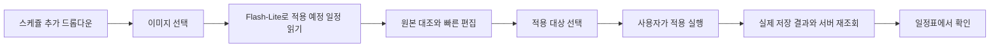

# SUL-44 이미지로 스케쥴 추가하기 — 설계

작성일: 2026-11-12 (Asia/Seoul)  
상태: **D1~D7 확정 / Flash-Lite 기본 전환·단일 이미지 실제 로컬 검증 완료 / 전체 D7·운영 적용 미검증**
이슈: [SUL-44](https://linear.app/sulfurbottom/issue/SUL-44/스케쥴-링크-또는-이미지-업로드시-자동-입력-기능)  
연결 문서: [구현 준비 계획](../plans/2026-11-12-sul-44-schedule-image-import.md), [현재 작업](../../current-work.md)

**상태·전송 안내 후속 결정(2026-11-16):** 방송/휴방/게릴라만 상태로 표시하고 시간 미정은 별도 체크로 유지한다. 사용자가 편집창의 공급자 전송 안내 제거와 약관 이동을 요청했다. 전송·보관 안내 및 공급자 정책 링크는 사이트 하단 ‘이용약관’에서 여는 `/rights#schedule-image-terms`에 둔다. 이 결정이 아래 D5의 편집창 안내 위치를 대체하며 실제 전송·저장 경계는 유지한다. 이미지 첨부는 명확한 점선 영역으로 표시한다.

**카드·완료 UX 후속 결정(2026-11-16):** 날짜/요일·방송 상태, 제목, 멤버/날짜/시간 순으로 편집 정보를 묶고 모바일은 한 열 입력과 하단 적용 버튼을 제공한다. 선택한 묶음의 저장과 일정표 재조회가 모두 성공하면 적용 로그를 표시하지 않고 창을 닫아 일정표로 돌아간다. 부분 실패·결과 불명·조회 실패는 창을 유지해 기존 복구를 제공한다. 조회 재시도 중 새 편집·닫기를 막으며 저장 요청은 반복하지 않는다. 이는 아래 적용 완료 로그/완료 창의 과거 표현을 대체한다.

**입력 UX 후속 결정(2026-11-16):** 첨부 필드에 이미지·파일명을 함께 표시하고 원문 나열·반복 안내를 제거한다. 현재 사이트 등록 멤버를 후보로 자동 연결하고, 표시 중인 주를 연도 없는 일정에 바로 반영한다. 주 변경은 첨부 영역의 ‘적용 주’에서 편집 가능한 행에 일괄 반영하며 최종 ‘선택 일정 적용’이 화면 값의 저장 확인이다. 따라서 아래 D2의 별도 기준 주 확인 단계는 이 사용자 요청으로 대체된다. 읽지 못한 멤버/요일/시간은 계속 확인 대상으로 남기고 기존 권한·중복·삭제 확인은 유지한다. 방송 예정·시간 미정·휴방·게릴라를 구분한다.

**2026-11-16 후속 변경:** 프로젝트 정식 추가 전 인식 횟수 한도를 두지 않기로 하여 아래 D6의 하루10회 조건은 현재 적용하지 않는다. 사이트별 월$0.50, 계정 동시1건, 입력/출력량·20초·자동 재시도 없음은 유지한다. [현재 작업](../../current-work.md)에서 실제11번째 인식과 비용을 확인한다.

**최신 인식 방식:** 후속 승인으로 원본+선택 영역의 겹치는 확대본4개를 단일 요청으로 읽는다. 전체/좌/우/상/하 선택, 최대2배·2048px/PNG500KB 제한을 두며 원본 배치와 확대 글자를 함께 대조한다. 모든 이미지 입력량을 사전 계산하고 제목/부제/시각을 분리한다. 모델은 Flash-Lite minimal·이미지 original, 기존 비용 한도와 D7 기준은 유지한다. [실제 결과·사용자 정답 확인과 한계](../../reports/2026-11-12-sul-44-image-import-implementation.md#일정-영역-확대분할과-제목부제-분리-검증)가 아래 high 표기와 이전 참조를 대체한다.

**후속 결정:** 사용자가 실측 비교 뒤 Flash-Lite minimal 기본 전환과 기존 비용 한도를 유지한 실제 로컬 검증을 승인했다. 현재 D5의 전송 대상은 OpenRouter·Google, D6 기본은 Gemini 3.5 Flash-Lite minimal·이미지 high이며 사이트별 월$0.50·하루10회/동시1건·50K/12K·20초·자동 재시도/전환 없음은 그대로다. 최대 비용 예약은 새 단가에 맞춰$0.045다. 아래 세부 초기 결정의 Luna/OpenAI·유료 실험 보류는 당시 기록이며 이 변경 범위에서 대체된다. [실측 비교](../../research/2026-11-12-sul-44-vision-model-comparison.md)와 [후속 구현·실제 검증](../../reports/2026-11-12-sul-44-image-import-implementation.md#flash-lite-minimal-기본-전환과-실제-로컬-검증-후속-승인)을 따른다. D7의 품질·속도·저장 기준은 완화하지 않았고 운영 DB 변경·배포는 승인하지 않았다.

## 1. 목적과 완료 기준

멤버별 주간 일정표나 통합 일정표 이미지를 보고 일정을 반복 입력하는 수고를 줄인다. 경량 모델이 이미지에서 적용 예정 일정을 읽고, 사용자가 원본과 비교해 빠르게 고친 뒤 선택한 일정만 실제 일정표에 반영한다.

최종 제품의 완료 기준은 정상 스케쥴 추가 버튼에서 진입하여 **이미지 선택 → 실제 모델 인식 → 편집 → 명시적 적용 → 서버 재조회 → 일정표 표시**가 이어지는 것이다. 예시 데이터나 모델 응답 mock만으로 기능 완료를 판정하지 않는다. 이 문서 작성은 그 기능의 구현 또는 운영 검증 완료를 뜻하지 않는다.

## 2. 사용자가 확정한 사항

| 항목 | 확정 내용 |
| --- | --- |
| 진입점 | `스케쥴 추가` 버튼에 드롭다운 옵션을 두고 `이미지로 스케쥴 추가하기`를 제공한다. |
| 원본 | 한 멤버의 일정표와 여러 멤버가 함께 있는 통합 일정표 이미지를 지원한다. |
| 주요 흐름 | 이미지를 올리면 적용 예정 일정을 보여주고 사용자가 빠르게 편집하여 적용한다. |
| 화면 방향 | 브라우저 시안의 업로드 → 원본 대조·편집 → 선택 적용 → 일정표 확인 흐름을 채택한다. |
| 기본 모델 | **Gemini 3.5 Flash-Lite minimal**, 모델 ID `gemini-3.5-flash-lite`, OpenRouter `google/gemini-3.5-flash-lite`·Google AI Studio 고정. |
| 비교 후보 | **Claude Haiku 5.5**, 모델 ID `claude-haiku-5-5`. 기본 처리 모델이나 자동 재시도 대상으로 확정한 것은 아니다. |
| AI 이용자 | **로그인 사용자에게 AI 이미지 인식을 제공한다.** 관리자를 포함하며 기존 비로그인 직접 입력과 일정 저장 권한은 유지한다. |
| 적용 사이트 | **OTW·LuvDia 모두** 새 이미지 입력 기능의 적용 대상으로 한다. 이는 향후 구현 범위 결정이며 현재 기능 활성화·배포나 기존 AI 자동화 재개 지시가 아니다. |
| 불명확한 값 보정 | **명확한 값은 자동 입력하고 모호한 부분만 사용자가 보정한다(D2 확정).** 기준 주·멤버 일괄 보정, 한국 시간의 자정 이후 변환, 시간 미정과 인식 실패 구분, 원본에 없는 상태·제목을 만들지 않는 규칙을 아래 결정 기록에 따른다. |
| 기존 일정 충돌 | **완전 중복은 제외하고 기존 일정의 변경·삭제는 사용자가 명시적으로 선택한다(D3 확정).** 같은 날의 여러 방송을 보존하고, 상태 전환의 삭제 영향을 추가 확인하며, 동시 변경은 다시 비교한다. |
| 적용 실패·재시도 | **같은 멤버·날짜의 변경을 한 묶음으로 저장하고 성공한 묶음은 유지하며 실패한 묶음만 재시도한다(D4 확정).** 저장 여부 불명은 결과 확인 중으로 구분하고, 저장 후 조회 실패는 조회만 재시도한다. |
| 업로드·보관 | **한 번에 PNG/JPG/WEBP 1장·10MB 이하·최대 100건으로 시작한다(D5 확정).** 이미지·미적용 초안은 편집창 동안만 유지하고, 저장 결과 확인용 최소 기록은 24시간 보관한다. 외부 AI 전송과 공급자 보관 정책을 안내한다. |
| 비용·호출 초기 설정 | **사이트별 월 $0.50·각 사이트 계정당 하루 10회/동시 1건, Luna 일반 요금·추론 없음, 입력 50,000/출력 12,000토큰, 업로드 후 분석 최대 20초, 자동 재시도·모델 전환 없음(D6 확정).** 한도는 AI 인식에 적용하고 기존 직접 입력·이미 읽은 일정의 편집/적용은 유지한다. |
| 품질·속도 검증 | **실제 이미지 30장·핵심 항목이 모두 맞는 일정 95% 이상·중앙값 멤버표 5초/통합표 10초·전체 요청 95%가 20초 내 편집 가능·전체 작업 시간 50% 이상 단축·확인 내용과 저장 결과 100% 일치(D7 확정).** Luna·Haiku 각 1회, 총 60회 또는 별도 $0.50 중 먼저 도달하면 종료한다. 이는 검증 설계 확정이며 실험 실행 승인이 아니다. |
| 규모 | 멤버별 주간표가 주 1회, 통합표가 주 1회 올라오며 전체 이용량은 **월 약 30장**으로 예상한다. |
| 현재 승인 범위 | 후속 사용자 지시로 별도 브랜치의 구현·로컬 검증·로컬 커밋을 재개했다. 유료 실험·원격 변경·게시·배포는 보류한다. |

## 3. 화면과 사용자 흐름

### 업로드

- 기존 직접 입력 기능과 이미지 입력 기능을 구분하여 진입할 수 있게 한다.
- 멤버표와 통합표 중 특정 양식을 골라야만 읽을 수 있는 구조로 제한하지 않는다.
- 파일 선택·끌어 놓기·붙여넣기를 지원한다. D5에 따라 한 번에 PNG/JPG/WEBP 1장·10MB 이하·최대 100건을 읽는다. 예시 이미지 선택은 시안의 설명 도구이며 실제 제품 인식의 필수 경로가 아니다.
- 이미지 선택이나 인식 완료만으로 실제 일정을 저장하지 않는다.

### 적용 예정 일정 확인·편집

- 넓은 화면에서는 원본 이미지 옆에 편집할 일정을 보여주고, 좁은 화면에서는 원본을 펼쳐 비교할 수 있게 한다. 이는 시안에서 검토한 배치이며 최종 반응형 동작은 실제 화면에서 확인한다.
- 멤버·날짜·방송 상태·시간·제목을 바로 수정하고 적용 대상을 선택할 수 있게 한다.
- 모호한 멤버·날짜·시간은 확인이 필요한 항목으로 드러낸다. 읽지 못한 내용을 확정된 사실처럼 채우지 않는다.
- 시안은 원본 확대, 시간 미정, 빠진 일정 추가, 기존 일정 유지·수정·추가, 중복 제외를 보여줬다. 충돌 처리와 여러 건 저장의 실패·재시도 규칙은 D3·D4로 확정했다.
- D6에 따라 사용자가 수정하는 동안 모델을 반복 호출하지 않는다. 인식 결과와 사용자 편집 상태를 분리한다.

### 적용·결과

- 사용자가 선택한 내용과 실제로 바뀌는 기존 일정을 확인하고 적용한다.
- 서버가 멤버·날짜별 쓰기 권한과 현재 상태를 다시 확인한다. 모델의 판단이나 화면에서 보낸 ID가 권한을 대신하지 않는다.
- 저장 결과와 재조회 결과를 구분한다. 저장 후 조회가 실패했다면 저장을 재실행하지 않고 조회만 다시 시도할 수 있어야 한다.
- 성공·실패·적용 제외를 실제 결과에 맞게 표시한다. 일부 실패를 전체 성공으로 표현하지 않는다.
- 동시 편집으로 확인한 기존 내용이 바뀌면 D3에 따라 해당 항목을 다시 비교한다. D4에 따라 같은 멤버·날짜의 묶음은 전부 성공하거나 전부 취소되며, 다른 묶음의 성공은 유지한다.

## 4. 접근 방식과 모델 선택

| 검토 방식 | 장점과 한계 | 결정 |
| --- | --- | --- |
| Luna가 이미지를 직접 읽고 정형 일정 목록 반환 | 별도 분류 호출 없이 이미지 해석과 항목 추출을 한 번에 처리할 수 있다. 실제 한국어 일정표 품질은 미검증이다. | **사용자가 선택한 기본 방식** |
| Haiku가 이미지를 직접 읽고 정형 일정 목록 반환 | 같은 일반 단가의 비교 후보다. 토큰 계산 방식과 실제 지연·인식 결과는 Luna와 다르므로 같은 이미지로 비교해야 한다. | 비교 후보로 보존 |
| Jev 또는 Raya를 먼저 호출하여 분류·라우팅 | 분류는 일정 제목과 가변 길이 일정 목록의 생성까지 대신하지 않는다. 현재 규모에서 앞단 호출을 추가할 이유가 확인되지 않았다. | 현재 설계에 넣지 않음 |
| 자체 경량 OCR + 일정 구조화 | 작은 공개 모델을 운영할 수 있으나 별도 추론 환경과 날짜·멤버 연결 과정이 필요하다. 월 30장에서는 운영 부담 대비 절감 효과가 작다고 판단했다. | 현재 설계에 넣지 않음 |

공식 문서 확인 결과:

- [Luna 모델 문서](https://developers.openai.com/api/docs/models/gpt-6-luna)는 이미지 입력·정형 출력과 `reasoning.effort`의 `none`·`low` 등을 지원한다. D6에서 **일반 요금·`none`을 기본 초기 설정으로 확정**했다. 인식률 검증 결과가 아니며 품질 부족 시 D7 결과를 보고 설정 변경을 다시 판단한다.
- [Haiku 모델 문서](https://platform.claude.com/docs/en/models/haiku-5-5/overview)는 이미지 입력과 낮은 지연을 목표로 한 모델임을 설명한다. 공급자 간 속도 우위를 입증하는 자료로 취급하지 않는다.
- [Jev 이미지 문서](https://docs.typesafe.ai/images)는 이미지 입력과 Box를 아직 실험 기능으로 안내한다. [응답 종류](https://docs.typesafe.ai/primitives)는 Choice·Score·Noul·Box로, 임의의 새 방송 제목을 포함하는 일정 목록의 주 추출 계약과 맞지 않는다.
- [Raya 제작자 설명](https://huggingface.co/TextCortex/raya/blob/main/README.md)은 텍스트 요청을 2~3개 모델 등급으로 라우팅하는 용도다. 일정 이미지 판독 모델로 선정하지 않는다.
- 더 작은 시각 모델의 예로 [PaddleOCR-VL-1.6](https://huggingface.co/PaddlePaddle/PaddleOCR-VL-1.6)은 0.9B 문서 인식 모델이다. 작다는 사실이 이 서비스에서 더 빠르거나 전체 운영비가 더 낮다는 증거는 아니다.

Luna를 실행하지 못할 때 Haiku나 상위 모델로 자동 전환하지 않는 것으로 D6에서 확정했다. API 계정·키·모델 접근 가능 여부는 아직 검증하지 않았다.

## 5. 예상 비용과 계산 가정

2026-11-12에 확인한 공급자 일반 API 요금 기준이다. 할인 캐시·Batch·Flex·Fast는 계산에 적용하지 않았다.

| 모델 | 입력 100만 토큰당 | 출력 100만 토큰당 | 출처 |
| --- | --- | --- | --- |
| GPT-6 Luna | $0.10 | $0.50 | [OpenAI 요금](https://developers.openai.com/api/docs/pricing) |
| Claude Haiku 5.5 | $0.10 | $0.50 | [짧은 입력 구간 요금](https://platform.claude.com/docs/en/models/haiku-5-5/overview) |

Luna 건당 예산 가정:

| 이미지 | 입력 토큰: 이미지+안내 | 출력 토큰: 결과+발생하는 내부 추론 | 예상 USD | 계산용 원화 |
| --- | ---: | ---: | ---: | ---: |
| 멤버 주간표 약 7건 | 3,000 | 1,500 | $0.00105 | 1.575원 |
| 통합 일정표 약 30건 | 8,000 | 4,000 | $0.00280 | 4.200원 |

`비용(USD) = (입력 토큰 × 입력 단가 + 출력 토큰 × 출력 단가) / 1,000,000`이다. 이미지별 과금 토큰 수를 측정한 값은 아니며, 표의 출력량도 실제 제한값이나 보장값이 아니다. 모델별 토큰 수가 달라 Haiku의 실제 건당 청구액이 같다고 단정하지 않는다.

월 30장 중 통합표가 4~5장이라고 가정하면:

| 월 구성 | 기본 USD | 기본 원화 | 추가 호출 10%를 가정한 원화 |
| --- | ---: | ---: | ---: |
| 멤버표 26장 + 통합표 4장 | $0.03850 | 57.750원 | 63.525원 |
| 멤버표 25장 + 통합표 5장 | $0.04025 | 60.375원 | 66.413원 |

설명용 예상치는 **월 약 60~70원**이다. `$1 = 1,500원`은 현재 환율 조회값이 아닌 계산용 가정이다. 세금·결제 수수료·서버·이미지 보관 비용과 별도 모델 비교 실험 비용은 제외했다. 추가 호출 10%도 실제 장애율이나 허용된 자동 재시도 정책을 뜻하지 않는다.

계산의 30장은 합계 입력 장수다. 사이트별 사용량 내역은 확인하지 않았으므로 사이트마다 30장이라고 임의로 배증하지 않는다. 운영 예산은 실제 사용량 예상과 별개로 D6에서 사이트별 월 $0.50씩 배분했다.

앞서 제안한 월 500~1,000원은 과거 참고안이며 현재 운영 한도는 **사이트별 월 $0.50, 합계 $1**이다. 계산용 환율로 약 1,500원이며, 세금·결제 수수료·공급자 계정의 다른 기능 비용까지 포함하는 청구액 상한으로 해석하지 않는다. 신규 계정 선결제 조건과 실제 결제 환경은 미확인이다. D7의 일회성 비교 실험은 운영 월 예산과 별도인 **총 $0.50·최대 60회**로 확정했으며 실제 실행은 계속 보류한다.

## 6. 기존 구조와 지켜야 할 경계

조사 기준은 로컬 `a9ed7abd`다. 이후 구현 재개 시 최신 소스와 현재 작업 지시를 다시 대조한다.

| 현재 요소 | 확인한 내용과 설계 영향 |
| --- | --- |
| [일간 진입점](../../../src/features/schedule-board/ui/daily/daily-schedule.tsx), [주간 헤더](../../../src/features/schedule-board/ui/weekly/components/weekly-header.tsx) | 둘 다 스케쥴 추가 버튼이 있다. 공통 입력 선택 UI를 연결하는 것이 설계자 제안이다. |
| [기존 입력창](../../../src/features/schedules/ui/schedule-dialog.tsx) | 멤버·날짜·상태·제목·시간을 한 건씩 편집한다. 직접 입력 기능을 보존한다. |
| [공유 API 클라이언트](../../../src/shared/api/client.ts) | 이미 FormData body에서 JSON Content-Type을 강제하지 않는다. 별도 공통 업로드 프레임워크를 만들 필요는 확인되지 않았다. |
| [정확한 API 경로](../../../contracts/api-routes.ts), [Worker 등록](../../../worker/app/routes.ts) | 새 인식 API를 만든다면 기존 정확 경로 등록과 사이트 접근 경계를 따른다. |
| [일정 저장 서비스](../../../worker/features/schedules/application/schedule-service.ts), [저장소](../../../worker/features/schedules/infrastructure/d1-schedule-write-repository.ts) | `save`는 충돌 일정 삭제까지 포함할 수 있다. 서비스를 직접 호출하는 것만으로 HTTP 인가가 재현되지는 않는다. 기존 정상 요청의 인가·충돌·감사 경계를 함께 보존해야 한다. |
| [일정 저장 피드백](../../../src/features/schedule-board/queries/use-schedule-save-feedback.ts) | 저장 성공과 조회 실패를 이미 구분한다. 이미지 적용에서도 이 의미를 유지한다. |

**특히 기존 `status: "미정"`은 단순한 시간 미정 표시가 아니다.** 현재 저장소에서는 같은 멤버·날짜의 일정을 지우는 `delete_conflicts` 결과를 낼 수 있다. 시간 미정을 이 값으로 변환하지 않는다. 방송 시간이 미정인 행은 별도의 확인 상태와 `start_time: null`로 표현할 수 있는지 기존 입력 계약에 맞춰 결정한다. 인식 실패를 기존 삭제 명령으로 변환하는 것은 금지한다.

설계자 제안 경계:

- 기능 소유자는 기존 `schedules`다. 인식 계약·도메인 검증·모델 어댑터·입력 UI를 그 아래에 두고 실제 조립만 `worker/app`에서 한다.
- 모델이 읽은 이름은 사이트의 실제 멤버 목록과 대조한다. 알 수 없는 멤버 ID, 다른 사이트 ID, 보관·운영 종료 예외를 모델 판단으로 통과시키지 않는다.
- 인식 결과는 편집할 초안이다. 현재 치지직 VOD용 `pending_schedules`에 그대로 넣거나 자동 수집기로 취급하지 않는다.
- 임시 이미지·초안과 결과 확인 기록의 보관은 확정된 D5를 따른다. 일정 적용 전 **일정 데이터 쓰기 0건**을 지키되, 승인받은 비용 계측·한도 예약에 필요한 메타데이터 쓰기까지 금지한 것으로 확대 해석하지 않는다.
- 키는 서버에만 두고 모델 응답을 검증한다. 이미지 안의 지시는 일정 내용으로만 다룬다. 모델에 임의 URL 조회·도구 실행·일정 쓰기 권한을 주지 않는다.
- 월 30장을 이유로 인가·동시성·중복 적용·비용 제한을 생략하지 않는다. 그렇다고 기존 음악 AI 자동화·Queue·Cron을 재개하거나 인식의 필수 경로로 연결하지도 않는다.

## 7. 전역 제약

다음 문장은 연결 계획에도 동일하게 적용한다.

- 사용자 재개 지시에 따라 구현·로컬 검증·로컬 커밋을 진행한다. 유료 실험·원격 변경·게시·병합·배포는 보류한다.
- Node.js >=24.20.0 <25, pnpm@11.7.0과 기존 React·Worker·D1 구조를 따른다.
- 기본 모델은 gpt-6-luna이며 claude-haiku-5-5는 비교 후보로만 둔다.
- AI 이미지 인식은 OTW·LuvDia 모두 로그인 사용자에게 제공한다.
- 사용자 적용 전에는 실제 일정 데이터를 쓰지 않는다.
- 기존 직접 입력·사이트별 공개 쓰기·보관·운영 종료 권한을 약화하거나 전역 로그인 의무로 바꾸지 않는다.
- 모델 응답·시안·테스트는 실제 저장과 정상 화면의 재조회 증거를 대신하지 않는다.
- Play·AI 자동화 재개, 유료 모델 실험, 원격 DB 변경, Git 게시, 병합·배포는 이번 승인에 포함하지 않는다.

## 8. 결정 진행 상황과 남은 사항

2026-11-12 사용자가 항목별 추천안과 이유를 설명하고 하나씩 확인하도록 요청했고, **D1~D7 모두 확정했다**. 사용자에게 제시한 검증 기준과 비교 실험 예산까지 승인받았으며 후속 지시로 구현을 재개했으며 유료 모델 실험 보류는 유지한다. 세부 인터페이스와 파일 배치는 아래 설계자 제안 및 구현 준비 계획의 상세화 대상으로 구분한다.

| ID | 결정할 내용 | 현재 제안 또는 선택지 | 결정이 필요한 이유 |
| --- | --- | --- | --- |
| D1 — 확정 | AI 이미지 입력 이용자와 사이트 범위 | **OTW·LuvDia 모두 적용하고 AI 인식은 로그인 사용자에게 제공한다.** 기존 수동 쓰기와 멤버·날짜별 저장 권한은 별개로 유지한다. | 양 사이트에서 같은 기능을 제공하고 로그인 사용자별로 유료 호출을 관리한다. 기존 AI 자동화 재개는 포함하지 않는다. |
| D2 — 확정 | 연도·주차·멤버·시간이 불분명한 자료 | **명확한 값은 자동 입력하고 모호한 부분만 보정한다.** 현재 표시 중인 주를 후보로 확인받아 날짜를 일괄 보정하고, 불명확한 멤버는 동일 이름의 행을 한 번에 연결한다. 자정 이후·시간 미정·상태·제목 규칙은 아래 기록을 따른다. | 반복 편집을 줄이면서 잘못 추정한 날짜·멤버·상태를 확정 저장하지 않는다. |
| D3 — 확정 | 기존 일정과 초안 내부의 충돌 | **완전 중복 제외, 기존 유지 기본값, 수정 대상 지정 또는 새 일정 추가의 명시적 선택**으로 정했다. 여러 방송 보존, 부수 삭제 추가 확인, 초안 내부 충돌 해결, 동시 변경 재비교는 아래 기록을 따른다. | 사용자가 판단할 항목만 확인하면서 중복 생성·숨은 삭제·의도하지 않은 덮어쓰기를 막는다. |
| D4 — 확정 | 여러 건 적용의 실패·재시도 단위 | **멤버·날짜별 묶음 안에서는 전부 성공 또는 전부 취소하고, 성공한 묶음을 유지하며 실패한 묶음만 재시도한다.** 결과 확인 중·중복 요청·권한/충돌 재확인·조회만 재시도는 아래 기록을 따른다. | 연결된 삭제·수정의 일부만 남는 것을 막으면서 다른 날짜의 정상 일정은 반영하고 재작업을 줄인다. |
| D5 — 확정 | 업로드 범위와 데이터 보관 | **1장·PNG/JPG/WEBP·10MB 이하·최대 100건, 원본/초안의 편집창 내 임시 유지, 결과 확인 최소 기록 24시간, 외부 OpenAI 전송 안내**로 정했다. 세부 규칙은 아래 기록을 따른다. | 일반 일정표를 간단히 처리하면서 영구 이미지 보관을 피하고 D4의 중복 방지·결과 확인을 보존한다. |
| D6 — 확정 | 비용·실행 한도와 실패 정책 | **사이트별 월 $0.50·각 사이트 계정당 하루 10회/동시 1건, Luna 일반 요금·추론 없음, 입력 50,000/출력 12,000토큰, 업로드 후 분석 20초, 자동 재시도·모델 전환 없음**으로 정했다. 선예약/실사용 정산·취소/불명 비용·한도 후 동작은 아래 기록을 따른다. | 월 30장 예상량에 여유를 주면서 자동 호출 증가와 동시 요청의 예산 초과를 막는다. |
| D7 — 확정 | 품질·속도 합격 기준과 비교 실험 설계 | **실제 이미지 30장·핵심 항목이 모두 맞는 일정 95% 이상·중앙값 멤버표 5초/통합표 10초·전체 요청 95%가 20초 내 편집 가능·전체 작업 시간 50% 이상 단축·저장 결과 100% 일치**, Luna·Haiku 각 1회·총 60회 또는 별도 $0.50 중 먼저 도달하면 종료한다. 세부 기준은 아래 기록을 따른다. | 인식률과 실제 편집 효용·저장 안전성을 함께 검증한다. 기준과 예산의 확정이며 현재 유료 실험은 보류다. |

### D2 확정 보정 규칙

사용자가 추천한 규칙 전체를 승인했다.

1. 연도·주차를 확정할 수 없으면 현재 화면에서 보고 있는 주를 **후보**로 보여주고 확인받는다. 확인한 기준 주로 요일별 날짜를 한 번에 보정한다. 현재 날짜나 후보 주를 확인 없이 저장값으로 사용하지 않는다. 월말·연말에도 같은 기준 주의 실제 날짜를 사용한다.
2. 멤버가 명확하지 않으면 실제 사이트 멤버를 선택하도록 한다. 같은 이름으로 읽힌 행은 한 번 연결하면 함께 반영한다. 서로 다른 이름이나 사이트의 멤버를 자동으로 합치지 않는다.
3. 시간은 한국 시간으로 다룬다. `11/12 25시 → 11/13 01:00`처럼 명확한 자정 이후 표기는 다음 날짜의 정상 시간으로 변환하고, 원문과 날짜 변경 사실을 보여준다. 해석이 모호한 표현은 확인 대상으로 남긴다.
4. 시간을 읽지 못한 행은 확인 필요로 둔다. 사용자가 시간을 입력하거나 **시간 미정**을 선택해야 해당 방송 행을 적용할 수 있다. 시간 미정은 기존 삭제 의미의 `status: "미정"`으로 변환하지 않는다. 원본의 명확한 휴방·게릴라는 시간 입력을 요구하지 않는다.
5. 휴방·게릴라는 원본에 명시된 상태를 읽으며 빈칸을 휴방으로 추정하지 않는다. 없는 제목은 빈칸으로 유지하고 임의로 생성하지 않는다.
6. 확인이 끝나지 않은 행은 적용에서 제외하고 나머지 행을 진행할 수 있다. 이는 사용자가 선택한 적용 대상의 범위이며, **선택한 행을 저장하던 중 실패했을 때**의 원자성·재시도 정책 D4와 구분한다.

### D3 확정 충돌 처리 규칙

사용자가 추천한 규칙 전체를 승인했다.

1. 같은 사이트에서 멤버·날짜·상태·시간·제목이 모두 같으면 중복으로 표시하고 적용에서 자동 제외한다. 초안 안의 완전 중복에도 같은 원칙을 적용한다. 제외된 사실은 화면에 보존한다.
2. 같은 멤버·날짜에 다른 기존 내용이 있으면 전후 내용을 비교하고 **기존 유지(기본) / 기존 일정 수정 / 새 일정 추가**를 명시적으로 선택한다. 수정은 대상 기존 일정을 지정해야 하며 같은 날의 첫 일정을 임의로 고르지 않는다.
3. 같은 날 여러 방송을 유지할 수 있다. 날짜가 같다는 이유만으로 하나로 합치거나 다른 방송을 삭제하지 않는다. 시간·제목이 다르면 시간 변경인지 별도 방송인지 자동으로 단정하지 않는다.
4. 휴방·게릴라 등 상태 전환으로 기존 일정이 삭제되는 경우 삭제될 일정 전체를 보여주고 한 번 더 확인받는다. 읽어온 새 행뿐 아니라 기존 저장 로직의 부수 삭제까지 확인 대상이다.
5. 초안 안에서 방송과 휴방처럼 함께 적용할 수 없는 행은 어느 쪽을 반영할지 선택하여 충돌을 해결한 뒤 적용한다. 확인이 필요한 행은 D2에 따라 적용 대상에서 제외할 수도 있다.
6. 편집하는 동안 다른 사람이 확인 대상 기존 내용을 바꿨다면 해당 항목은 최신 내용으로 다시 비교하게 한다. 사용자가 확인하지 않은 변경을 덮어쓰지 않는다. 다른 항목의 저장 진행·실패·재시도 단위는 아래 확정된 D4를 따른다.

### D4 확정 실패·재시도 규칙

사용자의 D4 확정 답변은 직전에 설명한 다음 실패·재시도 규칙을 승인한 것으로 기록한다.

1. 같은 사이트의 **같은 멤버·같은 날짜**에 대해 사용자가 선택한 변경들을 한 묶음으로 저장한다. 연결된 기존 일정 삭제·수정·생성과 필수 감사 기록은 전부 성공하거나 전부 취소되어야 한다. 한 행씩 독립 저장한 뒤 일부만 되돌리는 방식으로 이 보장을 대신하지 않는다.
2. 다른 멤버·날짜 묶음은 독립적으로 처리한다. 일부 묶음이 실패해도 성공한 묶음은 유지하고 실패한 묶음만 다시 적용한다. 주간표가 일부만 반영될 수 있으므로 적용 완료·실패·결과 확인 중·적용 제외를 실제 결과에 맞게 구분한다.
3. 통신 단절 등으로 저장 여부를 모르면 실패로 단정하지 않고 **결과 확인 중**으로 표시한다. 같은 저장 요청의 서버 결과를 확인하고, 같은 요청을 재전송하더라도 중복 생성·수정·삭제가 일어나지 않게 한다. 처리 중 재클릭도 같은 원칙으로 보호한다. 현재 요청 헤더가 존재한다는 사실만으로 서버의 중복 방지가 이미 보장된다고 가정하지 않는다.
4. 권한이나 비교한 기존 일정이 바뀌면 자동 반복하지 않고 해당 항목을 다시 확인하게 한다. 재시도할 때도 현재 권한·D3 충돌·확인된 변경 범위를 검증한다.
5. 저장은 성공했지만 화면 재조회가 실패했다면 **조회만 재시도**한다. 저장 성공과 화면 갱신 완료를 별개 상태로 표시한다.
6. 편집 내용을 보존하고 실패한 묶음을 재시도할 수 있게 한다. 저장 재시도를 이유로 이미지를 다시 인식하거나 모델을 다시 호출하지 않는다. 이 보존은 현재 편집 흐름의 요구이며, 편집창 닫기·새로고침 이후의 초안 수명과 결과 확인 기록의 보관은 아래 확정된 D5를 따른다.

### D5 확정 업로드·보관 규칙

사용자가 추천한 범위와 보관 방식 전체를 승인했다.

1. 한 번에 **PNG·JPG/JPEG·WEBP 이미지 1장, 10MB 이하**를 처리한다. 파일 선택·끌어 놓기·붙여넣기를 지원한다. 10MB는 구현 경계에서 10,000,000바이트로 고정한다.
2. 한 장에서 읽는 일정은 **최대 100건**이다. 초과하거나 공급자 응답이 잘리면 일부만 읽은 결과를 정상 완료로 표시하거나 누락한 채 적용하지 않는다. 분할 업로드를 안내한다.
3. 작은 글자를 뭉개는 일괄 축소를 피한다. 앱 내 자르기는 초기 범위에서 제외하며, 공급자 제한을 넘거나 읽기 어려운 큰 표는 사용자가 필요한 범위를 잘라 다시 올릴 수 있게 안내한다. 특정 템플릿이나 예시 이미지 사용을 인식의 전제로 만들지 않는다.
4. 원본 이미지와 미적용 초안은 **편집창을 열어둔 동안만 임시 유지**한다. 편집창을 닫거나 새로고침하면 폐기한다. 미적용 편집이 있으면 닫기 전에 확인받는다. 브라우저가 비정상 종료되는 경우까지 초안 복원을 보장하는 저장 기능으로 확대하지 않는다.
5. 서버의 영구 파일 저장소·일반 로그에 원본 이미지나 전체 인식 응답을 보관하지 않는다. 적용된 일정과 기존 변경 이력은 정상 저장·보관 정책을 따른다. 모델 호출량·비용 계측에 필요한 최소 메타데이터는 이미지/초안과 구분한다.
6. D4의 저장 결과 확인·중복 방지에 필요한 **최소 기록은 24시간 보관**한다. 다른 사용자/사이트에 노출하지 않으며, 만료된 요청을 새 저장으로 자동 재실행하지 않는다. 원본 이미지·미적용 초안의 장기 보관이나 기존 감사 이력의 24시간 삭제를 뜻하지 않는다. 정확한 만료 검증과 결과 확인 인터페이스는 이 정책을 지키도록 구현 준비 단계에서 고정한다.
7. 인식 버튼 근처에 **“일정표 분석을 위해 이미지가 OpenAI로 전송됩니다”**를 안내한다. 앱의 임시 보관과 외부 공급자의 보관을 구분하며 외부에도 아무 기록이 남지 않는다고 보장하지 않는다.

[OpenAI 공식 데이터 정책](https://developers.openai.com/api/docs/guides/your-data)을 2026-11-12 확인했다. API 입력은 별도 동의 없이 모델 학습에 사용되지 않는 것이 기본이며, 부정사용 감시 로그는 통상 최대 30일 보관될 수 있고 예외가 있다. 응답 저장 옵션을 끄는 것과 감시 로그까지 없애는 것은 다르다. 실제 API 계정의 데이터 공유·보관 설정과 예외 자격은 확인하지 않았다.

### D6 확정 비용·실행 규칙

사용자가 제안한 초기 설정 전체를 승인했다. 실측 전 초기값이며 실제 효과를 검증한 결과가 아니다.

1. 이 이미지 인식 기능의 운영 예산은 **OTW 월 $0.50, LuvDia 월 $0.50, 합계 $1**로 분리한다. 사이트별 한도를 독립적으로 지켜 합계 예산을 보호하며, 남은 한도를 다른 사이트로 자동 이전하지 않는다. 월·일 경계는 한국 시간이다. 사용자별 정상 이용량 추정과 강제 예산 상한은 구분한다.
2. **각 사이트의 로그인 계정당 하루 10회, 동시에 인식 1건**으로 제한한다. 사용자가 누른 다시 읽기는 새 인식 요청으로 센다. 실제 공급자 인식 호출을 시도한 뒤 취소·실패·시간 초과했다고 비용/횟수 측면에서 미호출로 되돌리지 않는다. 입력 검증·인가·사전 한도 거절은 실제 인식 호출과 구분한다.
3. 후속 승인에 따른 기본 호출은 **`gemini-3.5-flash-lite`, 일반 요금, minimal·이미지 high**다. OpenRouter에서 Google AI Studio만 사용하며 Haiku나 상위 모델로 자동 전환하지 않는다. 입력량 사전 계산은 Google native API, 생성은 고정 OpenRouter 경로다. 품질이 부족하면 검증 결과를 보고 변경 여부를 판단하며 조용히 추론량을 늘리지 않는다. 최초 Luna none 결정은 후속 승인으로 대체됐다.
4. 한 요청의 전체 입력은 **최대 50,000토큰**, 출력은 **최대 12,000토큰**으로 제한한다. D5의 100건 상한과 별개로 응답이 잘리면 정상 완료로 처리하지 않는다. [공식 입력 토큰 계산 API](https://developers.openai.com/api/docs/guides/token-counting)는 이미지·안내·요청 구조를 포함한 입력량 확인에 사용할 수 있다. 실제 계정/선택 모델에서의 호환성과 지연은 미검증이다.
5. **이미지 업로드 완료 후 분석 처리는 최대 20초**다. D7의 멤버표 중앙값 5초·통합표 중앙값 10초라는 검증 기준 및 사용자의 전체 작업 시간과 구분한다. 시간 초과나 취소가 이미 공급자로 전송된 호출의 비용을 취소한다는 보장은 하지 않는다.
6. 인식의 **자동 재시도는 0회**다. 사용자가 다시 읽기를 명시적으로 선택할 때 새 인식 요청과 비용으로 처리한다. 편집·선택·D4의 일정 저장 재시도·저장 결과 확인·재조회에는 모델을 다시 호출하지 않는다.
7. 공급자 호출 전에 **예상 최대 비용을 예약**하고, 완료 후 실제 사용량으로 정산한다. 동시 요청에도 월 한도를 넘는 예약을 허용하지 않는다. 취소/시간 초과 등으로 비용이 불명확하면 확보한 금액을 곧바로 반환하지 않는다. 세금·다른 기능·결제 수수료와 공급자 요금 변경까지 과거 고정 단가로 보장한다고 표현하지 않는다.
8. 한도에 도달하면 **AI 인식만 중단**한다. 기존 직접 입력과 이미 읽은 일정의 편집·적용은 기존 권한을 지키면서 계속 사용할 수 있다. 월 예산 계측 기록은 D5의 저장 결과 확인 기록 24시간 만료 때문에 사라져서는 안 된다.

### D7 확정 품질·속도 및 비교 실험 기준

사용자가 직전에 제시한 기준과 일회성 비교 예산을 승인했다. 아래 수치는 **실측 결과가 아니라 향후 합격 기준**이다. 구현은 후속 지시로 재개했으며 유료 실험은 별도 지시 전까지 실행하지 않는다.

1. 실제 일정표 이미지 **30장: 멤버표 12장·통합표 12장·어려운 사례 6장**을 사용한다. OTW·LuvDia 모두 포함하고, 어려운 사례에는 작은 글씨·자정 표기 등을 포함한다. 특정 예시나 템플릿만 통과하도록 자료를 한정하지 않는다. 원본과 대조할 정답 및 명확/모호한 항목은 비교 전에 정리한다.
2. 같은 이미지에 **Luna·Haiku를 각각 1회** 호출하고 같은 추출 항목·평가 기준으로 비교한다. 첫 결과의 누락·추가·오류를 그대로 집계하며 실패 표본을 빼거나 재호출 결과로 대체하지 않는다. Luna는 기본 모델로 유지하고 비교 결과만으로 자동 교체하지 않는다.
3. 명확히 읽히는 일정의 **95% 이상에서 멤버·날짜·시간·상태가 모두 정확**해야 한다. 읽어낸 행의 개별 필드 평균만으로 이를 대신하지 않으며, 누락·잘못 추가한 일정도 오류에 포함한다. 모호한 원문은 임의 확정 대신 확인 필요로 표시한다. 제목의 원문 보존과 수정량도 함께 기록하고 D2의 날짜/멤버 확인을 생략하지 않는다.
4. 속도는 **업로드 완료부터 전체 결과를 편집할 수 있을 때까지** 측정한다. 멤버표 중앙값 **5초 이하**, 통합표 중앙값 **10초 이하**, **전체 요청의 95%가 20초 이내에 편집 가능한 결과**를 제공해야 한다. 첫 토큰 도착을 완료로 삼지 않으며 사전 점검·응답 검증 등 이 구간의 처리도 포함한다. 시간 초과·실패를 집계에서 제외하지 않고 실패로 기록한다. 업로드 시간은 따로 기록한다.
5. **업로드→수정→적용→확인**의 전체 작업 시간 중앙값이 같은 범위의 직접 입력보다 **50% 이상 단축**되어야 한다. 인식이 빠르더라도 반복 수정으로 전체 작업이 느려지면 이 기준을 통과한 것으로 처리하지 않는다.
6. 사용자가 최종 확인한 내용과 실제 저장·정상 일정표 재조회 결과는 **100% 일치**해야 하며, **의도하지 않은 삭제·덮어쓰기·중복 저장은 0건**이어야 한다. 모델 인식률의 허용 오류를 실제 저장 오류 허용으로 확대하지 않는다. 정상 앱의 업로드·편집·선택 적용 경로에서 확인하며 모델 응답이나 합성 검사만으로 대체하지 않는다.
7. 일회성 비교 상한은 **총 60회 또는 총 $0.50 중 먼저 도달하는 시점**이다. 운영 월 예산과 분리하며 호출 전 최대 비용 예약과 불명 비용 보존 원칙을 따른다. 취소·시간 초과·실패도 호출/비용 집계에서 숨기지 않는다. 상한 때문에 끝내지 못한 범위는 미검증으로 남기고 자동 추가 호출이나 모델 전환을 하지 않는다. 표본·정답·보고 자료의 취급은 D5에 따르며 서버 일반 로그에 원본/전체 응답을 남기지 않는다.

이슈 제목의 **링크 입력**은 아직 흐름과 지원 출처를 구체화하지 않았다. 이번 문서는 이미지 입력만 다루며, 링크 지원을 완료하거나 이슈 전체에서 제거한 것으로 해석하지 않는다. 자동 주간 수집, 기존 자료 백필, 자체 OCR 운영도 이번 구현 대상으로 확정하지 않았다.

## 9. 검증과 인계

현재 증거는 임시 브라우저 시안에서 예시 일정의 선택·시간/제목 편집·기존 일정 수정 선택·일부 제외·적용 결과와 예시 일정표 표시를 확인한 것이다. 실제 이미지 인식이나 제품 DB 저장 증거가 아니다. 시안 파일과 로컬 서버는 제품 구현의 의존성으로 사용하지 않는다.

구현 재개 후 검증은 D1~D7 결정에 맞춰 다음을 포함한다.

1. 실제 앱의 정상 일간/주간 진입점에서 사용자 이미지로 편집 가능한 초안까지 도달한다.
2. 실제 모델의 멤버·날짜·시간·상태·제목과 누락·추가 오류를 원본과 대조하고 전체 편집 가능 시간과 사용량을 측정한다.
3. 적용 전 일정 쓰기 0건, 편집·일정 저장 재시도 중 모델 호출 증가 0건이라는 확정 동작을 확인한다.
4. 실제 저장 경로로 선택한 일정만 적용하고 기존 일정 영향·권한·동시성·재시도 규칙을 검증한다.
5. 서버의 일정/일정표 재조회와 자연스러운 화면 이동으로 반영을 확인한다. 합성 테스트는 회귀 보조 근거다.

후속 사용자 지시로 `codex/sul-44-schedule-image-import`에서 구현·로컬 검증을 진행한다. 현재 코드의 계약과 저장/비용 경계는 연결 계획 및 [개발 기록](../../reports/2026-11-12-sul-44-image-import-implementation.md)에 기록한다. 실제 모델의 인식률·속도·비용과 전체 사용자 흐름은 실측 전이며 완료로 판정하지 않는다.
